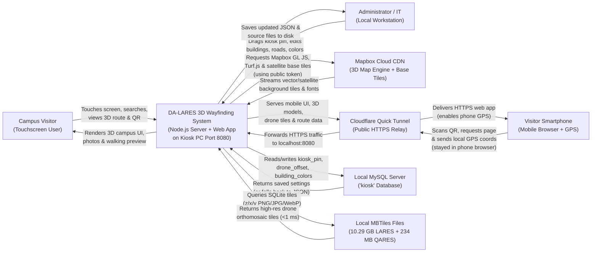
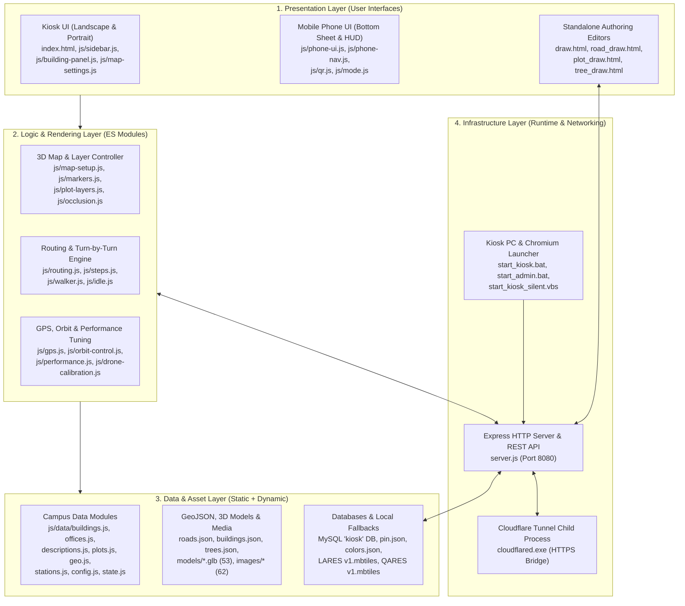
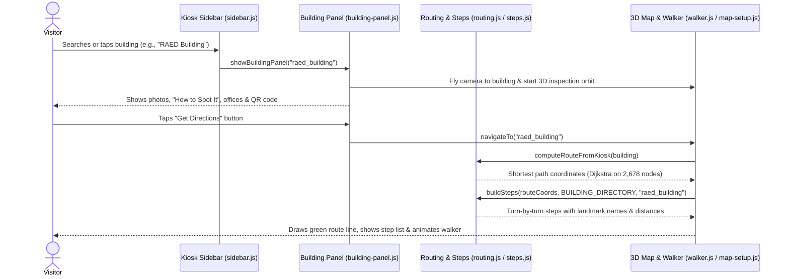
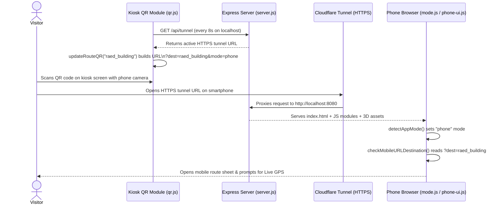
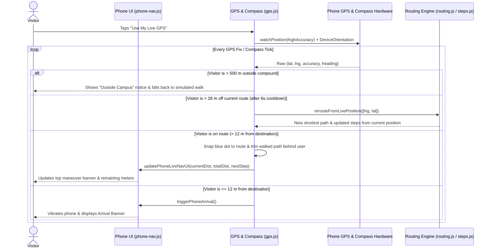
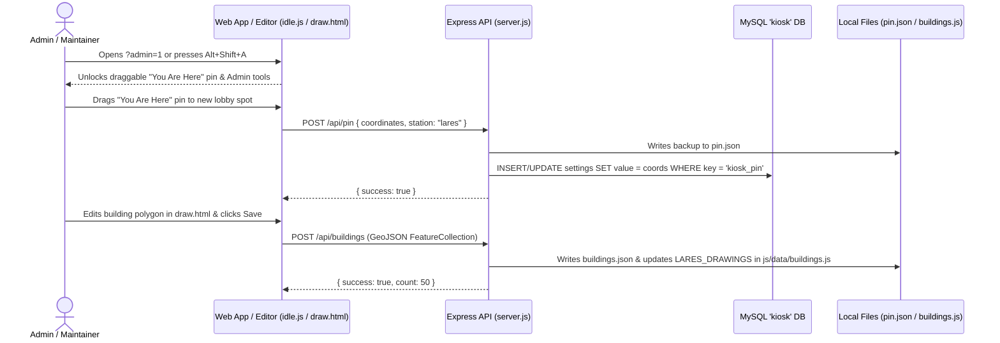
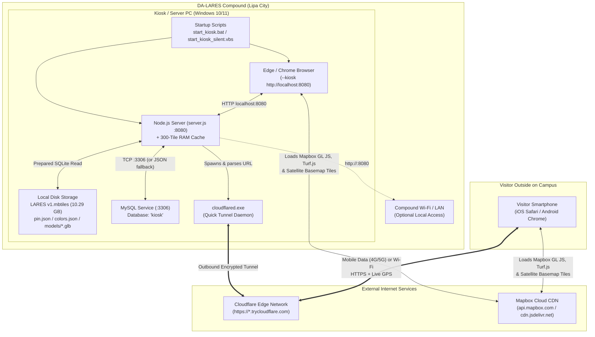

# DA-LARES Interactive 3D Campus Wayfinding System — System Overview

**Document Purpose:** Technical and operational overview for the Department of Agriculture CALABARZON (Region IV-A) Tech Update presentation. Written for a mixed audience of non-technical staff, supervisors, and IT personnel.

---

## 1. At a Glance (2-Minute Summary)

### One-Sentence Description
The **DA-LARES Interactive 3D Campus Wayfinding System (DASH)** is a touchscreen kiosk and mobile web map that guides visitors and staff across the Department of Agriculture — Lipa Agricultural Research and Experiment Station (DA-LARES) in Lipa City, Batangas, using a 3D campus map, animated walking previews, and QR-code smartphone GPS navigation.

### Elevator Pitch (3 Sentences)
DA-LARES spans dozens of research buildings, laboratories, warehouses, screenhouses, and experimental crop plots where first-time visitors and farmer stakeholders often have to ask guards or staff for directions. This system places an interactive 3D touchscreen directory at the compound lobby where anyone can search for a building, office, or agricultural plot, see what the building looks like, and watch a 3D animated walking preview of the exact route. Visitors can then scan a **QR code** *(a square barcode readable by any smartphone camera)* on the screen to transfer the route to their phone and walk to their destination with live turn-by-turn **GPS** *(Global Positioning System — satellite location tracking on a phone)* guidance.

### The Problem It Solves
- **For Visitors (Farmers, Researchers, Guests, Suppliers):** Eliminates confusion when locating specific divisions, laboratories, bidding rooms, or field trial plots across a large agricultural compound with 39 numbered buildings and 45 field plots. Visitors see both the route and a real photo plus a "How to Spot It" visual description before they start walking.
- **For the Office (DA-LARES & DA CALABARZON Staff):** Reduces repetitive direction-giving at guard houses and front desks, standardizes official facility and office listings, and provides a modern self-service digital directory for regional summits, trainings, and daily operations.

### Who Uses It and Where
- **On-site visitors and participants** use the **Standing Touchscreen Kiosk** installed at the Argosino Hall lobby (`[121.1664336, 13.9581208]`) or carry their **smartphones** outdoors while walking across the DA-LARES compound in Marawoy, Lipa City, Batangas.
- **DA staff and event organizers** use the kiosk or web browser to look up office locations, conference halls, and experimental field plots.
- **Designated administrators and IT maintainers** use the local server workstation to update the "You Are Here" kiosk pin, building colors, road segments, and facility records.

### By the Numbers (Verified from Code and Data)

| Metric | Exact Count | Source in Codebase |
| :--- | :--- | :--- |
| **Research Stations in Registry** | **2** (`lares` complete 3D, `qares` partial 2D/extruded) | `STATIONS` in `js/data/stations.js` |
| **DA-LARES Numbered Directory Buildings** | **39** (numbered `1` to `39`) | `BUILDING_DIRECTORY` in `js/data/buildings.js` |
| **Total DA-LARES Building Footprints** | **50** (39 numbered + 9 screenhouse/annex sub-plots + 2 Plot 22 utility amenities) | `LARES_DRAWINGS.features` in `js/data/buildings.js` |
| **Custom 3D Building Models (`.glb`)** | **48** active 3D building entries (**53** `.glb` files in `models/`, all $< 300\text{ KB}$) | `CUSTOM_3D_BUILDINGS` in `js/data/buildings.js`, `models/` |
| **Internal Offices & Operational Units** | **47** offices across **9** buildings + **3** embedded conference halls | `BUILDING_OFFICES` in `js/data/offices.js`, `EMBEDDED_CONFERENCE_HALLS` in `js/sidebar.js` |
| **Facility Categories (Filter Dropdown)** | **7** (`infrastructure`, `trial_sites`, `orchard`, `office`, `laboratory`, `conference`, `digital_agri`) | `BUILDING_CATEGORIES` in `js/data/buildings.js`, `index.html` |
| **Agricultural Field Plots & Zones** | **45** individual plots grouped into **23** official commodity zones (with **9** named sub-plots) | `ALL_PLOT_POLYGONS`, `FIELD_COMMODITY_ZONES` in `js/data/plots.js` |
| **Compound Gates** | **3** (`Main Entrance`, `Main Exit`, `Back Gate Entrance / Exit`) | `STANDALONE_GATES` in `js/data/buildings.js` |
| **Wayfinding Descriptions & Facility Photos** | **53** facility descriptions; **62** image files in `images/` | `BUILDING_WAYFINDING_INFO` in `js/data/descriptions.js`, `images/` |
| **Road & Walkway Network Features (LARES)** | **104** features (**56** road segments, **3** walkways, **45** building entrance points) | `roads.json` |
| **Total Mapped Road & Walkway Length** | **$2,684\text{ m}$ ($2.68\text{ km}$)** subdivided into **2,678** routing graph nodes | `roads.json`, `buildRoadGraph()` in `js/routing.js` |
| **3D Campus Trees** | **131** placed 3D trees using **4** tree model types | `trees.json`, `LARES_TREES` in `js/data/geo.js` |
| **Offline Drone Map Databases (`.mbtiles`)** | **2** (`LARES v1.mbtiles` = $10.29\text{ GB}$; `QARES v1.mbtiles` = $234.30\text{ MB}$) | Project root (`server.js` SQLite tile server) |
| **Active Modular JavaScript Files** | **26** ES modules (**18** in `js/` + **8** in `js/data/`, totaling **32,686** lines) | `js/*.js`, `js/data/*.js` |
| **Core Application Files (Lines of Code)** | `index.html`: **1,234** \| `server.js`: **1,159** \| `css/main.css`: **40,538** (8,919 non-blank) | `index.html`, `server.js`, `css/main.css` |
| **Standalone Browser Authoring Tools** | **7** editor pages (`draw.html`, `plot_draw.html`, `road_draw.html`, `tree_draw.html`, + 3 QARES editors) | Root `*.html` files |
| **Backend API Endpoints** | **30** unique HTTP routes (**32** route registrations in Express) | `server.js` |
| **Database Tables (MySQL + Fallbacks)** | **2** MySQL tables (`settings`, `building_colors`) + **4** local JSON fallback files | `initDB()` in `server.js` |
| **Supported Runtime Modes** | **4** (`Kiosk Landscape`, `Kiosk Portrait Totem`, `Mobile Phone`, `Admin Overlay`) | `detectAppMode()` in `js/mode.js`, `initAdminMode()` in `js/app.js` |

### Status Summary

| Status | Meaning | Capabilities in This State |
| :--- | :--- | :--- |
| **`IMPLEMENTED`** | Complete, active, and verified in code for DA-LARES | 3D campus map with 48 custom 3D building models; offline $10.29\text{ GB}$ drone aerial view; 39-building & 47-office search and category filtering; 23 agricultural commodity zones (Plots 1–45); shortest-path pedestrian routing (`buildRoadGraph`, `findShortestPath`); animated walker preview (`1x`/`2x`/`4x`/`6x` speed); dynamic 3D building transparency (`occlusion.js`); QR code handoff (`qr.js`); live phone GPS & compass navigation (`gps.js`, `phone-nav.js`); 45-second idle auto-reset & 5-minute thermal eco-rest (`idle.js`); adaptive GPU/battery performance profiles (`performance.js`); 3-tier MySQL/JSON/memory persistence (`server.js`). |
| **`PARTIAL`** | Present in code and functional in parts, but incomplete, unauthenticated, or secondary | **DA-QARES (Tiaong, Quezon) Secondary Station:** Has station switcher (`js/data/stations.js`), $234.30\text{ MB}$ drone MBTiles, 48 2D/extruded footprints (`qares_buildings.json`), and 31 road features (`qares_roads.json`), but no bespoke 3D `.glb` building models, no office directory, and no field plot zones. **Admin & Authoring Tools:** Moving the kiosk pin, nudging drone imagery (`drone-calibration.js`), editing colors, and drawing polygons/roads (`draw.html`, `road_draw.html`, `plot_draw.html`) work locally, but have no password authentication and require manual code synchronization for permanent directory additions. |
| **`PLANNED`** | Described in project documentation (`/docs`) but not yet built in code | **CSS Modularization:** Splitting `css/main.css` into 8 domain files (`docs/CSS_MODULARIZATION_PLAN.md`). **Permanent Custom Domain Tunnel:** Replacing temporary Cloudflare Quick Tunnels with a fixed `*.da-lares.gov.ph` domain (`docs/DEPLOYMENT_GUIDE.md`). **Bespoke 3D Models for DA-QARES:** Modeling QARES facilities in 3D (`docs/CSS_MODULARIZATION_PLAN.md`). **Indoor Floor-Plan Navigation:** Room-by-room indoor routing (currently out of scope; only text floor grouping exists for Admin Building). |

---

## 2. Purpose and Scope

### Goals
1. **Self-Service Outdoor Wayfinding:** Allow any visitor at the DA-LARES lobby kiosk to locate any building, internal office, conference hall, gate, or experimental field plot within seconds.
2. **Visual Landmark Recognition:** Show visitors an authentic 3D architectural model, ground-truth photographs, and plain-language *"How to Spot It"* cues so they recognize their destination in person.
3. **Seamless Kiosk-to-Phone Continuity:** Let visitors carry directions in their pocket by scanning a QR code that opens the same map in a mobile-optimized view with live GPS tracking, without installing a mobile app.
4. **Resilient Local Operation:** Serve the $10.29\text{ GB}$ high-resolution drone map and all 3D models directly from the local kiosk server so the core campus view and database settings keep working even if MySQL is stopped or local files are used as fallbacks.

### Scope Boundaries

| Area | In Scope (`IMPLEMENTED` / `PARTIAL`) | Out of Scope (Not in Code) |
| :--- | :--- | :--- |
| **Outdoor Campus Navigation** | **`IMPLEMENTED`** — Pedestrian routing along $2.68\text{ km}$ of mapped compound roads and walkways (`js/routing.js`, `roads.json`). | Public highway turn-by-turn driving directions outside the compound perimeter. |
| **Building & Office Directory** | **`IMPLEMENTED`** — Searching 39 numbered buildings, 9 screenhouse/annex structures, 2 Plot 22 utility amenities, 47 internal offices, and 3 embedded conference halls (`js/sidebar.js`, `js/data/offices.js`). | Staff employee rosters, individual desk maps, or appointment booking systems. |
| **Indoor Navigation** | **`PARTIAL` (Text Only)** — `admin_building` lists offices under `Ground Floor` and `2nd Floor` headings (`js/data/offices.js:14-35`). | Interactive indoor floor-plan maps, stairwell routing, or indoor Bluetooth/Wi-Fi positioning. |
| **Agricultural Field Plots** | **`IMPLEMENTED`** — 23 official commodity zones covering Plots 1–45 with interactive boundary highlights and screenhouse sub-plot cards (`js/data/plots.js`, `js/plot-layers.js`). | Agronomic crop yield databases, soil sensor telemetry, or live weather station data feeds. |
| **Multi-Station Support** | **`PARTIAL`** — Station switcher (`js/data/stations.js`) switches between DA-LARES (Lipa) and DA-QARES (Tiaong). | Full 3D building models, wayfinding descriptions, and office directories for DA-QARES or other Region IV-A stations. |

### Coverage Area
- **Primary Coverage (`IMPLEMENTED`):** The **DA-LARES Compound** in Brgy. Marawoy, Lipa City, Batangas (centered at `[121.16875, 13.95978]`, bounded by `DA_LARES_OUTER_PERIMETER` in `js/data/geo.js:4-26`).
- **Secondary Coverage (`PARTIAL`):** The **DA-QARES Compound** (Quezon Agricultural Research and Experiment Station) in Brgy. Lagalag, Tiaong, Quezon (centered at `[121.37130, 13.94650]`, defined in `js/data/stations.js:24-42` and `QARES_MASK` in `js/data/geo.js:30`).

---

## 3. Stakeholders and Users

| Actor | Role Description | What They Do with the System | What They Need |
| :--- | :--- | :--- | :--- |
| **Campus Visitor** *(Farmer, Researcher, Supplier, Guest)* | First-time or infrequent visitor arriving at DA-LARES for a transaction, training, laboratory submission, or field visit. | Uses the lobby touchscreen to search for a building/office, views photos and walking steps, and scans the QR code to follow live GPS directions on their smartphone. | Large touch buttons, clear landmark descriptions, zero app installation, and reliable outdoor phone directions. |
| **DA-LARES / CALABARZON Staff** | Employees, division chiefs, event hosts, and security personnel working inside the compound. | Uses the kiosk or desktop browser to direct guests, verify which building houses a program/unit, or showcase experimental plots and facilities during briefings. | Accurate official building names, up-to-date office assignments, and fast search by acronym (e.g., `RAED`, `PMED`, `BAC`, `RSBSA`). |
| **System Administrator** | Authorized staff member managing campus map layout and kiosk placement. | Activates Admin Mode (`?admin=1` or `Alt+Shift+A`) to unlock and drag the `"You Are Here"` kiosk pin, adjust building roof/badge colors, or calibrate drone map alignment. | Simple visual tools that save changes immediately without editing raw code. |
| **IT / Maintainer** | MIS / IT personnel responsible for the kiosk PC, Node.js server, network tunnel, and spatial data updates. | Runs startup scripts (`start_kiosk.bat`), monitors the Node.js server (`server.js`), manages the Cloudflare tunnel (`cloudflared`), and edits GeoJSON/JS files or authoring tools (`draw.html`, `road_draw.html`, `plot_draw.html`). | Clear startup automation, crash recovery, offline fallbacks when database/internet fails, and documented steps for adding facilities. |

---

## 4. System Context Diagram

Below is a **system context diagram** *(a high-level map showing the system as a single box in the center and every external person or service that exchanges data with it)*.

---

## 5. Architecture

The system follows a **four-layer architecture** *(organizing software into stacked responsibility levels: screen interface at the top, navigation logic in the middle, campus data below, and server hardware at the bottom)*.

### Layer Descriptions and Implementing Files

1. **Presentation Layer (`IMPLEMENTED` for Kiosk & Phone; `PARTIAL` for Authoring Editors):**
   - **What it does:** Renders the glassmorphic dark-theme interface (`css/main.css`), automatically switching between the **Kiosk Sidebar & Right Detail Drawer** on large screens and the **Draggable Bottom Sheet & Top Maneuver Banner** on phones.
   - **Files:** `index.html`, `css/main.css`, `js/mode.js` (`detectAppMode`, `applyAppModeToDOM`), `js/sidebar.js` (`buildDirectory`, `selectCategoryFilter`), `js/building-panel.js` (`showBuildingPanel`, `showPlotPanel`), `js/phone-ui.js` (`initPhoneUI`, `setPhoneSheetSnap`), `js/phone-nav.js` (`updatePhoneRouteUI`, `updatePhoneLiveNavUI`), `js/map-settings.js` (`initMapSettingsPanel`), `js/qr.js` (`updateRouteQR`, `updateBuildingQR`), plus standalone editors `draw.html`, `road_draw.html`, `plot_draw.html`, `tree_draw.html`, `qares_draw.html`, `qares_road_draw.html`, and `qares_boundary_draw.html`.
2. **Logic & Rendering Layer (`IMPLEMENTED`):**
   - **What it does:** Initializes the **WebGL** *(Web Graphics Library — hardware-accelerated 3D graphics inside a browser)* map canvas, loads 48 custom 3D `.glb` building models and 131 3D trees, computes shortest-path walking routes using **Dijkstra's algorithm** *(a graph search method that finds the shortest path between two points along a network of connected road nodes)*, generates landmark-based turn instructions, animates the walking avatar, fades out buildings blocking the camera's line of sight (`occlusion.js`), tracks smartphone GPS/compass sensors, and scales display resolution based on hardware capability.
   - **Files:** `js/app.js` (`initializeCampusData`), `js/map-setup.js` (`setupLayers`, `switchMapStyle`, `applyTimePreset`), `js/markers.js` (`createMarkers`, `virtualizeMarkers`), `js/plot-layers.js` (`initPlotLayers`, `selectPlotZone`), `js/occlusion.js` (`updateOcclusion`, `ensureOcclusionLayers`), `js/routing.js` (`buildRoadGraph`, `findShortestPath`, `drawRoute`), `js/steps.js` (`buildSteps`, `updateActiveStep`), `js/walker.js` (`navigateTo`, `setRouteSpeed`, `setCameraMode`, `startArrivedCountdown`), `js/idle.js` (`resetIdle`, `startIdleRotation`, `orbitBuilding`), `js/gps.js` (`startPhoneLiveGPS`, `handlePhoneGPSUpdate`, `handleDeviceOrientation`), `js/orbit-control.js` (`initOrbitControl`, `toggleOneFingerOrbitMode`), `js/performance.js` (`detectGpuHardware`, `setPerformanceProfile`), `js/drone-calibration.js` (`initDroneCalibration`, `applyDroneOffset`).
3. **Data & Asset Layer (`IMPLEMENTED` for DA-LARES; `PARTIAL` for DA-QARES):**
   - **What it does:** Holds the canonical coordinates, polygons, 3D model transforms, office lists, descriptions, road network, offline drone tile pyramids, and runtime settings.
   - **Files:** `js/data/config.js`, `js/data/state.js`, `js/data/stations.js`, `js/data/buildings.js`, `js/data/offices.js`, `js/data/descriptions.js`, `js/data/plots.js`, `js/data/geo.js`, `roads.json`, `buildings.json`, `trees.json`, `qares_buildings.json`, `qares_roads.json`, `qares_boundary.json`, `pin.json`, `qares_pin.json`, `colors.json`, `drone_offset.json`, `LARES v1.mbtiles`, `QARES v1.mbtiles`, `models/*.glb`, and `images/*`.
4. **Infrastructure Layer (`IMPLEMENTED`):**
   - **What it does:** Runs the local **Node.js** *(a runtime that executes JavaScript on a server/PC outside a web browser)* **Express** *(a lightweight web server framework for Node.js)* backend on port `8080`, serves static files and SQLite drone tiles, synchronizes settings with **MySQL** *(an open-source relational database that stores data in structured tables)*, spawns the **Cloudflare Tunnel** (`cloudflared`) child process for public **HTTPS** *(encrypted web connection required by mobile browsers to allow GPS access)*, and launches the browser in full-screen kiosk mode.
   - **Files:** `server.js`, `package.json`, `.env.example`, `start_kiosk.bat`, `start_admin.bat`, `start_kiosk_silent.vbs`, `create_shortcuts.ps1`, `manifest.json`.

---

## 6. Key Workflows

### Workflow 1: Visitor Finds a Building at the Kiosk and Gets Directions (`IMPLEMENTED`)
When a visitor searches for or taps a building in the kiosk directory (`js/sidebar.js`), the system opens the right-side detail drawer (`showBuildingPanel()` in `js/building-panel.js`), flies the camera to the building, and gently orbits around its 3D model (`orbitBuilding()` in `js/idle.js`). When the visitor taps **Get Directions**, `navigateTo()` in `js/walker.js` calls `computeRouteFromKiosk()` (`js/routing.js`) to find the shortest walking path from the `"You Are Here"` pin to the building's entrance node, generates turn-by-turn steps (`buildSteps()` in `js/steps.js`), draws the glowing green path on the map, and animates the 3D walking avatar along the route.

### Workflow 2: Kiosk-to-Phone Handoff via QR Code (`IMPLEMENTED`)
Whenever a building or route is selected on the kiosk, `updateBuildingQR()` and `updateRouteQR()` in `js/qr.js` generate a live QR code pointing to the active public Cloudflare tunnel URL (fetched from `/api/tunnel` in `server.js`) with URL parameters `?dest=<buildingId>&mode=phone` (and `&office=<name>` if a specific office was searched). When the visitor scans this QR code with their smartphone camera, the phone opens the web app over HTTPS, detects `mode=phone` (`detectAppMode()` in `js/mode.js`), hides all kiosk panels, opens the mobile bottom sheet (`initPhoneUI()` in `js/phone-ui.js`), and automatically computes the walking route (`checkMobileURLDestination()` in `js/qr.js`).

### Workflow 3: Live GPS Navigation on the Phone (`IMPLEMENTED`)
On the phone, `navigateTo()` (`js/walker.js`) first previews the route and displays a permission prompt (`promptPhoneGPSPermission()` in `js/gps.js`). When the visitor taps **Use My Live GPS**, `startPhoneLiveGPS()` requests hardware location updates (`navigator.geolocation.watchPosition`) and compass heading (`DeviceOrientationEvent`). As the visitor walks, `handlePhoneGPSUpdate()` snaps their raw GPS coordinates to the nearest point on the route (`turf.nearestPointOnLine`), slices the remaining route line so walked segments disappear behind them, updates the top turn-by-turn banner (`updatePhoneLiveNavUI()` in `js/phone-nav.js`), automatically recalculates the route if they wander more than $28\text{ m}$ off path (`rerouteFromLivePosition()`), and triggers vibration plus an arrival card within $12\text{ m}$ of the destination (`triggerPhoneArrival()`).

### Workflow 4: Admin Updates Data as It Works Today (`PARTIAL`)
An administrator activates Admin Mode by opening `http://localhost:8080/?admin=1` (or pressing `Alt+Shift+A`, handled by `initAdminMode()` in `js/app.js:338-415`). In the main map, the admin can drag the `"📍 You Are Here"` pin (`createKioskMarker()` and `repositionActiveKioskPin()` in `js/idle.js:14-120` → `POST /api/pin`), change building roof/badge colors (`saveCurrentColor()` in `js/building-panel.js:1544-1607` → `POST /api/colors`), or open the Drone Calibration HUD (`Alt+Shift+D`, `saveDroneOffsetToServer()` in `js/drone-calibration.js` → `POST /api/drone-offset`). For geometry edits, the maintainer opens standalone editors (`draw.html`, `road_draw.html`, `plot_draw.html`, `tree_draw.html`) which post updated **GeoJSON** *(a standard text format for encoding geographic points, lines, and polygons in JSON)* to `server.js`. *(Note: Marked `PARTIAL` because admin endpoints have no password authentication and adding a brand-new building to the searchable directory still requires editing `js/data/buildings.js`.)*

---

## 7. Data Overview

### What Data the System Holds, Where It Is Stored, How It Is Loaded, and Who Maintains It

| Data Category | Where It Is Stored | How It Is Loaded at Runtime | Who Maintains It |
| :--- | :--- | :--- | :--- |
| **Building Footprints, Directory & 3D Model Registry** | `js/data/buildings.js` (`LARES_DRAWINGS`, `BUILDING_DIRECTORY`, `CUSTOM_3D_BUILDINGS`, `STANDALONE_GATES`) + mirror in `buildings.json` | Imported as ES module constants on startup (`js/app.js`, `js/map-setup.js`); `buildings.json` also served at `GET /api/buildings`. | IT / Maintainer (via `draw.html` + `js/data/buildings.js`). |
| **3D Architectural & Tree Meshes** | `models/*.glb` (53 binary **glTF/GLB** files — *compact 3D model files containing geometry and materials*) | Loaded by Mapbox GL JS `model` layers (`setupLayers()` in `js/map-setup.js:345-415`) when building/tree layers initialize. | 3D Modeler / IT Maintainer (exported from Blender under $300\text{ KB}$ per file). |
| **Internal Offices & Floor Groupings** | `js/data/offices.js` (`BUILDING_OFFICES`) & `js/sidebar.js` (`EMBEDDED_CONFERENCE_HALLS`) | Imported by `js/sidebar.js`, `js/building-panel.js`, and `js/phone-ui.js`. | DA Administration / IT Maintainer (edits `js/data/offices.js`). |
| **Wayfinding Descriptions & Facility Photos** | `js/data/descriptions.js` (`BUILDING_WAYFINDING_INFO`), `images/*` (62 `.jpg`/`.png`/`.webp` files), `js/data/buildings.js` (`BUILDING_IMAGES`) | Descriptions imported in `js/building-panel.js` and `js/phone-ui.js`; photos loaded on demand when a building/plot card opens. | RAFIS / Station Staff / IT Maintainer. |
| **Agricultural Plots & Commodity Zones** | `js/data/plots.js` (`FIELD_COMMODITY_ZONES`, `ZONE_POLYGONS`, `ALL_PLOT_POLYGONS`, `INTERNAL_CUT_LINES`) | Imported in `js/plot-layers.js`, `js/sidebar.js`, `js/building-panel.js`, and `js/phone-ui.js`. | Research / Farm Superintendent & IT Maintainer (via `plot_draw.html` + `js/data/plots.js`). |
| **Pedestrian Road & Walkway Network** | `roads.json` (LARES: 104 features) and `qares_roads.json` (QARES: 31 features) | Fetched asynchronously in `initializeCampusData()` (`js/app.js:116-140`) via `fetch('roads.json')` and compiled into an in-memory graph by `buildRoadGraph()` (`js/routing.js`). | IT Maintainer (via `road_draw.html` / `qares_road_draw.html`). |
| **3D Tree Locations** | `trees.json` (131 point features) and `LARES_TREES` in `js/data/geo.js` | Fetched via `GET /api/trees` (`server.js:560`) and rendered on the `3d-trees-layer` model layer (`js/map-setup.js`). | IT Maintainer (via `tree_draw.html`). |
| **Kiosk Pin, Drone Offset & Custom Colors** | MySQL `kiosk` database (`settings` and `building_colors` tables) + local JSON fallbacks (`pin.json`, `qares_pin.json`, `drone_offset.json`, `colors.json`) | Fetched via `GET /api/pin`, `GET /api/colors`, and `GET /api/drone-offset` in `initializeCampusData()` (`js/app.js:46-114`) and `initDroneCalibration()` (`js/drone-calibration.js:43`). | System Administrator (via in-app Admin Mode UI). |
| **Offline Drone Orthomosaic Tiles** | `LARES v1.mbtiles` ($10.29\text{ GB}$) & `QARES v1.mbtiles` ($234.30\text{ MB}$) in SQLite **MBTiles** format *(a single-file SQLite database storing thousands of map image tiles by zoom, column, and row)* | Streamed on demand by `server.js` via `GET /api/tiles/:z/:x/:y` and `GET /api/qares/tiles/:z/:x/:y` with a 300-tile in-memory cache (`server.js:850-965`). | Survey / Drone Mapping Team & IT Maintainer. |

### Entity Diagram

```mermaid
erDiagram
    STATION ||--o{ BUILDING : "contains"
    STATION ||--o{ COMMODITY_ZONE : "contains"
    STATION ||--o{ ROAD_SEGMENT : "has"
    STATION ||--|| KIOSK_PIN : "has default start"
    STATION ||--|| MBTILES_ARCHIVE : "has drone imagery"

    BUILDING ||--o| CUSTOM_3D_MODEL : "rendered by (48 of 50)"
    BUILDING ||--o{ OFFICE : "houses (9 buildings, 47 offices)"
    BUILDING ||--o| WAYFINDING_DESCRIPTION : "described by (53 entries)"
    BUILDING ||--o{ FACILITY_PHOTO : "displays"
    BUILDING ||--o| BUILDING_COLOR : "styled by"
    BUILDING ||--o{ ENTRANCE_NODE : "connects via (45 entrances)"

    ROAD_SEGMENT }o--o{ ENTRANCE_NODE : "snaps to (buildRoadGraph)"

    COMMODITY_ZONE ||--|{ FIELD_PLOT : "groups (23 zones -> 45 plots)"
    COMMODITY_ZONE ||--o{ SUB_PLOT_FACILITY : "includes (Plots 17, 18, 22)"

    STATION {
        string id PK "lares | qares"
        string name "Station Title"
        float_array center "[lng, lat]"
    }
    BUILDING {
        string id PK "e.g. raed_building"
        int num "1..39 or null"
        string name "Official Facility Name"
        string category "infrastructure | office | laboratory | etc."
        polygon geometry "GeoJSON footprint"
    }
    CUSTOM_3D_MODEL {
        string id PK "e.g. raed_building"
        string modelUrl "models/*.glb (<300 KB)"
        float_array coordinates "[lng, lat]"
        float rotation "Bearing in degrees"
    }
    OFFICE {
        string building_id FK "Parent building ID"
        string floor "Optional floor group"
        string office_name "Division / Unit name"
    }
    WAYFINDING_DESCRIPTION {
        string building_id PK "Target building/zone ID"
        string compactTag "Short subtitle"
        string visualLandmark "How to Spot It"
        string keyServices "What's Inside & Services"
    }
    COMMODITY_ZONE {
        string id PK "e.g. zone_citrus_orchard"
        string name "Official Zone Name"
        string plotRange "e.g. Plots 6-12"
        string category "orchard | crop | nursery"
    }
    FIELD_PLOT {
        int plotNumber PK "1..45"
        string zoneId FK "Parent zone ID"
        polygon geometry "Individual plot polygon"
    }
    SUB_PLOT_FACILITY {
        string id PK "e.g. screenhouse_1"
        string parentZoneId FK "Plot 17, 18, or 22"
        string name "Sub-plot facility name"
    }
    ROAD_SEGMENT {
        string id PK "road_* or walkway_*"
        string type "road | walkway"
        linestring geometry "Path coordinates"
    }
    ENTRANCE_NODE {
        string id PK "entrance_*"
        string buildingId FK "Target building ID"
        point geometry "[lng, lat]"
    }
    KIOSK_PIN {
        string key PK "kiosk_pin | qares_kiosk_pin"
        string value "JSON [lng, lat]"
    }
    BUILDING_COLOR {
        string building_id PK "Target building ID"
        string roof_color "Hex color"
        string number_color "Hex color"
    }
    MBTILES_ARCHIVE {
        int zoom_level PK "z (12..22)"
        int tile_column PK "x"
        int tile_row PK "y (TMS flipped)"
        blob tile_data "PNG/JPEG/WebP image"
    }
```

### Step-by-Step Instructions: How to Add a New Building or Office

#### A. Adding or Updating an Internal Office Inside an Existing Building
1. Open [`js/data/offices.js`](file:///c:/Users/LGU-SanPedro/Downloads/map/js/data/offices.js) in a text editor.
2. Locate the `BUILDING_OFFICES` object (`lines 3–79`) and find the building key (for example, `'tanco_hall_building'` or `'admin_building'`), or add a new key matching the building's `id` in `js/data/buildings.js`.
3. Add the official office name string to that building's array (or under a `{ floor: 'Ground Floor', offices: [...] }` object for multi-floor grouping).
4. *(Optional)* Update the office count in `compactTag` and `keyServices` inside [`js/data/descriptions.js`](file:///c:/Users/LGU-SanPedro/Downloads/map/js/data/descriptions.js).
5. Increment the script version query parameter `?v=...` on `<script type="module" src="js/app.js?v=...">` at the bottom of [`index.html`](file:///c:/Users/LGU-SanPedro/Downloads/map/index.html) and refresh the browser. Search and directory chips will update automatically via `getFlattenedOffices()` and `renderBuildingOfficesHTML()`.

#### B. Adding a New Building to the Campus Map
1. **Draw the 2D Footprint:** With `node server.js` running, open `http://localhost:8080/draw.html`, trace the building's roof/foundation polygon over the drone imagery, set its `id` (e.g., `new_facility_building`), `name`, and `height`, and click **Save**. This saves `buildings.json` and updates `LARES_DRAWINGS` in [`js/data/buildings.js`](file:///c:/Users/LGU-SanPedro/Downloads/map/js/data/buildings.js).
2. **Plot the Entrance & Walkway Connection:** Open `http://localhost:8080/road_draw.html`, place an **Entrance** point (`type: "entrance"`, `buildingId: "new_facility_building"`) at the front door, connect it with a road or walkway segment to the existing road network, and click **Save** (updates `roads.json`).
3. **Register in the Building Metadata Tables (`js/data/buildings.js`):**
   - Add the building's category (`'office'`, `'laboratory'`, `'infrastructure'`, `'conference'`, or `'digital_agri'`) to `BUILDING_CATEGORIES`.
   - Add its photo path(s) in `images/` to `BUILDING_IMAGES` (and `BUILDING_EXTRA_VIEWS` if multiple angles exist).
   - Verify or assign its sequence number (`num`) in `BUILDING_ORDER` so `BUILDING_DIRECTORY` generates its numbered marker pin.
4. **Add Visitor Wayfinding Descriptions (`js/data/descriptions.js`):** Add an entry under `BUILDING_WAYFINDING_INFO['new_facility_building']` with `compactTag`, `visualLandmark` (*"How to Spot It"*), and `keyServices` (*"What's Inside & Services"*).
5. **(Optional) Add a Custom 3D `.glb` Model:** Export a `.glb` model under $300\text{ KB}$ into `models/new_facility_building.glb`, add an entry to `CUSTOM_3D_BUILDINGS` in `js/data/buildings.js` with `coordinates: [lng, lat]`, `modelUrl`, `scale: 1`, and `rotation`, and set `"has_3d_model": true` on its feature in `LARES_DRAWINGS`.
6. **Verify Routing Reachability:** Run `node tools/tests/test_routing_graph.js` in the terminal to confirm the new entrance node is $100\%$ reachable from the kiosk pin, bump `?v=...` in `index.html`, and reload.

---

## 8. Technology Stack

All versions below are read directly from [`package.json`](file:///c:/Users/LGU-SanPedro/Downloads/map/package.json), [`index.html`](file:///c:/Users/LGU-SanPedro/Downloads/map/index.html), and [`server.js`](file:///c:/Users/LGU-SanPedro/Downloads/map/server.js).

| Component | Technology | Version in Code | Why It Is Used |
| :--- | :--- | :--- | :--- |
| **Front-End UI & Logic** | Vanilla HTML5, CSS3, ES6 Modules (`<script type="module">`) | HTML5 / ES2022 (`index.html`, `js/*.js`) | Runs directly in the browser with zero framework build step or bundle hydration delay, keeping startup fast on kiosk PCs and mobile phones. |
| **3D WebGL Map Engine** | **Mapbox GL JS** *(a hardware-accelerated vector and 3D map library for web browsers)* | `v3.31.0` in `index.html:10-11` (`v2.15.0` in standalone `draw.html` editors) | Renders 3D `.glb` models (`model` layer), extruded polygons (`fill-extrusion`), custom drone raster tiles, smooth 60 FPS camera flights, and dynamic time-of-day lighting. |
| **Geospatial Math Library** | **Turf.js** (`@turf/turf`) *(a JavaScript library for geographic distance, bearing, and line calculations)* | `v6` loaded via CDN in `index.html:12` (`^7.4.0` installed in `package.json:14` for Node tests) | Computes metric distances (`turf.distance`, `turf.length`), splits roads into $1\text{ m}$ segments (`turf.lineChunk`), snaps GPS to routes (`turf.nearestPointOnLine`), and slices progress lines (`turf.lineSliceAlong`). |
| **Polygon Authoring Plugin** | **Mapbox GL Draw** | `v1.4.3` in `draw.html:9`, `road_draw.html:9`, `plot_draw.html:9` | Provides interactive vertex dragging, polygon drawing, and line editing in the standalone admin authoring pages. |
| **QR Code Rendering** | **QuickChart QR API** + SVG Data-URI Fallback (`js/qr.js`) | `https://quickchart.io/qr` (`js/qr.js:116`) | Generates high-contrast scannable QR images for kiosk-to-phone handoff, with an offline SVG card fallback if the image request fails. |
| **Backend Web Server** | **Node.js** + **Express** | Express `^5.2.1` (`package.json:16`), `cors` `^2.8.6`, `dotenv` `^17.3.1` | Serves static files, provides the 30 REST API endpoints, manages the Cloudflare tunnel process, and streams offline drone tiles on port `8080`. |
| **Relational Database** | **MySQL** (`mysql2/promise`) | `mysql2` `^3.20.0` (`package.json:18`) | Persists `settings` (`kiosk_pin`, `qares_kiosk_pin`, `drone_offset`, `tunnel_url`, `drawing_counter`) and `building_colors` in a connection pool (`connectionLimit: 10`), backed by automatic local JSON file fallbacks. |
| **Offline Drone Tile Engine** | **SQLite3** (`sqlite3`) reading **MBTiles** | `sqlite3` `^5.1.7` (`package.json:19`) | Queries the $10.29\text{ GB}$ `LARES v1.mbtiles` and $234.30\text{ MB}$ `QARES v1.mbtiles` files in read-only mode using prepared SQL statements and a 300-tile in-memory **LRU cache** *(Least Recently Used cache — keeps the 300 most recently viewed map tiles in RAM for instant repeat loading)*. |
| **Public HTTPS Tunnel** | **Cloudflare Tunnel** (`cloudflared`) | Local `cloudflared.exe` / system binary spawned by `server.js:1079` | Creates an outbound encrypted HTTPS tunnel (`*.trycloudflare.com`) without router port-forwarding so visitors on mobile data (LTE/5G) can open the QR link and use browser GPS. |
| **3D Asset Pipeline & Dev Tools** | **Blender 4** (Headless TCP `127.0.0.1:9876`) + `three` (`^0.186.1` in `package.json`) + Node test scripts (`tools/tests/`) | Blender 4 / `three` `^0.186.1` | Used during development to author and export watertight $<300\text{ KB}$ `.glb` building models and validate road graph connectivity (`tools/tests/test_routing_graph.js`). |

---

## 9. Deployment and Operations

### Deployment Diagram

### How the Kiosk Starts
1. **Interactive or Silent Launch (`IMPLEMENTED`):**
   - Running [`start_kiosk.bat`](file:///c:/Users/LGU-SanPedro/Downloads/map/start_kiosk.bat) (or [`start_kiosk_silent.vbs`](file:///c:/Users/LGU-SanPedro/Downloads/map/start_kiosk_silent.vbs) for zero-window background startup) checks if port `8080` is already listening (`netstat -ano | findstr :8080`).
   - If not running, it starts `node server.js` in the project directory and waits 2 seconds.
   - It then locates Microsoft Edge (`msedge.exe`) or Google Chrome (`chrome.exe`) and launches it in locked full-screen kiosk mode (`--kiosk "http://localhost:8080" --edge-kiosk-type=fullscreen --no-first-run --disable-session-crashed-bubble --overscroll-history-navigation=0`).
2. **Desktop Shortcuts (`IMPLEMENTED`):** Running [`create_shortcuts.ps1`](file:///c:/Users/LGU-SanPedro/Downloads/map/create_shortcuts.ps1) places two shortcuts on the Windows Desktop: **DA-LARES Kiosk** (points to `start_kiosk_silent.vbs`) and **DA-LARES Admin Mode** (points to `start_admin.bat`, which opens `http://localhost:8080/?admin=1` in a normal maximized browser window).

### How It Recovers After a Restart
- **Server & Tunnel Auto-Retry (`IMPLEMENTED` in `server.js`):** When `server.js` starts, it automatically initializes the MySQL tables (`initDB()`), opens the `.mbtiles` databases, and spawns `cloudflared tunnel --url http://localhost:8080` (`startCloudflareTunnel()` at `server.js:1079`). If `cloudflared` exits unexpectedly, `server.js` automatically restarts the tunnel after 5 seconds (`setTimeout(startCloudflareTunnel, 5000)` at `server.js:1118`).
- **OS Reboot Auto-Start (`PLANNED` / Manual Setup in `docs/DEPLOYMENT_GUIDE.md`):** Placing the **DA-LARES Kiosk** shortcut into the Windows Startup folder (`shell:startup`) or registering `pm2` (`pm2 start server.js`) as described in `docs/DEPLOYMENT_GUIDE.md` ensures unattended recovery after a power outage.
- **Kiosk Idle & Thermal Self-Healing (`IMPLEMENTED` in `js/idle.js`):** If a visitor walks away mid-route, the kiosk automatically resets after **45 seconds** (`IDLE_TIMEOUT = 45000` in `js/data/config.js:56`), clearing any route, closing modals, returning to the default overview, and orbiting the campus at 30 FPS. After **5 minutes** of continuous idle orbit (`MAX_CONTINUOUS_ORBIT_MS = 300000` in `js/idle.js:230`), it pauses rotation to let the CPU/GPU cool down.

### How Phones Reach It
1. **Primary Path — Cloudflare HTTPS Tunnel (`IMPLEMENTED`):** `server.js` spawns `cloudflared`, captures the generated `https://<random-words>.trycloudflare.com` URL from process output (`server.js:1096`), saves it to MySQL (`tunnel_url`) and memory (`activeTunnelUrl`), and exposes it via `GET /api/tunnel`. The kiosk's QR generator (`js/qr.js:16-39`) polls `/api/tunnel` every 8 seconds and embeds that HTTPS URL into every QR code on screen. Visitors can use their own cellular data (4G/5G) without joining the office Wi-Fi.
2. **Fallback Path — Manual URL or Local LAN (`IMPLEMENTED`):** If the kiosk runs on a static LAN IP or custom domain, an admin can set the URL via `POST /api/tunnel` or clicking the tunnel badge in Admin Mode (`promptCustomTunnelUrl()` in `js/qr.js:42-70`), which saves to `localStorage.getItem('da_lares_tunnel_url')`.

### Who Maintains It
- **Day-to-day pin/color adjustments:** Designated DA-LARES / RAFIS / Admin staff using Admin Mode (`start_admin.bat`).
- **Server, network, and spatial data updates:** DA-LARES / Regional MIS (Management Information Systems) IT staff.

### What Happens If the Internet Fails
- **What Keeps Working Offline (on the Local Kiosk Screen):**
  - The Node.js server (`server.js`), MySQL database, local JSON fallbacks (`pin.json`, `colors.json`, `drone_offset.json`), the $10.29\text{ GB}$ high-resolution drone orthomosaic (`LARES v1.mbtiles`), all 53 `.glb` 3D models, 62 facility photos, building/office directory search, and the road routing graph (`roads.json`) are all stored **locally on the kiosk PC**.
  - If the kiosk browser is already open and loaded when the internet drops, searching buildings, viewing photos/descriptions, switching to Drone View, and computing routes continue to work locally.
- **What Breaks If the Internet Fails (Critical Dependency):**
  - **Initial Page Load / Refresh:** `index.html` loads Mapbox GL JS (`api.mapbox.com`), Turf.js (`cdn.jsdelivr.net`), and Google Fonts (`fonts.googleapis.com`) from external internet CDNs (`index.html:10-16`), and initializes Mapbox with satellite/standard cloud style URLs (`mapbox://styles/mapbox/satellite-streets-v12` in `js/map-setup.js:69-71`). If the kiosk browser is refreshed while offline, the map canvas cannot initialize.
  - **QR Code Generation & Mobile Handoff:** `js/qr.js` uses `https://quickchart.io/qr` to render the QR image (falling back to a non-scannable SVG placeholder if offline) and relies on the Cloudflare internet tunnel so mobile phones on cellular data can reach the local server.

---

## 10. Quality Attributes (Honest Assessment)

| Quality Attribute | Assessment | Strengths in Code | Weak Areas / Risks to Address |
| :--- | :--- | :--- | :--- |
| **Performance** | **Strong (`IMPLEMENTED`)** | All 53 `.glb` 3D models are strictly $< 300\text{ KB}$ (largest is $294.2\text{ KB}$). `js/performance.js` detects Intel HD/UHD and mobile GPUs (`detectGpuHardware()`), disables costly **MSAA** *(Multi-Sample Anti-Aliasing — edge smoothing that taxes older graphics chips)*, clamps pixel ratio (`1.0x` in Eco mode), hides 3D trees in low-perf mode, virtualizes off-screen HTML markers (`virtualizeMarkers()` in `js/markers.js`), and caches 300 MBTiles in RAM (`server.js:856`). | Loading 48 custom 3D models and 50 polygon footprints simultaneously can still warm up older dual-core integrated-GPU PCs if set to `High` instead of `Auto` or `Eco`. |
| **Availability & Resilience** | **Moderate (`PARTIAL`)** | 3-tier data fallback (MySQL $\rightarrow$ local JSON files $\rightarrow$ in-memory defaults in `server.js`); automatic 5-second restart for `cloudflared` tunnel (`server.js:1118`); 45-second kiosk auto-reset and 5-minute thermal pause (`js/idle.js`). | Mapbox GL JS, Turf.js, Mapbox base styles, and QuickChart QR images require active internet on page load. Cloudflare free Quick Tunnels (`trycloudflare.com`) have no uptime SLA, can hit 200-request rate limits during busy events, and change URLs whenever `server.js` restarts. |
| **Security** | **Weak (`PARTIAL` — Must Fix Before Public Launch)** | SQL queries use parameterized prepared statements (`?` placeholders in `server.js`), preventing SQL injection; `.env` is ignored in `.gitignore`. | **1)** Write endpoints (`POST /api/pin`, `/api/colors`, `/api/buildings`, `/api/roads`, `/api/trees`, `/api/drone-offset`, `/api/tunnel`) have **no authentication** and are reachable through the public Cloudflare tunnel. **2)** Admin mode is toggled purely client-side (`?admin=1` or `Alt+Shift+A`). **3)** `express.static(__dirname)` serves the root project folder. **4)** The Mapbox public token (`pk.*`) is hardcoded in `js/data/config.js:4` and standalone HTML editors. |
| **Privacy** | **Strong (`IMPLEMENTED`)** | **Zero visitor tracking or PII collection.** Smartphone GPS coordinates (`navigator.geolocation.watchPosition` in `js/gps.js:230`) and compass headings are processed **100% in the visitor's phone browser memory** and are **never sent to `server.js` or saved to MySQL/disk**. | None for visitors; server logs only standard console error messages and admin save actions. |
| **Accessibility** | **Moderate (`PARTIAL`)** | Kiosk buttons and directory cards use large touch targets; includes a dedicated **1-Finger Orbit Accessibility Mode** (`js/orbit-control.js`) for users who cannot perform 2-finger pinch/twist gestures; provides a **Compact / Full Label** toggle (`js/map-settings.js`); uses two-tier plain-language landmark descriptions (`js/data/descriptions.js`). | **English-only interface** (no Tagalog/Filipino language toggle yet); limited `aria-label` screen-reader coverage; no voice-guided audio readout (TTS) for turn-by-turn steps. |
| **Maintainability** | **Moderate (`PARTIAL`)** | JavaScript was cleanly refactored into **26 single-responsibility ES modules** (`js/` and `js/data/`) with automated routing graph tests (`tools/tests/test_routing_graph.js`). | `css/main.css` is a single **40,538-line** file (8,919 non-blank lines) awaiting the planned split (`docs/CSS_MODULARIZATION_PLAN.md`). `server.js` has duplicate `/api/drone-offset` route definitions (`lines 194-234` and `726-770`) and mutates `js/data/buildings.js` via regex string replacement (`lines 601-614`). |
| **Scalability** | **Moderate (`PARTIAL`)** | Multi-station architecture (`js/data/stations.js`) already supports switching between DA-LARES and DA-QARES with station-specific MBTiles and pins. | A single local PC running a free Cloudflare Quick Tunnel is suited for 1 lobby kiosk and moderate concurrent phone users, not hundreds of simultaneous remote users without a dedicated cloud/domain tunnel. |

---

## 11. Assumptions, Constraints, and Dependencies

1. **Internet Connectivity for Map Engine & Basemap:** Although the $10.29\text{ GB}$ drone orthomosaic is stored locally, the browser requires internet access to load `mapbox-gl.js`, `turf.min.js`, Mapbox satellite/standard base style definitions, font glyphs, and QuickChart QR code images.
2. **HTTPS Requirement for Smartphone GPS & Compass:** Modern mobile browsers (iOS Safari and Android Chrome) block `navigator.geolocation` and `DeviceOrientationEvent` on insecure `http://` pages (except `localhost`). Phone users must access the app through an `https://` URL (provided by the Cloudflare tunnel or an official SSL domain).
3. **Physical GPS Reception Outdoors:** Live GPS navigation on phones (`js/gps.js`) assumes the visitor is walking outdoors within $500\text{ m}$ of the compound center with clear sky view (accuracy $\le 60\text{ m}$). If the visitor is $> 500\text{ m}$ away (`distFromCenter > 500` in `js/gps.js:272`), the app automatically notifies them and falls back to the animated route preview.
4. **Third-Party Service Limits:**
   - **Mapbox GL JS:** Uses a public access token (`pk.*` in `js/data/config.js`) subject to Mapbox's monthly free-tier map load limits unless upgraded or URL-restricted.
   - **Cloudflare Quick Tunnel:** Free `trycloudflare.com` tunnels require no account, but generate a new random URL every time the server restarts and enforce a 200-concurrent-request limit.
5. **Large Offline Drone File Transfer (`.mbtiles`):** Because `LARES v1.mbtiles` is $10.29\text{ GB}$, it cannot be stored in standard GitHub repositories ($100\text{ MB}$ file limit) and is excluded in `.gitignore`. It must be copied to new kiosk/server PCs via USB drive or LAN share (`docs/DEPLOYMENT_GUIDE.md`).

---

## 12. Glossary (Plain-Language Definitions)

| Term | Plain-Language Definition |
| :--- | :--- |
| **A\* / Dijkstra's Algorithm** | A step-by-step mathematical method used by `js/routing.js` to find the shortest walking path along connected road segments from the kiosk to any building entrance. |
| **API (Application Programming Interface) / REST Endpoint** | A URL path on the local server (such as `/api/pin` or `/api/tunnel`) that lets the web map request or save data. |
| **Bearing & Pitch** | **Bearing** is the compass direction the map camera faces ($0^\circ$ = North, $90^\circ$ = East); **Pitch** is the tilt angle of the camera ($0^\circ$ = straight down from above, $60^\circ$ = angled 3D view). |
| **CDN (Content Delivery Network)** | External internet servers (such as `api.mapbox.com` and `cdn.jsdelivr.net`) that deliver shared code libraries and global satellite map tiles. |
| **Cloudflare Tunnel (`cloudflared`)** | A lightweight background program that creates a secure public `https://` web link to the local kiosk PC without requiring router port-forwarding or a static public IP address. |
| **ES Module (ECMAScript Module)** | A standard JavaScript file (`import` / `export`) that keeps one specific part of the program (such as search, routing, or GPS) organized in its own file. |
| **GeoJSON** | A standard text file format (`.json`) for storing geographic shapes on a map: **Points** (entrances, trees), **LineStrings** (roads, walkways), and **Polygons** (building footprints, crop plots). |
| **glTF / GLB (`.glb`)** | A compact single-file 3D model format (like a "JPEG for 3D") used in `models/*.glb` to display realistic 3D buildings and trees on the map. |
| **GPS (Global Positioning System)** | Satellite location tracking built into smartphones that tells the web map where the visitor is standing outdoors. |
| **HTTPS** | An encrypted web connection (`https://`) required by iPhones and Android phones before they allow a website to read the user's GPS location. |
| **LRU Cache (Least Recently Used Cache)** | A fast memory buffer in `server.js` that keeps the 300 most recently viewed drone map tiles in RAM so zooming and panning feel instant. |
| **Mapbox GL JS** | The 3D graphics map engine running in the browser that renders the terrain, satellite/drone imagery, 3D buildings, and animated route lines. |
| **MBTiles (`.mbtiles`)** | A single-file SQLite database (`LARES v1.mbtiles`) that stores thousands of high-resolution aerial drone map tiles sorted by zoom level, column, and row for offline use. |
| **MSAA (Multi-Sample Anti-Aliasing)** | A graphics technique that smooths jagged 3D edges; automatically turned off on older Intel integrated graphics and mobile phones (`js/performance.js`) to prevent lag. |
| **MySQL** | A database service running on the PC that stores the `"You Are Here"` pin coordinates, drone offset, tunnel URL, and custom building colors in structured tables. |
| **Node.js** | Software that lets the kiosk computer run `server.js` as a local web server on port `8080`. |
| **Occlusion (X-Ray Transparency)** | When a tall 3D building stands between the camera and the walking route, `js/occlusion.js` turns that building semi-transparent (like frosted glass) so the walker and path stay visible. |
| **Orthomosaic** | A geometrically corrected, high-resolution aerial photograph stitched together from hundreds of drone photos so measurements and building alignments are true to scale. |
| **QR Code** | A two-dimensional square barcode displayed on the kiosk screen that visitors scan with their phone camera to open the live mobile map. |
| **Turf.js** | A geographic calculation library used to measure distances in meters, snap GPS dots onto road lines, and slice route lines as the user walks. |
| **WebGL (Web Graphics Library)** | Browser technology that uses the computer's or phone's graphics chip (GPU) to draw smooth 3D buildings and maps at up to 60 frames per second. |

---

## 13. Open Questions (Cannot Be Determined from Code Alone)

The following operational and administrative details are not stored in the repository and require confirmation from the project owner or DA CALABARZON management:

1. **Exact Kiosk & Server Hardware Specifications:** What is the exact processor (CPU), RAM, GPU model, screen size/resolution, and operating system edition of the physical kiosk totem and/or dedicated 24/7 server PC to be installed at Argosino Hall? (Docs mention both Raspberry Pi/Linux Chrome kiosk in `AGENTS.md` and a Windows Server PC / Intel i3-i5 in `docs/DEPLOYMENT_GUIDE.md` and `js/performance.js`.)
2. **Designated Data Owners After Handover:** Which specific DA-LARES or Regional unit (e.g., MIS, RAFIS, GSS, or Center Chief's Office) will be officially responsible for maintaining office directory changes (`js/data/offices.js`), facility photos, and server restarts?
3. **Expected Visitor & Event Volume:** How many daily kiosk interactions and concurrent mobile QR scans are expected during normal operations versus peak regional summits at Argosino Hall (e.g., 20 concurrent users vs. 200+ concurrent users)?
4. **Official Government Domain & Hosting Plan:** Will DA CALABARZON / MIS provision an official subdomain (such as `map.da-lares.gov.ph` or a Cloudflare Named Tunnel account) and a paid/agency Mapbox account before launch, or will the initial rollout rely on the free Cloudflare Quick Tunnel?
5. **DA-QARES Timeline & Scope:** Is DA-QARES (Tiaong, Quezon) scheduled for full 3D building modeling and on-site kiosk deployment in the next phase, or should the station switcher be hidden/locked to DA-LARES for the initial launch?

---

## Verification — Files Read to Produce This Document

- `index.html`
- `server.js`
- `package.json`
- `.env.example`
- `.gitignore`
- `manifest.json`
- `start_kiosk.bat`
- `start_admin.bat`
- `start_kiosk_silent.vbs`
- `create_shortcuts.ps1`
- `pin.json`
- `drone_offset.json`
- `roads.json`
- `trees.json`
- `buildings.json`
- `qares_buildings.json`
- `qares_roads.json`
- `qares_boundary.json`
- `css/main.css`
- `js/app.js`
- `js/map-setup.js`
- `js/markers.js`
- `js/plot-layers.js`
- `js/occlusion.js`
- `js/orbit-control.js`
- `js/sidebar.js`
- `js/building-panel.js`
- `js/routing.js`
- `js/steps.js`
- `js/walker.js`
- `js/idle.js`
- `js/qr.js`
- `js/mode.js`
- `js/phone-ui.js`
- `js/phone-nav.js`
- `js/gps.js`
- `js/performance.js`
- `js/map-settings.js`
- `js/drone-calibration.js`
- `js/data/config.js`
- `js/data/state.js`
- `js/data/stations.js`
- `js/data/buildings.js`
- `js/data/offices.js`
- `js/data/descriptions.js`
- `js/data/plots.js`
- `js/data/geo.js`
- `draw.html`, `road_draw.html`, `plot_draw.html`, `tree_draw.html`
- `tools/tests/test_routing_graph.js`
- `AGENTS.md`, `docs/SESSION_HANDOFF.md`, `docs/DEPLOYMENT_GUIDE.md`, `docs/CSS_MODULARIZATION_PLAN.md`, `docs/da_lares_wayfinding_system_architecture.md`

