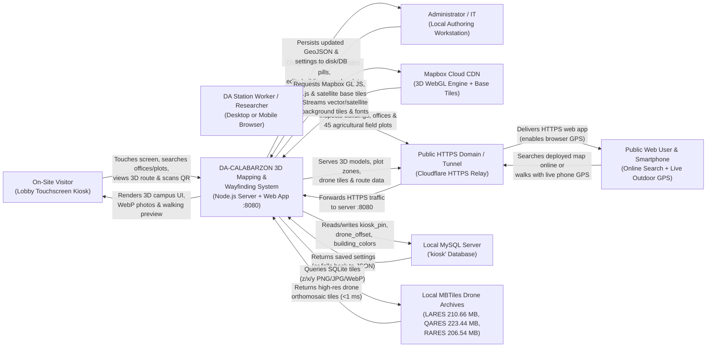
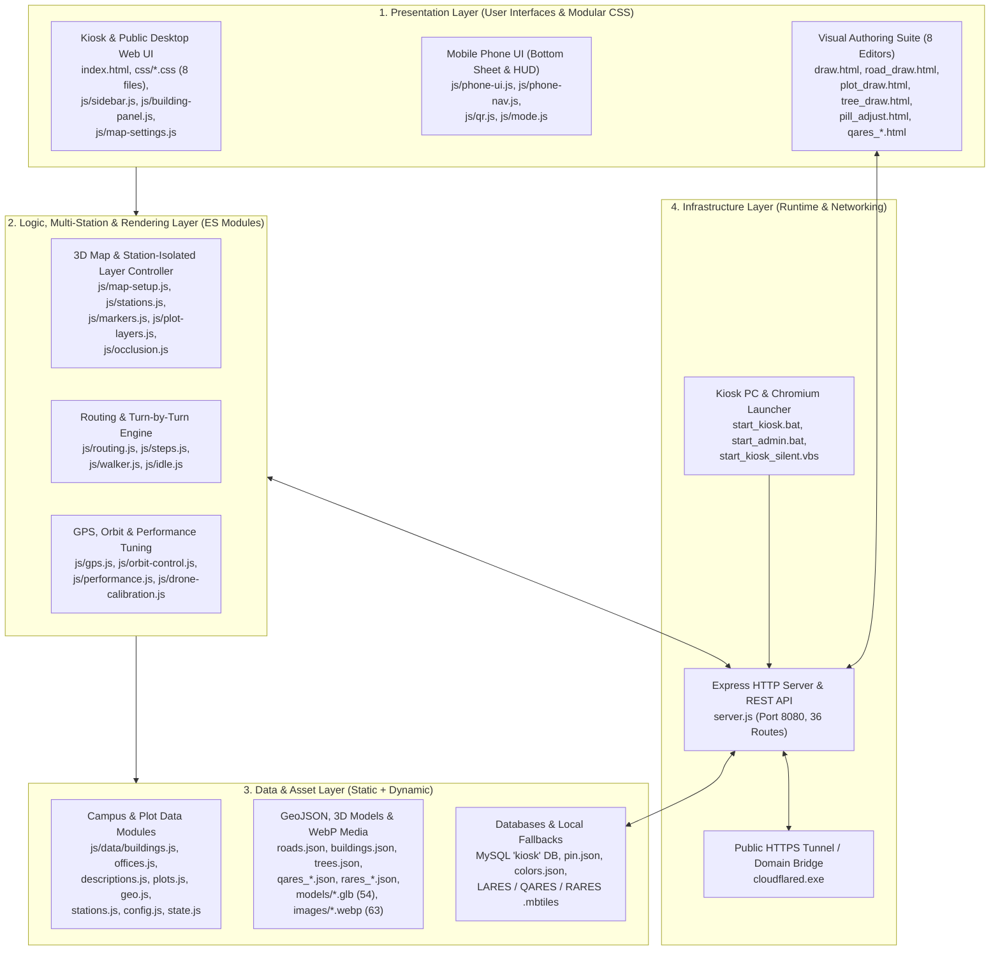
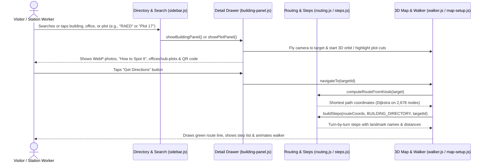
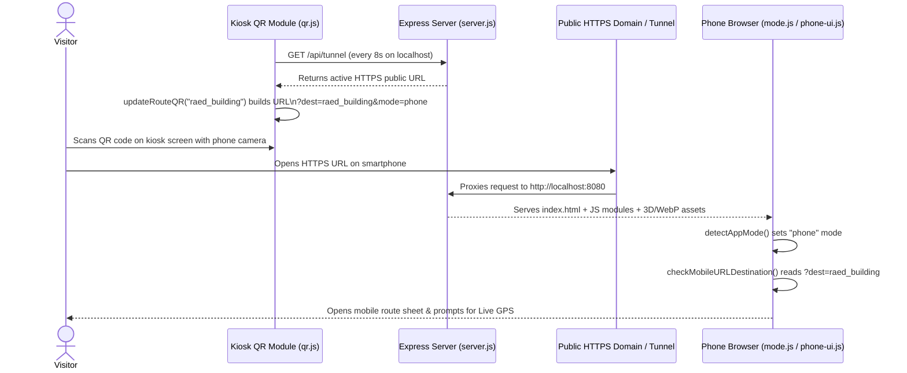
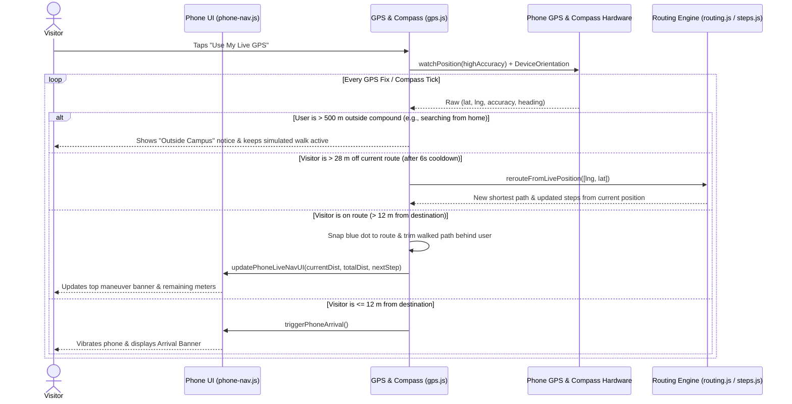
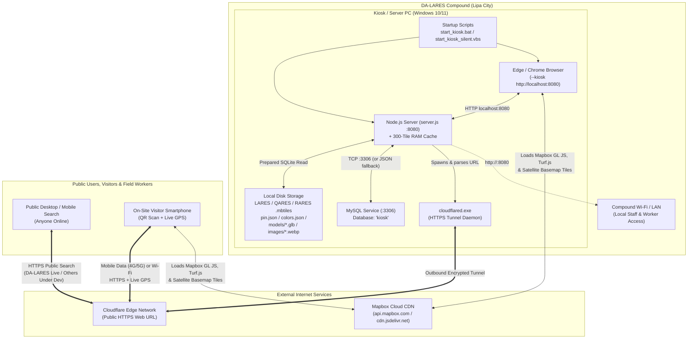

# DA-CALABARZON Interactive 3D Research Station Mapping & Wayfinding System — System Overview

**Document Purpose:** Technical and operational overview for the Department of Agriculture CALABARZON (Region IV-A) Tech Update presentation. Written for a mixed audience of non-technical staff, station workers, researchers, supervisors, and IT personnel.  
*(Note: "DASH" is the current tentative working title; official standalone system branding proposals are presented alongside this update.)*

---

## 1. At a Glance (2-Minute Summary)

### One-Sentence Description
The **DA-CALABARZON Interactive 3D Research Station Mapping & Wayfinding System** (working title: **DASH**) is a publicly searchable web platform, lobby touchscreen kiosk, and mobile GPS navigation system built for **all four DA-CALABARZON research stations**—presenting the fully completed **DA-LARES** campus in Lipa City, Batangas first (while **DA-QARES**, **DA-RARES**, and **DA-CARES** are under active development)—to guide visitors and provide station workers with interactive facility, office, and agricultural plot intelligence.

### Elevator Pitch (3 Sentences)
Agricultural research stations across Region IV-A span dozens of research buildings, laboratories, warehouses, screenhouses, and experimental crop plots where visitors need clear directions and station workers need a unified spatial view of facilities and field trials. Deployed online so **anyone can search and explore it from any browser**, as well as running on an on-site touchscreen kiosk, the system lets users search for any building, internal office, or agricultural plot, view real WebP photographs and *"How to Spot It"* guides, and watch a 3D animated walking preview of the exact route. Visitors on-site can scan a **QR code** *(a square barcode readable by any smartphone camera)* to transfer the route to their phone with live turn-by-turn **GPS** *(Global Positioning System — satellite location tracking on a phone)* guidance, while station workers and researchers use the **Agricultural Plots** map as the foundation for tracking what is planted in each plot, exact tree counts, and annual versus monthly/seasonal crop cycles.

### The Problem It Solves
- **For Visitors & Public Stakeholders (Farmers, Researchers, Guests, Suppliers):** Eliminates confusion both before arriving (by searching the deployed map online) and on-site at the compound across 39 numbered buildings, 47 internal offices, and 45 field plots. Visitors see both the route and a real photo plus a *"How to Spot It"* visual description before they start walking.
- **For Station Workers, Researchers & Farm Superintendents:** Provides a visual spatial directory of all **45 experimental field plots** (grouped into **23 official commodity zones** at DA-LARES), screenhouses, and utility infrastructures. It empowers workers to inspect plot boundaries and sub-plots today, and is designed to expand into a live agronomic plot information system showing **what crop/variety is currently planted**, **tree counts per plot**, and **which plots are annual/perennial orchards versus monthly/seasonal trial plots**.
- **For the Office (DA-LARES & DA CALABARZON Management):** Reduces repetitive direction-giving at guard houses and front desks, standardizes official facility and office listings, and establishes a single unified platform for all four regional research stations (**DA-LARES**, **DA-QARES**, **DA-RARES**, and **DA-CARES**).

### Who Uses It and Where
- **Public Online Users (Anywhere):** Search and explore the deployed interactive 3D map from any desktop or mobile web browser prior to or during a station visit.
- **On-Site Visitors & Event Participants:** Use the **Standing Touchscreen Kiosk** installed at the Argosino Hall lobby (`[121.1664336, 13.9581208]`) or carry their **smartphones** outdoors while walking across the DA-LARES compound in Marawoy, Lipa City, Batangas.
- **DA Station Workers, Researchers & Staff:** Use the web application on desktops, tablets, or phones to locate offices, conference halls, and experimental field plots, and to monitor plot-level agricultural activities.
- **Designated Administrators & IT Maintainers:** Use the local server workstation and built-in visual authoring editors to update the `"You Are Here"` kiosk pin, building colors, road segments, facility pills, and plot records.

### By the Numbers (Verified from Code and Data)

| Metric | Exact Count | Source in Codebase |
| :--- | :--- | :--- |
| **DA-CALABARZON Research Stations in Platform** | **4** (`DA-LARES` presented live; `DA-QARES`, `DA-RARES`, `DA-CARES` gated as *Under Development* in deployed mode) | `STATIONS` in `js/data/stations.js`, `js/stations.js` |
| **DA-LARES Numbered Directory Buildings** | **39** (numbered `1` to `39`) | `BUILDING_DIRECTORY` in `js/data/buildings.js` |
| **Total DA-LARES Building Footprints** | **50** (39 numbered + 9 screenhouse/annex sub-plots + 2 Plot 22 utility amenities) | `LARES_DRAWINGS.features` in `js/data/buildings.js` |
| **Custom 3D Building Models (`.glb`)** | **49** active LARES 3D model entries + **1** RARES Guard House (**54** `.glb` files in `models/`, all < 300 KB) | `CUSTOM_3D_BUILDINGS` in `js/data/buildings.js`, `rares_buildings.json`, `models/` |
| **Internal Offices & Operational Units** | **47** verified offices across **9** multi-office buildings + **3** embedded conference halls | `BUILDING_OFFICES` in `js/data/offices.js`, `EMBEDDED_CONFERENCE_HALLS` in `js/sidebar.js` |
| **Facility Categories (Filter Dropdown)** | **7** (`infrastructure`, `trial_sites`, `orchard`, `office`, `laboratory`, `conference`, `digital_agri`) | `BUILDING_CATEGORIES` in `js/data/buildings.js`, `index.html` |
| **Agricultural Field Plots & Zones (LARES)** | **45** individual plots grouped into **23** official commodity zones (with **9** named screenhouse/utility sub-plots) | `ALL_PLOT_POLYGONS`, `FIELD_COMMODITY_ZONES` in `js/data/plots.js` |
| **Compound Gates (LARES)** | **3** (`Main Entrance`, `Main Exit`, `Back Gate Entrance / Exit`) | `STANDALONE_GATES` in `js/data/buildings.js` |
| **Wayfinding Descriptions & Optimized Photos** | **53** facility descriptions; **63** optimized `.webp` photos in `images/` | `BUILDING_WAYFINDING_INFO` in `js/data/descriptions.js`, `images/*.webp` |
| **Road & Walkway Network Features (LARES)** | **104** features (**56** road segments, **3** walkways, **45** building entrance points) | `roads.json` |
| **Total Mapped Road & Walkway Length (LARES)** | **2,684 m (2.68 km)** subdivided into **2,678** routing graph nodes (**45/45 entrances 100% reachable**) | `roads.json`, `buildRoadGraph()` in `js/routing.js` |
| **3D Campus Trees (LARES)** | **131** placed 3D trees using **4** tree model types | `trees.json`, `LARES_TREES` in `js/data/geo.js` |
| **Offline Drone Map Databases (`.mbtiles`)** | **3** (`LARES v1.mbtiles` = 210.66 MB; `QARES v1.mbtiles` = 223.44 MB; `RARES v1.mbtiles` = 206.54 MB — 640.64 MB total) | Project root (`server.js` SQLite tile server) |
| **Active Modular JavaScript Files** | **27** ES modules (**19** in `js/` + **8** in `js/data/`, totaling **34,816** lines) | `js/*.js`, `js/data/*.js` |
| **Modular CSS Stylesheets** | **8** domain CSS files (`variables.css`, `base.css`, `kiosk.css`, `building-panel.css`, `navigation.css`, `phone.css`, `admin.css`, `main.css` — **9,852** lines) | `css/*.css` |
| **Core Application Files (Lines of Code)** | `index.html`: **1,246** \| `server.js`: **1,310** \| `css/*.css`: **9,852** | `index.html`, `server.js`, `css/*.css` |
| **Standalone Browser Authoring Tools** | **8** editor pages (`draw.html`, `plot_draw.html`, `road_draw.html`, `tree_draw.html`, `pill_adjust.html`, + 3 QARES editors) | Root `*.html` files |
| **Backend API Endpoints** | **36** HTTP routes in Express | `server.js` |
| **Database Tables (MySQL + Fallbacks)** | **2** MySQL tables (`settings`, `building_colors`) + **4** local JSON fallback files | `initDB()` in `server.js` |
| **Supported Runtime Modes** | **4** (`Kiosk Landscape` / Public Web, `Kiosk Portrait Totem`, `Mobile Phone`, `Admin Overlay`) | `detectAppMode()` in `js/mode.js`, `initAdminMode()` in `js/app.js` |

### Status Summary

| Status | Meaning | Capabilities in This State |
| :--- | :--- | :--- |
| **`IMPLEMENTED` (Flagship DA-LARES & Core Platform)** | Complete, active, and verified in code for public deployment and Tech Update presentation | Publicly searchable 3D web map & lobby kiosk for **DA-LARES**; 49 custom 3D building models on station-isolated WebGL layers (`lares-3d-models-layer`); offline 210.66 MB high-resolution drone aerial view (Zoom 14–21); 39-building & 47-office search and 7-category filtering; 23 agricultural commodity zones (Plots 1–45) with sub-plots; shortest-path pedestrian routing (`buildRoadGraph`, `findShortestPath`); animated walker preview (`1x`/`2x`/`4x`/`6x` speed); dynamic 3D building X-ray transparency (`occlusion.js`); QR code handoff (`qr.js`); live phone GPS & compass navigation (`gps.js`, `phone-nav.js`); 45-second idle auto-reset & 5-minute thermal eco-rest (`idle.js`); adaptive GPU/battery performance profiles (`performance.js`); 8-file modular CSS (`css/*.css`); 100% WebP photo optimization (`images/*.webp`); 3-tier MySQL/JSON/memory persistence (`server.js`); and automatic **"Station Under Development"** modal gating (`js/stations.js`) for secondary stations in deployed mode. |
| **`UNDER DEVELOPMENT` (Secondary Stations: QARES, RARES, CARES)** | Registered in the multi-station platform and actively being surveyed/modeled; gated with an official *Under Development* modal on the public web deployment | **DA-RARES (Tanay, Rizal):** 206.54 MB drone MBTiles, 39 numbered building footprints (`rares_buildings.json`), 45 agricultural plots (`rares_plots.json`), road network (`rares_roads.json`), and custom 3D Guard House (`rares_guard_house.glb`) integrated on `rares-3d-models-layer`. **DA-QARES (Tiaong, Quezon):** 223.44 MB drone MBTiles, 48 building footprints (`qares_buildings.json`), and 31 road features (`qares_roads.json`) integrated. **DA-CARES (Naic, Cavite):** Registered in the station switcher (`js/data/stations.js`) awaiting drone survey and 3D modeling. |
| **`PLANNED` (Next Platform Evolution)** | Scheduled enhancements building on the deployed foundation | **Worker-Facing Agronomic Plot Intelligence:** Expanding the 45 agricultural plots (`js/data/plots.js`) to display current planted crop/variety, exact tree counts per orchard plot, planting/harvest dates, and **Annual/Perennial vs. Monthly/Seasonal** crop cycle classification for station workers. **Permanent Custom Domain:** Binding a permanent government/agency domain via a Cloudflare Named Tunnel. **Full 3D Rollout for RARES, QARES & CARES:** Completing the remaining 3D `.glb` models and office directories for all regional stations. |

---

## 2. Purpose and Scope

### Goals
1. **Publicly Searchable Multi-Station Platform:** Provide a single regional web application where anyone online—as well as visitors and workers on-site—can search and explore DA-CALABARZON research stations, starting with **DA-LARES** as the completed flagship station.
2. **Self-Service Outdoor Wayfinding for Visitors:** Allow any visitor at the lobby kiosk or on their phone to locate any building, internal office, conference hall, gate, or experimental field plot within seconds.
3. **Operational & Agronomic Plot Reference for Station Workers:** Give DA researchers, farm workers, and management an interactive map of all **45 numbered experimental plots** (23 commodity zones) and screenhouse sub-plots, serving as the spatial backbone for tracking planted crops, tree counts, and annual versus monthly/seasonal trial schedules.
4. **Visual Landmark Recognition:** Show users an authentic 3D architectural model, ground-truth `.webp` photographs, and plain-language *"How to Spot It"* cues so they immediately recognize any facility in person.
5. **Seamless Kiosk-to-Phone Continuity:** Let visitors carry directions in their pocket by scanning a QR code that opens the map in a mobile-optimized view with live GPS tracking, without installing a mobile app.
6. **Resilient Local & Hybrid Operation:** Serve the 210.66 MB high-resolution drone map and all 3D models directly from the server with a 300-tile RAM cache and 3-tier MySQL/JSON/memory fallback.

### Scope Boundaries

| Area | Current & Planned Platform Scope | Out of Scope |
| :--- | :--- | :--- |
| **Multi-Station Regional Coverage** | **`IMPLEMENTED` (DA-LARES) / `UNDER DEVELOPMENT` (QARES, RARES, CARES)** — Unified station selector (`js/data/stations.js`, `js/stations.js`) presenting DA-LARES live while displaying a clean *"Station Under Development"* notice for QARES, RARES, and CARES in public deployed mode. | Non-DA facilities outside the four CALABARZON research station perimeters. |
| **Outdoor Campus Navigation** | **`IMPLEMENTED`** — Pedestrian routing along 2.68 km of mapped compound roads and walkways (`js/routing.js`, `roads.json`) plus public web access and mobile GPS tracking (`js/gps.js`). | Public highway turn-by-turn driving directions outside the station gates. |
| **Building & Office Directory** | **`IMPLEMENTED`** — Searching 39 numbered buildings, 9 screenhouse/annex structures, 2 Plot 22 utility amenities, 47 internal offices, and 3 embedded conference halls (`js/sidebar.js`, `js/data/offices.js`). | Individual employee payroll/HR records or external appointment booking systems. |
| **Agricultural Field Plots & Worker Agronomic Data** | **`IMPLEMENTED` (Spatial Zones & Sub-Plots) + `PLANNED` (Agronomic Intelligence)** — 23 official commodity zones covering Plots 1–45 with interactive boundary highlights and screenhouse/utility sub-plot cards (`js/data/plots.js`, `js/plot-layers.js`), expanding to include worker-facing records of **what is planted in each plot**, **tree counts**, and **annual/perennial vs. monthly/seasonal crop cycles**. | Automated IoT soil hardware sensors or external market price feeds. |
| **Indoor Navigation** | **`IMPLEMENTED` (Floor Groupings)** — Multi-floor text grouping (`Ground Floor` and `2nd Floor`) in `js/data/offices.js`. | Room-by-room indoor Bluetooth/Wi-Fi positioning or stairwell CAD schematics. |

### Coverage Area
- **Flagship Live Station (`IMPLEMENTED` — Presented in Tech Update):** **DA-LARES** (Lipa Agricultural Research and Experiment Station) in Brgy. Marawoy, Lipa City, Batangas (centered at `[121.16875, 13.95978]`, bounded by `DA_LARES_OUTER_PERIMETER` in `js/data/geo.js`).
- **Regional Stations Under Development (`UNDER DEVELOPMENT` in Public Deployed Mode):**
  - **DA-QARES** (Quezon Agricultural Research and Experiment Station) in Brgy. Lagalag, Tiaong, Quezon (`[121.37130, 13.94650]`).
  - **DA-RARES** (Rizal Agricultural Research and Experiment Station) in Tanay, Rizal (`[121.34225, 14.57729]`).
  - **DA-CARES** (Cavite Agricultural Research and Experiment Station) in Naic, Cavite (`[120.78979, 14.30552]`).

---

## 3. Stakeholders and Users

| Actor | Role Description | What They Do with the System | What They Need |
| :--- | :--- | :--- | :--- |
| **Public Online User & Campus Visitor** *(Farmer, Researcher, Supplier, Guest, Student)* | Anyone searching the deployed system online before a visit, or arriving on-site at DA-LARES for a transaction, training, laboratory submission, or field tour. | Searches the map online or at the lobby touchscreen to find a building, office, or plot; views 3D models, `.webp` photos, and walking steps; and scans the QR code on-site to follow live GPS directions on their smartphone. | Fast public web access, large touch buttons, clear landmark descriptions, zero app installation, and reliable outdoor phone directions. |
| **DA Station Worker, Researcher & Farm Superintendent** | Field technicians, agriculturists, researchers, division chiefs, and staff working across the station's buildings and 45 experimental plots. | Uses the interactive map on desktop or mobile to inspect agricultural plots (Plots 1–45), screenhouses, and trial sites; guides visiting stakeholders; and (as the agronomic plot database expands) checks what crop/variety is planted in a plot, its tree count, and whether it is an annual/perennial plot or a monthly/seasonal plot. | Accurate plot boundaries, official commodity zone names, sub-plot visibility, fast search by office acronym (`RAED`, `PMED`, `BAC`, `RSBSA`), and plot-level crop information. |
| **System Administrator** | Authorized staff member managing campus map layout and kiosk placement. | Activates Admin Mode (`?admin=1` or `Alt+Shift+A`) to unlock and drag the `"You Are Here"` kiosk pin, adjust building roof/badge colors, or calibrate drone map alignment. | Simple visual tools that save changes immediately without editing raw code. |
| **IT / Maintainer** | MIS / IT personnel responsible for the server, public deployment, network tunnel, and spatial data updates across all 4 stations. | Runs startup scripts (`start_kiosk.bat`), manages `server.js` and the HTTPS tunnel/domain, and uses the visual authoring suite (`draw.html`, `road_draw.html`, `plot_draw.html`, `tree_draw.html`, `pill_adjust.html`) to onboard buildings, roads, and plots. | Clear startup automation, crash recovery, offline fallbacks when database/internet fails, and standardized multi-station onboarding tools. |

---

## 4. System Context Diagram

Below is a **system context diagram** *(a high-level map showing the system as a single box in the center and every external person or service that exchanges data with it)*.

---

## 5. Architecture

The system follows a **four-layer architecture** *(organizing software into stacked responsibility levels: screen interface at the top, navigation and multi-station logic in the middle, campus and plot data below, and server hardware at the bottom)*.

### Layer Descriptions and Implementing Files

1. **Presentation Layer (`IMPLEMENTED`):**
   - **What it does:** Renders the glassmorphic dark-theme interface using **8 modular CSS stylesheets** (`css/variables.css`, `base.css`, `kiosk.css`, `building-panel.css`, `navigation.css`, `phone.css`, `admin.css`, `main.css`), automatically adapting between the **Desktop Web / Kiosk Sidebar & Right Detail Drawer** on large screens and the **Draggable Bottom Sheet & Top Maneuver Banner** on smartphones. Also displays the **"Station Under Development"** modal (`#station-dev-modal`) when a public user clicks DA-QARES, DA-RARES, or DA-CARES.
   - **Files:** `index.html`, `css/*.css` (8 files), `js/mode.js` (`detectAppMode`, `applyAppModeToDOM`), `js/sidebar.js` (`buildDirectory`, `selectCategoryFilter`), `js/building-panel.js` (`showBuildingPanel`, `showPlotPanel`), `js/phone-ui.js` (`initPhoneUI`, `setPhoneSheetSnap`), `js/phone-nav.js` (`updatePhoneRouteUI`, `updatePhoneLiveNavUI`), `js/map-settings.js` (`initMapSettingsPanel`), `js/qr.js` (`updateRouteQR`, `updateBuildingQR`), plus standalone editors `draw.html`, `road_draw.html`, `plot_draw.html`, `tree_draw.html`, `pill_adjust.html`, `qares_draw.html`, `qares_road_draw.html`, and `qares_boundary_draw.html`.
2. **Logic, Multi-Station & Rendering Layer (`IMPLEMENTED`):**
   - **What it does:** Initializes the **WebGL** *(Web Graphics Library — hardware-accelerated 3D graphics inside a browser)* map canvas; mounts dedicated, **station-isolated 3D model sources and layers** (`lares-3d-models-layer`, `rares-3d-models-layer`, `qares-3d-models-layer` via `setupStation3DModels()` in `js/map-setup.js`) so 3D buildings never vanish when switching stations; manages multi-station transitions and deployed-mode gating (`js/stations.js`); computes shortest-path walking routes using **Dijkstra's algorithm** (`js/routing.js`); generates landmark-based turn instructions (`js/steps.js`); animates the walking avatar (`js/walker.js`); fades out buildings blocking the camera's line of sight (`js/occlusion.js`); tracks smartphone GPS/compass sensors (`js/gps.js`); and scales display resolution based on hardware capability (`js/performance.js`).
   - **Files:** `js/app.js`, `js/stations.js`, `js/map-setup.js`, `js/markers.js`, `js/plot-layers.js`, `js/occlusion.js`, `js/routing.js`, `js/steps.js`, `js/walker.js`, `js/idle.js`, `js/gps.js`, `js/orbit-control.js`, `js/performance.js`, `js/drone-calibration.js`.
3. **Data & Asset Layer (`IMPLEMENTED` for DA-LARES; `UNDER DEVELOPMENT` for QARES, RARES, CARES):**
   - **What it does:** Holds the canonical coordinates, polygons, 3D model transforms, office lists, descriptions, agricultural plot zones, road networks, offline drone tile pyramids, and runtime settings. All 63 facility and plot photos in `images/` are compressed into `.webp` format for fast loading over public web and mobile connections.
   - **Files:** `js/data/config.js`, `js/data/state.js`, `js/data/stations.js`, `js/data/buildings.js`, `js/data/offices.js`, `js/data/descriptions.js`, `js/data/plots.js`, `js/data/geo.js`, `roads.json`, `buildings.json`, `trees.json`, `qares_*.json`, `rares_*.json`, `pin.json`, `qares_pin.json`, `rares_pin.json`, `colors.json`, `drone_offset.json`, `LARES v1.mbtiles`, `QARES v1.mbtiles`, `RARES v1.mbtiles`, `models/*.glb` (54 files), and `images/*.webp` (63 files).
4. **Infrastructure Layer (`IMPLEMENTED`):**
   - **What it does:** Runs the local **Node.js** + **Express** backend on port `8080`, serves static files and SQLite drone tiles across 36 HTTP routes, synchronizes settings with **MySQL**, spawns the **Cloudflare Tunnel** (`cloudflared`) child process for public **HTTPS** web access and mobile GPS, and launches the browser in full-screen kiosk mode on the lobby totem.
   - **Files:** `server.js`, `package.json`, `.env.example`, `start_kiosk.bat`, `start_admin.bat`, `start_kiosk_silent.vbs`, `create_shortcuts.ps1`, `manifest.json`.

---

## 6. Key Workflows

### Workflow 1: User Searches a Building, Office, or Agricultural Plot & Gets Directions (`IMPLEMENTED`)
Whether accessed online by a public user/station worker or tapped on the lobby kiosk (`js/sidebar.js`), selecting a building or agricultural plot opens the right-side detail drawer (`showBuildingPanel()` or `showPlotPanel()` in `js/building-panel.js`), flies the camera to the target, and gently orbits around its 3D model (`orbitBuilding()` in `js/idle.js`) or illuminates its field plot boundaries and internal cut lines (`selectPlotZone()` in `js/plot-layers.js`). When the user taps **Get Directions**, `navigateTo()` in `js/walker.js` calls `computeRouteFromKiosk()` (`js/routing.js`) to find the shortest walking path from the `"You Are Here"` pin to the destination entrance node, generates turn-by-turn steps (`buildSteps()` in `js/steps.js`), draws the glowing green path on the map, and animates the 3D walking avatar along the route.

### Workflow 2: Kiosk-to-Phone Handoff via QR Code (`IMPLEMENTED`)
Whenever a building or route is selected on the kiosk, `updateBuildingQR()` and `updateRouteQR()` in `js/qr.js` generate a live QR code pointing to the active public HTTPS URL (fetched from `/api/tunnel` in `server.js`) with URL parameters `?dest=<buildingId>&mode=phone` (and `&office=<name>` if a specific office was searched). When the visitor scans this QR code with their smartphone camera, the phone opens the web app over HTTPS, detects `mode=phone` (`detectAppMode()` in `js/mode.js`), hides all desktop panels, opens the mobile bottom sheet (`initPhoneUI()` in `js/phone-ui.js`), and automatically computes the walking route (`checkMobileURLDestination()` in `js/qr.js`).

### Workflow 3: Live GPS Navigation on the Phone (`IMPLEMENTED`)
On the phone, `navigateTo()` (`js/walker.js`) first previews the route and displays a permission prompt (`promptPhoneGPSPermission()` in `js/gps.js`). When the visitor taps **Use My Live GPS**, `startPhoneLiveGPS()` requests hardware location updates (`navigator.geolocation.watchPosition`) and compass heading (`DeviceOrientationEvent`). As the visitor walks, `handlePhoneGPSUpdate()` snaps their raw GPS coordinates to the nearest point on the route (`turf.nearestPointOnLine`), slices the remaining route line so walked segments disappear behind them, updates the top turn-by-turn banner (`updatePhoneLiveNavUI()` in `js/phone-nav.js`), automatically recalculates the route if they wander more than 28 m off path (`rerouteFromLivePosition()`), and triggers vibration plus an arrival card within 12 m of the destination (`triggerPhoneArrival()`).

### Workflow 4: Multi-Station Switching & Deployed "Under Development" Gatekeeping (`IMPLEMENTED`)
When a user clicks the station selector dropdown (`js/sidebar.js`, `js/stations.js`), they see all **4 DA-CALABARZON Research Stations** (**DA-LARES**, **DA-QARES**, **DA-RARES**, **DA-CARES**). In public deployed mode (`isDeployedMode()` returns `true` when accessed via the public web URL rather than `localhost`), selecting **DA-QARES**, **DA-RARES**, or **DA-CARES** automatically opens the **"Station Under Development"** modal (`showStationDevModal()` in `js/stations.js`) explaining that DA-LARES is the flagship launched station while the selected station is currently under active development. On the developer workstation (`localhost`), selecting QARES or RARES smoothly transitions the camera, drone MBTiles, footprints, and station-isolated 3D model layers (`lares-3d-models-layer` ↔ `rares-3d-models-layer`) so development can continue seamlessly.

### Workflow 5: Admin Updates & Visual Authoring Suite (`IMPLEMENTED`)
An administrator activates Admin Mode on the workstation by opening `http://localhost:8080/?admin=1` (or pressing `Alt+Shift+A`, handled by `initAdminMode()` in `js/app.js`). In the main map, the admin can drag the `"📍 You Are Here"` pin (`repositionActiveKioskPin()` in `js/idle.js` → `POST /api/pin`), change building roof/badge colors (`saveCurrentColor()` in `js/building-panel.js` → `POST /api/colors`), or open the Drone Calibration HUD (`Alt+Shift+D`, `saveDroneOffsetToServer()` in `js/drone-calibration.js` → `POST /api/drone-offset`). For spatial authoring, the maintainer uses the standalone browser editors (`draw.html`, `road_draw.html`, `plot_draw.html`, `tree_draw.html`, `pill_adjust.html`) which save updated GeoJSON directly to `server.js`.

---

## 7. Data Overview

### What Data the System Holds, Where It Is Stored, How It Is Loaded, and Who Maintains It

| Data Category | Where It Is Stored | How It Is Loaded at Runtime | Who Maintains It |
| :--- | :--- | :--- | :--- |
| **Multi-Station Registry & Config** | `js/data/stations.js` (`STATIONS`: `lares`, `qares`, `rares`, `cares`) & `js/stations.js` | Imported at startup; controls camera bounds, tile URLs, station-isolated 3D layers, and the Deployed Mode *"Under Development"* modal. | IT / Maintainer. |
| **Building Footprints, Directory & 3D Model Registry** | `js/data/buildings.js` (`LARES_DRAWINGS`, `BUILDING_DIRECTORY`, `CUSTOM_3D_BUILDINGS`, `STANDALONE_GATES`), `buildings.json`, `qares_buildings.json`, `rares_buildings.json` | Imported as ES module constants (`js/data/buildings.js`) or fetched per station (`js/stations.js`); rendered on station-isolated 3D layers (`js/map-setup.js`). | IT / Maintainer (via `draw.html`, `pill_adjust.html`, + `js/data/buildings.js`). |
| **3D Architectural & Tree Meshes** | `models/*.glb` (54 binary **glTF/GLB** files — 49 LARES building placements, 1 RARES Guard House, 4 tree models, all < 300 KB) | Loaded by Mapbox GL JS station-isolated `model` layers (`lares-3d-models-layer`, `rares-3d-models-layer`, `3d-trees-layer` in `js/map-setup.js`). | 3D Modeler / IT Maintainer (exported from Blender under 300 KB per file). |
| **Internal Offices & Floor Groupings** | `js/data/offices.js` (`BUILDING_OFFICES` — 47 verified offices across 9 LARES buildings) & `js/sidebar.js` (`EMBEDDED_CONFERENCE_HALLS`) | Imported by `js/sidebar.js`, `js/building-panel.js`, and `js/phone-ui.js`. | DA Administration / IT Maintainer (edits `js/data/offices.js`). |
| **Wayfinding Descriptions & WebP Facility Photos** | `js/data/descriptions.js` (`BUILDING_WAYFINDING_INFO`), `images/*.webp` (63 optimized `.webp` files), `js/data/buildings.js` (`BUILDING_IMAGES`) | Descriptions imported in `js/building-panel.js` and `js/phone-ui.js`; `.webp` photos loaded on demand when a building/plot card opens. | RAFIS / Station Staff / IT Maintainer (`tools/convert_photos_to_webp.py`). |
| **Agricultural Plots, Commodity Zones & Future Agronomic Records** | `js/data/plots.js` (`FIELD_COMMODITY_ZONES`, `ZONE_POLYGONS`, `ALL_PLOT_POLYGONS`, `INTERNAL_CUT_LINES`) and `rares_plots.json` | Imported in `js/plot-layers.js`, `js/sidebar.js`, `js/building-panel.js`, and `js/phone-ui.js`. Designed to expand with per-plot crop variety, tree count, and annual vs. monthly/seasonal cycle fields for station workers. | Research / Farm Superintendent & IT Maintainer (via `plot_draw.html` + `js/data/plots.js`). |
| **Pedestrian Road & Walkway Network** | `roads.json` (LARES: 104 features), `qares_roads.json` (QARES: 31 features), `rares_roads.json` (RARES) | Fetched asynchronously in `initializeCampusData()` (`js/app.js`) and compiled into an in-memory graph by `buildRoadGraph()` (`js/routing.js`). | IT Maintainer (via `road_draw.html`). |
| **3D Tree Locations** | `trees.json` (131 point features) and `LARES_TREES` in `js/data/geo.js` | Fetched via `GET /api/trees` (`server.js`) and rendered on the `3d-trees-layer` model layer (`js/map-setup.js`). | IT Maintainer (via `tree_draw.html`). |
| **Kiosk Pin, Drone Offset & Custom Colors** | MySQL `kiosk` database (`settings` and `building_colors` tables) + local JSON fallbacks (`pin.json`, `qares_pin.json`, `rares_pin.json`, `drone_offset.json`, `colors.json`) | Fetched via `GET /api/pin`, `GET /api/colors`, and `GET /api/drone-offset` in `initializeCampusData()` (`js/app.js`). | System Administrator (via in-app Admin Mode UI). |
| **Offline Drone Orthomosaic Tiles** | `LARES v1.mbtiles` (210.66 MB), `QARES v1.mbtiles` (223.44 MB), & `RARES v1.mbtiles` (206.54 MB) in SQLite **MBTiles** format | Streamed on demand by `server.js` via `/api/tiles/:z/:x/:y`, `/api/qares/tiles/:z/:x/:y`, and `/api/rares/tiles/:z/:x/:y` with a 300-tile in-memory LRU cache. | Survey / Drone Mapping Team & IT Maintainer. |

### Entity Diagram

```mermaid
erDiagram
    STATION ||--o{ BUILDING : "contains"
    STATION ||--o{ COMMODITY_ZONE : "contains"
    STATION ||--o{ ROAD_SEGMENT : "has"
    STATION ||--|| KIOSK_PIN : "has default start"
    STATION ||--o| MBTILES_ARCHIVE : "has drone imagery"

    BUILDING ||--o| CUSTOM_3D_MODEL : "rendered by (<300 KB .glb)"
    BUILDING ||--o{ OFFICE : "houses (9 buildings, 47 offices)"
    BUILDING ||--o| WAYFINDING_DESCRIPTION : "described by (53 entries)"
    BUILDING ||--o{ FACILITY_PHOTO : "displays (.webp)"
    BUILDING ||--o| BUILDING_COLOR : "styled by"
    BUILDING ||--o{ ENTRANCE_NODE : "connects via (45 entrances)"

    ROAD_SEGMENT }o--o{ ENTRANCE_NODE : "snaps to (buildRoadGraph)"

    COMMODITY_ZONE ||--|{ FIELD_PLOT : "groups (23 zones -> 45 plots)"
    COMMODITY_ZONE ||--o{ SUB_PLOT_FACILITY : "includes (Plots 17, 18, 22)"
    FIELD_PLOT ||--o| AGRONOMIC_RECORD : "tracks for workers (Planned)"

    STATION {
        string id PK "lares | qares | rares | cares"
        string name "Official Station Title"
        string status "Live (LARES) | Under Development"
        float_array center "[lng, lat]"
    }
    BUILDING {
        string id PK "e.g. raed_building"
        int num "1..39 or null"
        string name "Official Facility Name"
        string category "infrastructure | office | laboratory | etc."
        polygon geometry "GeoJSON footprint"
    }
    CUSTOM_3D_MODEL {
        string id PK "e.g. raed_building"
        string modelUrl "models/*.glb (<300 KB)"
        float_array coordinates "[lng, lat]"
        float rotation "Bearing in degrees"
    }
    OFFICE {
        string building_id FK "Parent building ID"
        string floor "Optional floor group"
        string office_name "Division / Unit name"
    }
    WAYFINDING_DESCRIPTION {
        string building_id PK "Target building/zone ID"
        string compactTag "Short subtitle"
        string visualLandmark "How to Spot It"
        string keyServices "What's Inside & Services"
    }
    COMMODITY_ZONE {
        string id PK "e.g. zone_citrus_orchard"
        string name "Official Zone Name"
        string plotRange "e.g. Plots 6-12"
        string category "orchard | crop | nursery"
    }
    FIELD_PLOT {
        int plotNumber PK "1..45"
        string zoneId FK "Parent zone ID"
        polygon geometry "Individual plot polygon"
    }
    AGRONOMIC_RECORD {
        int plotNumber FK "1..45 (Planned Worker Data)"
        string currentCrop "Planted crop / variety"
        int treeCount "Number of trees in plot"
        string cycleType "Annual/Perennial | Monthly/Seasonal"
        string plantingSchedule "Month / Season"
    }
    SUB_PLOT_FACILITY {
        string id PK "e.g. screenhouse_1"
        string parentZoneId FK "Plot 17, 18, or 22"
        string name "Sub-plot facility name"
    }
    ROAD_SEGMENT {
        string id PK "road_* or walkway_*"
        string type "road | walkway"
        linestring geometry "Path coordinates"
    }
    ENTRANCE_NODE {
        string id PK "entrance_*"
        string buildingId FK "Target building ID"
        point geometry "[lng, lat]"
    }
```

### Step-by-Step Instructions: How to Add a New Building or Office

#### A. Adding or Updating an Internal Office Inside an Existing Building
1. Open [`js/data/offices.js`](file:///c:/Users/LGU-SanPedro/Downloads/map/js/data/offices.js) in a text editor.
2. Locate the `BUILDING_OFFICES` object and find the building key (for example, `'tanco_hall_building'` or `'admin_building'`), or add a new key matching the building's `id` in `js/data/buildings.js`.
3. Add the official office name string to that building's array (or under a `{ floor: 'Ground Floor', offices: [...] }` object for multi-floor grouping).
4. *(Optional)* Update the office count in `compactTag` and `keyServices` inside [`js/data/descriptions.js`](file:///c:/Users/LGU-SanPedro/Downloads/map/js/data/descriptions.js).
5. Increment the script version query parameter `?v=...` on `<script type="module" src="js/app.js?v=...">` at the bottom of [`index.html`](file:///c:/Users/LGU-SanPedro/Downloads/map/index.html) and refresh the browser.

#### B. Adding a New Building to the Campus Map
1. **Draw the 2D Footprint:** With `node server.js` running, open `http://localhost:8080/draw.html`, trace the building's roof/foundation polygon over the drone imagery, set its `id`, `name`, and `height`, and click **Save**.
2. **Plot the Entrance & Walkway Connection:** Open `http://localhost:8080/road_draw.html`, place an **Entrance** point (`type: "entrance"`, `buildingId: "<id>"`) at the front door, connect it with a road or walkway segment to the existing road network, and click **Save**.
3. **Convert Photos to WebP & Register Metadata (`js/data/buildings.js`):**
   - Run `python tools/convert_photos_to_webp.py` so all facility photos in `images/` are optimized `.webp` files.
   - Add the building's category to `BUILDING_CATEGORIES` and its `.webp` photo paths to `BUILDING_IMAGES`.
   - Assign its sequence number (`num`) in `BUILDING_ORDER` and optionally fine-tune its floating pill position in `http://localhost:8080/pill_adjust.html`.
4. **Add Wayfinding Descriptions (`js/data/descriptions.js`):** Add an entry under `BUILDING_WAYFINDING_INFO['<id>']` with `compactTag`, `visualLandmark` (*"How to Spot It"*), and `keyServices` (*"What's Inside & Services"*).
5. **Add a Custom 3D `.glb` Model:** Export a watertight `.glb` model under 300 KB into `models/<id>.glb`, add an entry to `CUSTOM_3D_BUILDINGS` in `js/data/buildings.js`, and set `"has_3d_model": true` on its footprint feature.
6. **Verify Routing Reachability:** Run `node tools/tests/test_routing_graph.js` in the terminal to confirm the new entrance node is 100% reachable from the kiosk pin, bump `?v=...` in `index.html`, and reload.

---

## 8. Technology Stack

All versions below are verified directly from [`package.json`](file:///c:/Users/LGU-SanPedro/Downloads/map/package.json), [`index.html`](file:///c:/Users/LGU-SanPedro/Downloads/map/index.html), and [`server.js`](file:///c:/Users/LGU-SanPedro/Downloads/map/server.js).

| Component | Technology | Version in Code | Why It Is Used |
| :--- | :--- | :--- | :--- |
| **Front-End UI & Logic** | Vanilla HTML5, Modular CSS3 (8 files), ES6 Modules (27 files) | HTML5 / ES2022 (`index.html`, `css/*.css`, `js/*.js`) | Runs directly in the browser with zero framework build step or bundle hydration delay, keeping startup fast on public web, kiosk PCs, and mobile phones. |
| **3D WebGL Map Engine** | **Mapbox GL JS** | `v3.31.0` in `index.html` | Renders station-isolated 3D `.glb` models (`model` layer), extruded polygons (`fill-extrusion`), custom drone raster tiles, smooth 60 FPS camera flights, and dynamic time-of-day lighting. |
| **Geospatial Math Library** | **Turf.js** (`@turf/turf`) | `v6` loaded via CDN in `index.html` (`^7.4.0` in `package.json`) | Computes metric distances (`turf.distance`, `turf.length`), splits roads into 1 m segments (`turf.lineChunk`), snaps GPS to routes (`turf.nearestPointOnLine`), and slices progress lines (`turf.lineSliceAlong`). |
| **Polygon Authoring Plugin** | **Mapbox GL Draw** | `v1.4.3` in `draw.html`, `road_draw.html`, `plot_draw.html` | Provides interactive vertex dragging, polygon drawing, and line editing in the standalone admin authoring pages. |
| **Image Optimization Pipeline** | **WebP Format** (`Pillow` via `tools/convert_photos_to_webp.py`) | Max width `1440px`, quality `80` (`.webp`) | Compresses all 63 facility and plot photos in `images/*.webp` to minimize bandwidth for public web and mobile users. |
| **QR Code Rendering** | **QuickChart QR API** + SVG Data-URI Fallback (`js/qr.js`) | `https://quickchart.io/qr` | Generates high-contrast scannable QR images for kiosk-to-phone handoff, with an offline SVG card fallback if the image request fails. |
| **Backend Web Server** | **Node.js** + **Express** | Express `^5.2.1`, `cors` `^2.8.6`, `dotenv` `^17.3.1` | Serves static files, provides the 36 REST API endpoints, manages the Cloudflare tunnel process, and streams offline drone tiles on port `8080`. |
| **Relational Database** | **MySQL** (`mysql2/promise`) | `mysql2` `^3.20.0` | Persists `settings` (`kiosk_pin`, `qares_kiosk_pin`, `rares_kiosk_pin`, `drone_offset`, `tunnel_url`, `drawing_counter`) and `building_colors` in a connection pool, backed by automatic local JSON file fallbacks. |
| **Offline Drone Tile Engine** | **SQLite3** (`sqlite3`) reading **MBTiles** | `sqlite3` `^5.1.7` | Queries `LARES v1.mbtiles` (210.66 MB), `QARES v1.mbtiles` (223.44 MB), and `RARES v1.mbtiles` (206.54 MB) in read-only mode using prepared SQL statements and a 300-tile in-memory **LRU cache**. |
| **Public HTTPS Tunnel / Web Access** | **Cloudflare Tunnel** (`cloudflared`) | Local `cloudflared.exe` / system binary spawned by `server.js` | Creates an outbound encrypted HTTPS tunnel without router port-forwarding so anyone online can search the map and visitors on mobile data (LTE/5G) can scan the QR link and use browser GPS. |
| **3D Asset Pipeline & Dev Tools** | **Blender 4** (Headless TCP `127.0.0.1:9876`) + `three` (`^0.186.1`) + Playwright/Node tests (`tools/tests/`) | Blender 4 / `three` `^0.186.1` | Used during development to author watertight <300 KB `.glb` building models and verify road graph connectivity and WebGL rendering. |

---

## 9. Deployment and Operations

### Deployment Diagram

### How the Kiosk & Server Start
1. **Interactive or Silent Launch (`IMPLEMENTED`):**
   - Running [`start_kiosk.bat`](file:///c:/Users/LGU-SanPedro/Downloads/map/start_kiosk.bat) (or [`start_kiosk_silent.vbs`](file:///c:/Users/LGU-SanPedro/Downloads/map/start_kiosk_silent.vbs) for zero-window background startup) checks if port `8080` is already listening.
   - If not running, it starts `node server.js` in the project directory and waits 2 seconds.
   - It then locates Microsoft Edge (`msedge.exe`) or Google Chrome (`chrome.exe`) and launches it in locked full-screen kiosk mode (`--kiosk "http://localhost:8080"`).
2. **Desktop Shortcuts (`IMPLEMENTED`):** Running [`create_shortcuts.ps1`](file:///c:/Users/LGU-SanPedro/Downloads/map/create_shortcuts.ps1) places two shortcuts on the Windows Desktop: **DA-LARES Kiosk** and **DA-LARES Admin Mode** (`http://localhost:8080/?admin=1`).

### How It Recovers After a Restart
- **Server & Tunnel Auto-Retry (`IMPLEMENTED` in `server.js`):** When `server.js` starts, it automatically initializes the MySQL tables (`initDB()`), opens the `.mbtiles` databases (`LARES`, `QARES`, `RARES`), and spawns `cloudflared tunnel --url http://localhost:8080`. If `cloudflared` exits unexpectedly, `server.js` automatically restarts the tunnel after 5 seconds.
- **Kiosk Idle & Thermal Self-Healing (`IMPLEMENTED` in `js/idle.js`):** If a visitor walks away mid-route, the kiosk automatically resets after **45 seconds** (`IDLE_TIMEOUT = 45000`), clearing any route, closing modals, returning to the default overview, and orbiting the campus at 30 FPS. After **5 minutes** of continuous idle orbit (`MAX_CONTINUOUS_ORBIT_MS = 300000`), it pauses rotation to let the CPU/GPU cool down.

### How Public Users and Smartphones Reach It
1. **Public HTTPS Tunnel / Domain (`IMPLEMENTED`):** `server.js` exposes the web application over HTTPS via Cloudflare Tunnel (`GET /api/tunnel`). Anyone with the public link can search and explore **DA-LARES** online, while visitors at the kiosk can scan the on-screen QR code (`js/qr.js`) using their own cellular data (4G/5G) without joining office Wi-Fi.
2. **Deployed Mode Station Gatekeeper (`IMPLEMENTED` in `js/stations.js`):** When accessed via the public URL (`isDeployedMode() === true`), the station selector lets users view all 4 CALABARZON research stations, keeping **DA-LARES** fully interactive while presenting a clean **"Station Under Development"** modal if **DA-QARES**, **DA-RARES**, or **DA-CARES** is clicked.

---

## 10. Quality Attributes (Honest Assessment)

| Quality Attribute | Assessment | Strengths in Code | Areas for Upcoming Enhancement |
| :--- | :--- | :--- | :--- |
| **Performance** | **Strong (`IMPLEMENTED`)** | All 54 `.glb` 3D models are strictly < 300 KB; all 63 facility/plot photos are optimized `.webp`; `js/performance.js` detects Intel HD/UHD and mobile GPUs, disables heavy MSAA, clamps pixel ratio (`1.0x` in Eco mode), hides 3D trees in low-perf mode, virtualizes off-screen HTML markers (`js/markers.js`), and caches 300 MBTiles in RAM (`server.js`). | Loading 49 custom 3D models and 50 polygon footprints simultaneously can still warm up older dual-core integrated-GPU PCs if manually forced to `High` instead of `Auto` or `Eco`. |
| **Availability & Resilience** | **Strong Local / Moderate Cloud (`IMPLEMENTED`)** | 3-tier data fallback (MySQL → local JSON files → in-memory defaults in `server.js`); automatic 5-second restart for `cloudflared` tunnel; 45-second kiosk auto-reset and 5-minute thermal pause (`js/idle.js`). | Mapbox GL JS, Turf.js, and Mapbox base styles require internet on initial page refresh (`LIM-01`); transitioning from a free Quick Tunnel to a permanent Named Tunnel domain will remove temporary URL changes on server restart (`LIM-02`). |
| **Security** | **Pre-Launch Hardening Ready (`PARTIAL`)** | SQL queries use parameterized prepared statements (`?` placeholders in `server.js`), preventing SQL injection; `.env` is ignored in `.gitignore`; public users are gated from incomplete stations via `isDeployedMode()`. | Before permanent public hosting, add localhost/password middleware to write endpoints (`POST /api/*`), require a server-verified PIN for `?admin=1`, and restrict `express.static` to public asset directories (`docs/03-limitations-and-roadmap.md`). |
| **Privacy** | **Strong (`IMPLEMENTED`)** | **Zero visitor tracking or PII collection.** Smartphone GPS coordinates (`navigator.geolocation.watchPosition` in `js/gps.js`) and compass headings are processed **100% in the user's phone browser memory** and are **never sent to `server.js` or saved to MySQL/disk**. | None for visitors; server logs only standard console messages and admin save actions. |
| **Accessibility** | **Strong (`IMPLEMENTED`)** | Large touch targets; dedicated **1-Finger Orbit Accessibility Mode** (`js/orbit-control.js`) for users who cannot perform 2-finger pinch/twist gestures; **Compact / Full Label** toggle (`js/map-settings.js`); and plain-language landmark descriptions (`js/data/descriptions.js`). | Adding an optional Tagalog/Filipino language toggle and Web Speech API voice readout (`LIM-06`) is planned for Phase 3. |
| **Maintainability** | **Strong (`IMPLEMENTED`)** | Cleanly organized into **27 single-responsibility ES JavaScript modules** (`js/` and `js/data/`), **8 modular CSS stylesheets** (`css/*.css`), station-isolated 3D model layers (`js/map-setup.js`), and automated routing graph tests (`tools/tests/test_routing_graph.js`). | Deduplicating `/api/drone-offset` in `server.js` (`DEBT-01`) and transitioning regex JS file syncs to pure JSON imports (`DEBT-02`). |
| **Scalability** | **Strong (`IMPLEMENTED`)** | Multi-station architecture (`js/data/stations.js`, `js/stations.js`) already supports all 4 CALABARZON stations (`lares`, `qares`, `rares`, `cares`) with isolated 3D sources/layers and per-station `.mbtiles` databases. | Upgrading from a free Quick Tunnel to a Cloudflare Named Tunnel / dedicated server domain for high-traffic public events. |

---

## 11. Assumptions, Constraints, and Dependencies

1. **Internet Connectivity for Map Engine & Public Search:** While the 210.66 MB drone orthomosaic is stored locally on the server, browsers require internet access to load `mapbox-gl.js`, `turf.min.js`, Mapbox satellite/standard base styles, and public web requests over the HTTPS tunnel.
2. **HTTPS Requirement for Smartphone GPS & Compass:** Modern mobile browsers (iOS Safari and Android Chrome) require an encrypted `https://` connection before allowing `navigator.geolocation` and `DeviceOrientationEvent` (except on `localhost`).
3. **Physical GPS Reception Outdoors vs. Remote Online Preview:** Live GPS navigation on phones (`js/gps.js`) activates when the user is outdoors within 500 m of the compound center. When someone searches and opens the map remotely from home or another city (> 500 m away), the system automatically notifies them and runs the animated 3D route preview instead so anyone anywhere can still explore routes.
4. **Large Offline Drone File Transfer (`.mbtiles`):** Because `LARES v1.mbtiles` is 210.66 MB and `QARES v1.mbtiles` is 223.44 MB, they exceed GitHub's 100 MB file limit and are excluded in `.gitignore`, transferring to new server PCs via USB drive or LAN share (`docs/DEPLOYMENT_GUIDE.md`).

---

## 12. Glossary (Plain-Language Definitions)

| Term | Plain-Language Definition |
| :--- | :--- |
| **A\* / Dijkstra's Algorithm** | A mathematical method used by `js/routing.js` to find the shortest walking path along connected road segments from the starting pin to any building or plot entrance. |
| **Annual / Perennial vs. Monthly / Seasonal Plots** | **Annual / Perennial plots** hold long-term crops and fruit trees (like citrus, coffee, mango, cacao), whereas **Monthly / Seasonal plots** rotate short-term trials (like corn, cassava, and vegetables) across specific months. |
| **API (Application Programming Interface) / REST Endpoint** | A URL path on the server (such as `/api/pin` or `/api/tunnel`) that lets the web map request or save data. |
| **Bearing & Pitch** | **Bearing** is the compass direction the map camera faces (0° = North, 90° = East); **Pitch** is the tilt angle of the camera (0° = straight down from above, 60° = angled 3D view). |
| **Cloudflare Tunnel (`cloudflared`)** | A background program that creates a secure public `https://` web link to the server PC without requiring router port-forwarding or a static public IP address. |
| **ES Module (ECMAScript Module)** | A standard JavaScript file (`import` / `export`) that keeps one specific part of the program (such as search, routing, stations, or GPS) organized in its own file. |
| **GeoJSON** | A standard text file format (`.json`) for storing geographic shapes on a map: **Points** (entrances, trees), **LineStrings** (roads, walkways), and **Polygons** (building footprints, crop plots). |
| **glTF / GLB (`.glb`)** | A compact single-file 3D model format (like a "JPEG for 3D") used in `models/*.glb` to display realistic 3D buildings and trees on the map. |
| **GPS (Global Positioning System)** | Satellite location tracking built into smartphones that tells the web map where the visitor is standing outdoors. |
| **LRU Cache (Least Recently Used Cache)** | A fast memory buffer in `server.js` that keeps the 300 most recently viewed drone map tiles in RAM so zooming and panning feel instant. |
| **Mapbox GL JS** | The 3D graphics map engine running in the browser that renders the terrain, satellite/drone imagery, 3D buildings, and animated route lines. |
| **MBTiles (`.mbtiles`)** | A single-file SQLite database (`LARES v1.mbtiles`, `QARES v1.mbtiles`, `RARES v1.mbtiles`) that stores thousands of high-resolution aerial drone map tiles for offline use. |
| **Occlusion (X-Ray Transparency)** | When a tall 3D building stands between the camera and the walking route, `js/occlusion.js` turns that building semi-transparent (like frosted glass) so the walker and path stay visible. |
| **Orthomosaic** | A geometrically corrected, high-resolution aerial photograph stitched together from hundreds of drone photos so measurements and building alignments are true to scale. |
| **WebP (`.webp`)** | A modern image format used across `images/*.webp` that provides crisp facility photographs at a fraction of the file size of older JPG/PNG files. |

---

## Verification — Files Read to Produce This Document

- `index.html`, `server.js`, `package.json`, `.env.example`, `.gitignore`, `manifest.json`
- `start_kiosk.bat`, `start_admin.bat`, `start_kiosk_silent.vbs`, `create_shortcuts.ps1`
- `pin.json`, `qares_pin.json`, `rares_pin.json`, `drone_offset.json`, `roads.json`, `trees.json`, `buildings.json`
- `qares_buildings.json`, `qares_roads.json`, `qares_boundary.json`, `rares_buildings.json`, `rares_roads.json`, `rares_plots.json`, `rares_boundary.json`
- `css/variables.css`, `css/base.css`, `css/kiosk.css`, `css/building-panel.css`, `css/navigation.css`, `css/phone.css`, `css/admin.css`, `css/main.css`
- `js/app.js`, `js/stations.js`, `js/map-setup.js`, `js/markers.js`, `js/plot-layers.js`, `js/occlusion.js`, `js/orbit-control.js`, `js/sidebar.js`, `js/building-panel.js`, `js/routing.js`, `js/steps.js`, `js/walker.js`, `js/idle.js`, `js/qr.js`, `js/mode.js`, `js/phone-ui.js`, `js/phone-nav.js`, `js/gps.js`, `js/performance.js`, `js/map-settings.js`, `js/drone-calibration.js`
- `js/data/config.js`, `js/data/state.js`, `js/data/stations.js`, `js/data/buildings.js`, `js/data/offices.js`, `js/data/descriptions.js`, `js/data/plots.js`, `js/data/geo.js`
- `draw.html`, `road_draw.html`, `plot_draw.html`, `tree_draw.html`, `pill_adjust.html`
- `tools/tests/test_routing_graph.js`, `tools/convert_photos_to_webp.py`
- `AGENTS.md`, `docs/SESSION_HANDOFF.md`, `docs/DEPLOYMENT_GUIDE.md`, `docs/CSS_MODULARIZATION_PLAN.md`
