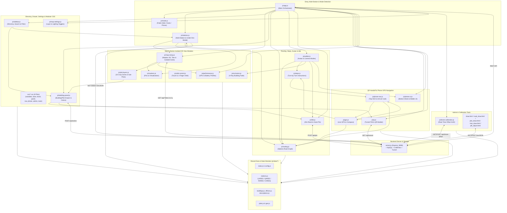

# DA-CALABARZON Interactive 3D Research Station Mapping & Wayfinding System — Module Reference

**Document Purpose:** Detailed breakdown of every software module in the **DA-CALABARZON Interactive 3D Research Station Mapping & Wayfinding System** (working title: **DASH**), including its one-sentence purpose, behavior, inputs/outputs, implementing files and functions, module dependencies, and current implementation status. All metrics and statuses match [`docs/00-system-overview.md`](file:///c:/Users/LGU-SanPedro/Downloads/map/docs/00-system-overview.md).

---

## Module Dependency Diagram

Below is a **module dependency diagram** *(a visual chart showing which JavaScript files import or call other files, from the top-level application entry point down to the shared data modules and backend server)*.

---

## 1. Application Orchestrator, Multi-Station Manager & Mode Detection

### Purpose
Bootstraps the web application, detects whether the device is a desktop browser/landscape kiosk, portrait totem, smartphone, or admin workstation, manages switching across the **4 DA-CALABARZON research stations** (`DA-LARES`, `DA-QARES`, `DA-RARES`, `DA-CARES`) with automatic **"Under Development"** modal gating in public deployed mode, and loads server-side settings and road networks.

### What It Does
- **Viewport & Device Mode Classification (`js/mode.js`):** Runs `detectAppMode()` and `applyAppModeToDOM()` to classify the viewport into **Kiosk Landscape / Public Desktop Web**, **Kiosk Portrait Totem**, or **Mobile Phone** mode, applying CSS body classes (`mode-kiosk`, `kiosk-landscape`, `kiosk-portrait`, `mode-phone`) and showing/hiding the appropriate UI shells.
- **Multi-Station Switching & Deployed Mode Gatekeeper (`js/stations.js`):**
  - Registers all 4 regional stations from `js/data/stations.js` (`lares`, `qares`, `rares`, `cares`).
  - Runs `isDeployedMode()` to detect whether the user is accessing the system over the public web/tunnel (`!isLocalhost`) versus the local development workstation.
  - When a public user selects **DA-QARES**, **DA-RARES**, or **DA-CARES**, calls `showStationDevModal(station)` to display the polished **"Station Under Development"** modal (`#station-dev-modal`), keeping public visitors focused on the completed **DA-LARES** flagship campus while showcasing the regional platform scope.
  - On the local workstation, `switchActiveStation()` loads station-specific drone MBTiles (`QARES v1.mbtiles`, `RARES v1.mbtiles`), footprints (`qares_buildings.json`, `rares_buildings.json`), plots (`rares_plots.json`), and roads (`qares_roads.json`, `rares_roads.json`), toggling visibility on the dedicated station-isolated 3D model layers.
- **Campus Data Initialization (`js/app.js`):** Fetches the saved `"You Are Here"` pin (`/api/pin`), custom building colors (`/api/colors`), and road networks (`roads.json`) via `initializeCampusData()`, injects the 3 standalone compound gates into `BUILDING_DIRECTORY`, and compiles the pedestrian routing graph (`buildRoadGraph()`).
- **Welcome Modal & Intro Choreography (`js/app.js`):** Manages the Welcome Modal (`dismissWelcomeModal()`, `returnToWelcomeMenu()`) and plays the smooth 3D camera fly-in animation (`playIntroAnimation()`).

### Inputs and Outputs
- **Inputs:** URL query parameters (`?mode=phone`, `?portrait=1`, `?dest=...`, `?admin=1`, `?deployed=1`), `window.location.hostname`, `window.innerWidth`/`innerHeight`, `/api/pin`, `/api/colors`, `roads.json`, `qares_*.json`, `rares_*.json`.
- **Outputs:** Populated `state` singleton (`js/data/state.js`), compiled routing graph (`state.ROAD_GRAPH`), initialized Mapbox layers, active station UI state, and `#station-dev-modal` in deployed mode.

### Main Files and Functions
- [`js/app.js`](file:///c:/Users/LGU-SanPedro/Downloads/map/js/app.js) (495 lines): `initializeCampusData()`, `playIntroAnimation()`, `dismissWelcomeModal()`, `returnToWelcomeMenu()`, `initAdminMode()`, `toggleAdminMode()`, `setElevationView()`.
- [`js/stations.js`](file:///c:/Users/LGU-SanPedro/Downloads/map/js/stations.js) (2,130 lines): `isDeployedMode()`, `showStationDevModal()`, `closeStationDevModal()`, `switchActiveStation()`, `loadQaresStationData()`, `loadRaresStationData()`, `loadCaresStationData()`, `toggleQaresLayers()`, `toggleRaresLayers()`, `toggleCaresLayers()`, `toggleLaresSpecificLayers()`.
- [`js/mode.js`](file:///c:/Users/LGU-SanPedro/Downloads/map/js/mode.js) (188 lines): `detectAppMode()`, `isPhoneMode()`, `isKioskMode()`, `isKioskPortrait()`, `isKioskLandscape()`, `applyAppModeToDOM()`, `setAppMode()`, `initAppMode()`.

### Dependencies on Other Modules
Imports from all UI/logic modules in `js/` and data modules in `js/data/` (`config.js`, `stations.js`, `buildings.js`, `plots.js`, `state.js`), exposing key handlers on `window.*` for HTML controls in `index.html`.

### Status
- **`IMPLEMENTED`** (DA-LARES presented live; DA-QARES, DA-RARES, and DA-CARES automatically gated with the *"Under Development"* modal in public deployed mode).

---

## 2. Map & Station-Isolated 3D View Engine

### Purpose
Initializes the **Mapbox GL JS** 3D canvas, streams offline drone orthomosaic tiles and satellite basemaps, mounts dedicated **station-isolated 3D `.glb` building model sources and layers**, renders building footprints, agricultural plot zones, and 3D trees, and manages camera gestures and dynamic building X-ray transparency.

### What It Does
- **Map Initialization & Station-Isolated 3D Model Architecture (`js/map-setup.js`):**
  - Instantiates `mapboxgl.Map` with hardware-tuned anti-aliasing and pixel ratio settings; mounts offline drone tile sources (`/api/tiles/{z}/{x}/{y}` for LARES, `/api/qares/tiles/{z}/{x}/{y}` for QARES, `/api/rares/tiles/{z}/{x}/{y}` for RARES), perimeter masks (`LARES_MASK`, `QARES_MASK`, `RARES_MASK`), and 3D extruded footprints (`3d-drawings`).
  - **Option C Station-Isolated 3D Layers (`setupStation3DModels()`, `setup3DBuildingModelsLayer()`):** Creates dedicated, static GeoJSON sources and Mapbox `model` layers per station—`lares-3d-models-source` / `lares-3d-models-layer` (**49** LARES 3D model placements), `rares-3d-models-source` / `rares-3d-models-layer` (RARES 3D models, starting with `rares_guard_house.glb`), and `qares-3d-models-source` / `qares-3d-models-layer`—ensuring zero `.setData()` race conditions and guaranteeing that 3D buildings never vanish when switching between research stations.
  - Enforces strict layer ordering so 3D building models always render cleanly above raster drone orthomosaics, world masks, footprints, and plot polygons.
  - Switches between **Drone Aerial View** and **Mapbox 3D Standard View** (`switchMapStyle()`) and applies 4 time-of-day lighting presets (`dawn`, `day`, `dusk`, `night` via `applyTimePreset()`).
- **Numbered Markers & Viewport Virtualization (`js/markers.js`):** Creates numbered HTML badge markers (`1`–`39`) for standalone buildings (`createMarkers()`), respects custom `marker_coords` offsets calibrated via `pill_adjust.html` so floating pills never block front facades, hides off-screen markers outside a 12% viewport buffer to maintain 60 FPS (`virtualizeMarkers()`), and highlights the active destination pin during routing (`setRouteMarkerLock()`, `showDestinationSpotlight()`).
- **Agricultural Plot & Commodity Zone Layers (`js/plot-layers.js`):** Renders the **23 official commodity zones** covering **Plots 1–45** (`plots-group-fill`, `plots-group-casing`), illuminates internal sub-plot cut lines when a multi-plot zone is selected (`selectPlotZone()`, `highlightSubPlot()`), and manages floating plot markers (`renderPlotMarkers()`, `declutterPlotMarkers()`) for both visitors and station workers.
- **Smart 3D Building X-Ray Occlusion (`js/occlusion.js`):** Uses a spatial bounding-box index (`initBuildingSpatialIndex()`) to detect when any 3D building stands between the camera and the active walking avatar or route line, dynamically switching those obstructing buildings on the active station's 3D layer (`getActive3DModelsLayerId()`) to 22%–25% frosted-glass opacity (`updateOcclusion()`).
- **Hybrid Touch & 1-Finger Orbit Control (`js/orbit-control.js`):** Enables standard multi-touch gestures and provides a dedicated **1-Finger Orbit Accessibility Mode** (`toggleOneFingerOrbitMode()`) so users can rotate and tilt the 3D camera with a single finger.

### Inputs and Outputs
- **Inputs:** `CUSTOM_3D_BUILDINGS`, `LARES_DRAWINGS`, `rares_buildings.json`, `FIELD_COMMODITY_ZONES`, `LARES_MASK`, `/api/*tiles/{z}/{x}/{y}`, `trees.json`, `models/*.glb`, camera pan/zoom/pitch events, and active walker coordinates.
- **Outputs:** Interactive WebGL 3D map canvas (`#map`), station-isolated 3D model layers, DOM marker elements (`.bldg-map-marker`, `.plot-map-marker`), spotlight beacons, and translucent occluded building states.

### Main Files and Functions
- [`js/map-setup.js`](file:///c:/Users/LGU-SanPedro/Downloads/map/js/map-setup.js) (1,540 lines): `map`, `getStation3DLayerIds()`, `getActive3DModelsLayerId()`, `setupStation3DModels()`, `setup3DBuildingModelsLayer()`, `setupLayers()`, `setupMapboxStandardLayers()`, `switchMapStyle()`, `applyTimePreset()`, `setBuildingHighlight()`, `setPlotsVisibility()`.
- [`js/markers.js`](file:///c:/Users/LGU-SanPedro/Downloads/map/js/markers.js) (1,044 lines): `createMarkers()`, `removeMarkers()`, `virtualizeMarkers()`, `updateMarkerZoomState()`, `setRouteMarkerLock()`, `declutterMarkersForOrbit()`, `restoreMarkersAfterOrbit()`, `showDestinationSpotlight()`.
- [`js/plot-layers.js`](file:///c:/Users/LGU-SanPedro/Downloads/map/js/plot-layers.js) (1,287 lines): `initPlotLayers()`, `renderPlotMarkers()`, `selectPlotZone()`, `deselectPlotZone()`, `highlightSubPlot()`, `clearSubPlotHighlight()`, `updatePlotLayerStyles()`.
- [`js/occlusion.js`](file:///c:/Users/LGU-SanPedro/Downloads/map/js/occlusion.js) (545 lines): `initBuildingSpatialIndex()`, `ensureOcclusionLayers()`, `updateOcclusion()`, `resetOcclusion()`, `fastMetersDistance()`.
- [`js/orbit-control.js`](file:///c:/Users/LGU-SanPedro/Downloads/map/js/orbit-control.js) (144 lines): `initOrbitControl()`, `toggleOneFingerOrbitMode()`, `isOneFingerOrbitActive()`.

### Dependencies on Other Modules
Imports `js/data/config.js`, `js/data/stations.js`, `js/data/geo.js`, `js/data/buildings.js`, `js/data/plots.js`, `js/data/state.js`, `js/performance.js`, and `js/building-panel.js`. Requires global `mapboxgl` and `turf`.

### Status
- **`IMPLEMENTED`**

---

## 3. Building Directory, Search, Detail Drawer & Modular CSS

### Purpose
Provides the left-hand searchable facility directory, 7-category filter dropdown, 4-station switcher, right-hand building/plot detail drawer with multi-angle `.webp` photo gallery and wayfinding cards, map settings control popover, and the **8-file modular CSS architecture**.

### What It Does
- **Directory & Multi-Entity Search (`js/sidebar.js`):** Renders the scrollable facility list (`buildDirectory()`), displaying the **39 numbered buildings** by default (`LARES BUILDINGS (39)`). When a visitor or station worker types in `#search-input` or selects one of the **7 official categories** (`infrastructure`, `trial_sites`, `orchard`, `office`, `laboratory`, `conference`, `digital_agri`) via `selectCategoryFilter()`, it filters across buildings, the **47 internal offices** (`BUILDING_OFFICES`), **3 embedded conference halls** (`EMBEDDED_CONFERENCE_HALLS`), **23 agricultural plot zones** (`FIELD_COMMODITY_ZONES`), **9 screenhouse/annex sub-plots**, and **2 Plot 22 utility amenities** (`plot22_water_tank`, `plot22_comfort_room`), showing matched office highlight pills directly under matching buildings.
- **Building & Agricultural Plot Detail Drawer (`js/building-panel.js`):** Opens the right-side drawer (`showBuildingPanel()`, `showPlotPanel()`) showing:
  - High-resolution `.webp` facility photos with multi-angle view chips (`BUILDING_EXTRA_VIEWS`) and full-screen lightbox (`openPhotoLightbox()` in `js/phone-ui.js`).
  - Two-tier wayfinding guidance from `js/data/descriptions.js`: **How to Spot It** (`visualLandmark`) and **What's Inside & Services** (`keyServices`).
  - Interactive internal office chips (`renderBuildingOfficesHTML()` from `js/data/offices.js`) and clickable sub-plot cards for Plot 17, Plot 18, and Plot 22 (with architecture ready to display worker agronomic data: planted crop/variety, tree count, and annual vs. monthly/seasonal cycle).
  - Primary **Get Directions** button and the live **Walk with your Phone** QR code card (`updateBuildingQR()`).
  - Admin-only color customization controls (`previewColor()`, `saveCurrentColor()`, `resetCurrentColor()`).
- **Map Settings Control Panel (`js/map-settings.js`):** Manages the floating gear-icon settings popover (`toggleMapSettingsPanel()`), syncing checkboxes for **3D Buildings** (across all station-isolated 3D model layers), **Building Labels** (working seamlessly in both **Full Pill View** and **Compact Number** modes), **Perimeter Boundary**, and **Agricultural Plots** (`handleLayerToggle()`), switching lighting presets (`setLightingPreset()`), and exposing the **Hardware / Battery Performance Profile** buttons.
- **8-File Modular CSS Architecture (`css/*.css`):** Organizes all styles into 8 domain files (`variables.css`, `base.css`, `kiosk.css`, `building-panel.css`, `navigation.css`, `phone.css`, `admin.css`, `main.css`).

### Inputs and Outputs
- **Inputs:** User search text (`#search-input`), category selection (`state.activeCategory`), clicked building/plot ID (`buildingId`, `zoneId`), `BUILDING_DIRECTORY`, `BUILDING_OFFICES`, `BUILDING_WAYFINDING_INFO`, `FIELD_COMMODITY_ZONES`, and layer toggle events.
- **Outputs:** Rendered DOM cards in `#directory-list` and `#building-panel`, camera inspection fly-to and orbit triggers, and `POST /api/colors` requests in Admin Mode.

### Main Files and Functions
- [`js/sidebar.js`](file:///c:/Users/LGU-SanPedro/Downloads/map/js/sidebar.js) (1,341 lines): `buildDirectory()`, `filterByCategory()`, `toggleCategoryDropdown()`, `selectCategoryFilter()`, `toggleStationDropdown()`, `updateStationSelectorUI()`, `initSidebarToggle()`.
- [`js/building-panel.js`](file:///c:/Users/LGU-SanPedro/Downloads/map/js/building-panel.js) (1,806 lines): `showBuildingPanel()`, `showPlotPanel()`, `closeBuildingPanel()`, `previewColor()`, `saveCurrentColor()`, `resetCurrentColor()`.
- [`js/map-settings.js`](file:///c:/Users/LGU-SanPedro/Downloads/map/js/map-settings.js) (330 lines): `initMapSettingsPanel()`, `toggleMapSettingsPanel()`, `closeMapSettingsPanel()`, `syncLayerToggleCheckboxes()`, `handleLayerToggle()`, `setLabelDisplayMode()`, `setLightingPreset()`.
- Stylesheets: [`css/variables.css`](file:///c:/Users/LGU-SanPedro/Downloads/map/css/variables.css), [`css/base.css`](file:///c:/Users/LGU-SanPedro/Downloads/map/css/base.css), [`css/kiosk.css`](file:///c:/Users/LGU-SanPedro/Downloads/map/css/kiosk.css), [`css/building-panel.css`](file:///c:/Users/LGU-SanPedro/Downloads/map/css/building-panel.css), [`css/navigation.css`](file:///c:/Users/LGU-SanPedro/Downloads/map/css/navigation.css), [`css/phone.css`](file:///c:/Users/LGU-SanPedro/Downloads/map/css/phone.css), [`css/admin.css`](file:///c:/Users/LGU-SanPedro/Downloads/map/css/admin.css), [`css/main.css`](file:///c:/Users/LGU-SanPedro/Downloads/map/css/main.css) (9,852 lines total).

### Dependencies on Other Modules
Imports `js/data/buildings.js`, `js/data/offices.js`, `js/data/descriptions.js`, `js/data/plots.js`, `js/data/stations.js`, `js/data/state.js`, `js/map-setup.js`, `js/qr.js`, `js/idle.js`, `js/markers.js`, and `js/performance.js`.

### Status
- **`IMPLEMENTED`**

---

## 4. Routing & Turn-by-Turn Directions Engine

### Purpose
Compiles the GeoJSON road and walkway network into a mathematical routing graph, calculates the shortest walking path between any two points on campus, draws the animated route line on the map, and translates the path geometry into human-readable turn-by-turn directions with landmark references.

### What It Does
- **Road Graph Construction (`buildRoadGraph()` in `js/routing.js`):** Subdivides every `road` and `walkway` `LineString` in `roads.json` into **1 m chunks** using `turf.lineChunk`, snaps vertices within **0.5 m** (`SNAP_PRECISION = 0.000005` degrees) to form **2,678 connected graph nodes**, and links each of the **45 building entrance nodes** (`type === 'entrance'`) to its nearest road/walkway node with a tiny 2× virtual connector penalty so through-traffic never cuts across building porches.
- **Shortest-Path Calculation (`findShortestPath()`, `computeRouteFromKiosk()`):** Runs **Dijkstra's shortest-path algorithm** from the active kiosk pin (or live phone GPS position) to the destination building's entrance node, applies path-simplification and right-angle corner smoothing, and caches computed routes in `ROUTE_CACHE`.
- **Route Line Rendering (`drawRoute()`, `clearRoute()`):** Renders a multi-layered glowing green route (`route-glow`, `route-casing`, `route-line`, and `route-arrows`) on the Mapbox canvas and draws dashed connector lines at the start and end points.
- **Landmark-Aware Turn-by-Turn Step Builder (`buildSteps()` in `js/steps.js`):** Analyzes heading changes along the route vertices, consolidates micro-bends at intersections, classifies maneuvers (`Turn left`, `Turn right`, `Slight left`, `Slight right`, `Head north/south/east/west`), identifies the nearest building landmark at each turn corner using actual polygon footprint proximity, and renders the interactive step list (`#steps-list`), top maneuver banner (`#live-turn-hud`), and progress highlights (`updateActiveStep()`, `focusRouteStep()`).

### Inputs and Outputs
- **Inputs:** `roads.json` (104 features), `qares_roads.json` (31 features), or `rares_roads.json`, origin `[lng, lat]` (`state.KIOSK_COORDS` or live phone GPS), destination building/plot object, and current walker distance along the route.
- **Outputs:** Ordered coordinate array `state.currentRouteCoords`, step objects array `state.currentRouteSteps` (`{ text, icon, coords, at, landmark }`), Mapbox `route` GeoJSON source updates, and active step UI highlights.

### Main Files and Functions
- [`js/routing.js`](file:///c:/Users/LGU-SanPedro/Downloads/map/js/routing.js) (1,341 lines): `buildRoadGraph()`, `findShortestPath()`, `computeRouteFromKiosk()`, `drawRoute()`, `clearRoute()`, `closeRouteAndReset()`, `getNearestNode()`.
- [`js/steps.js`](file:///c:/Users/LGU-SanPedro/Downloads/map/js/steps.js) (1,700 lines): `buildSteps()`, `updateActiveStep()`, `focusRouteStep()`.

### Dependencies on Other Modules
Imports `js/data/buildings.js`, `js/data/state.js`, `js/map-setup.js`, `js/markers.js`, `js/walker.js`, `js/mode.js`, `js/phone-nav.js`, and `js/occlusion.js`. Verified by [`tools/tests/test_routing_graph.js`](file:///c:/Users/LGU-SanPedro/Downloads/map/tools/tests/test_routing_graph.js) (**45/45 LARES entrances 100% reachable**).

### Status
- **`IMPLEMENTED`**

---

## 5. Avatar, Walkthrough Animation & Idle Controller

### Purpose
Animates the 3D walking avatar along computed routes with adjustable playback speeds and camera perspectives, manages the arrival celebration and auto-return countdown, and resets the kiosk to an attract-mode screensaver after 45 seconds of visitor inactivity.

### What It Does
- **Animated Route Walkthrough (`js/walker.js`):** When `navigateTo(buildingId)` is called, spawns the animated walker marker (`createWalkerMarker()`), moves it smoothly along `state.currentRouteCoords` using `requestAnimationFrame`, trims the walked portion of the route behind the walker, triggers X-ray building occlusion (`updateOcclusion()`), and updates turn-by-turn steps (`updateActiveStep()`).
- **Speed & Camera Mode Controls (`js/walker.js`):** Lets users switch playback speed between **`1x`**, **`2x`**, **`4x`**, and **`6x`** (`setRouteSpeed()`), or switch camera tracking between **Follow / Side View** (`follow`), **Top View / 2D Overview** (`overview`), and **Unlocked / Free Look** (`free`) via `setCameraMode()`, plus **Replay Walk** (`replayRoute()`) and **Exit Route** (`exitRouteMode()`).
- **Arrival Banner & Countdown (`js/walker.js`):** Displays the top arrival notification (`#arrived-banner`) and runs a 10-second auto-return countdown (`startArrivedCountdown()`, `clearArrivedCountdown()`).
- **Inactivity Auto-Reset & Thermal Eco-Rest (`js/idle.js`):** Tracks all touch, mouse, wheel, and keyboard events (`resetIdle()`). After **45 seconds** of inactivity (`IDLE_TIMEOUT = 45000` ms), closes open drawers, modals, and routes, returns the camera to the default station overview, and begins a smooth 30 FPS campus orbit (`startIdleRotation()`). After **5 minutes** of uninterrupted idle rotation (`MAX_CONTINUOUS_ORBIT_MS = 300000` ms), pauses WebGL animation until the next touch so the kiosk GPU stays cool. Also manages the `"📍 You Are Here"` kiosk pin (`createKioskMarker()`, `repositionActiveKioskPin()`) and 3D building inspection orbit (`orbitBuilding()`, `stopOrbit()`).

### Inputs and Outputs
- **Inputs:** Destination `buildingId`, `state.currentRouteCoords`, speed multiplier (`1`, `2`, `4`, `6`), camera mode (`follow`, `overview`, `free`), user input events, and admin pin drag events.
- **Outputs:** Animated walker DOM marker (`state.walkerMarker`), camera `easeTo`/`jumpTo` transforms, `#arrived-banner` state, idle orbit state, and `POST /api/pin` updates when an admin drags the kiosk marker.

### Main Files and Functions
- [`js/walker.js`](file:///c:/Users/LGU-SanPedro/Downloads/map/js/walker.js) (1,053 lines): `navigateTo()`, `createWalkerMarker()`, `setRouteSpeed()`, `setCameraMode()`, `replayRoute()`, `exitRouteMode()`, `startArrivedCountdown()`, `clearArrivedCountdown()`, `selectStandaloneGate()`.
- [`js/idle.js`](file:///c:/Users/LGU-SanPedro/Downloads/map/js/idle.js) (585 lines): `createKioskMarker()`, `repositionActiveKioskPin()`, `toggleKioskLock()`, `orbitBuilding()`, `stopOrbit()`, `startIdleRotation()`, `stopIdleRotation()`, `resetIdle()`.

### Dependencies on Other Modules
Imports `js/data/config.js`, `js/data/stations.js`, `js/data/buildings.js`, `js/data/state.js`, `js/map-setup.js`, `js/routing.js`, `js/steps.js`, `js/sidebar.js`, `js/building-panel.js`, `js/phone-ui.js`, `js/qr.js`, `js/mode.js`, `js/markers.js`, and `js/occlusion.js`.

### Status
- **`IMPLEMENTED`**

---

## 6. QR Code Handoff Module

### Purpose
Bridges the physical lobby kiosk and the visitor's smartphone by polling the active HTTPS tunnel/domain URL, generating scannable QR codes for any selected building or active route, and automatically opening the destination route when the scanned URL loads on a phone.

### What It Does
- Polls `GET /api/tunnel` every 8 seconds when running on `localhost`/`127.0.0.1` (`fetchActiveTunnelUrl()`) to keep `state.PUBLIC_TUNNEL_URL` synchronized with the live `cloudflared` process in `server.js`.
- Generates mobile handoff URLs (`getMobileBaseUrl()`) containing `?dest=<buildingId>&mode=phone` (plus `&office=<encodedOffice>` if an internal office was searched).
- Updates QR code images inside both the **Route Directions Sidebar** (`updateRouteQR()`) and the **Building Detail Drawer** (`updateBuildingQR()`), using `https://quickchart.io/qr` with an automatic inline SVG fallback (`buildFallbackQRSvgDataUri()`) if the external QR image service is unreachable.
- Provides a **Tap QR to Enlarge** full-screen modal (`openQRZoomModal()`, `closeQRZoomModal()`) with a 25-second auto-close timer (`resetQRAutoExitCountdown()`).
- On the visitor's smartphone, inspects the URL on page load (`checkMobileURLDestination()`) and automatically triggers `navigateTo(destId, officeParam)` once the road graph finishes loading.

### Inputs and Outputs
- **Inputs:** Active `buildingId`, `state.activeSearchedOffice`, `state.currentStationId`, `/api/tunnel` JSON response, and browser `window.location.search` parameters (`?dest=...&office=...&mode=phone`).
- **Outputs:** Scannable QR image `src` attributes (`#qr-code-img`, `#bp-qr-code-img`, `#qr-zoom-img`), human-readable tunnel badges, and automatic mobile route activation on phone load.

### Main Files and Functions
- [`js/qr.js`](file:///c:/Users/LGU-SanPedro/Downloads/map/js/qr.js) (368 lines): `fetchActiveTunnelUrl()`, `getMobileBaseUrl()`, `updateRouteQR()`, `updateBuildingQR()`, `openQRZoomModal()`, `closeQRZoomModal()`, `resetQRAutoExitCountdown()`, `clearQRAutoExitCountdown()`, `checkMobileURLDestination()`, `promptCustomTunnelUrl()`.

### Dependencies on Other Modules
Imports `js/data/buildings.js`, `js/data/state.js`, `js/walker.js`, and `js/mode.js`. Communicates with `GET /api/tunnel` and `POST /api/tunnel` in `server.js`.

### Status
- **`IMPLEMENTED`**

---

## 7. Phone UI & Live GPS Navigation

### Purpose
Delivers a native-app-like mobile wayfinding and field reference interface with a gesture-draggable bottom sheet, top turn-by-turn maneuver banner, live smartphone GPS road-snapping, hardware compass orientation cone, automatic off-route recalculation, and haptic arrival alerts.

### What It Does
- **Mobile Bottom Sheet & Directory (`js/phone-ui.js`):** Replaces the desktop sidebars with a 3-stop touch-draggable bottom sheet (`peek`, `half`, `full` via `setPhoneSheetSnap()`) and 3 view states (`directory`, `details`, `route` via `setPhoneSheetView()`). Provides mobile search (`#phone-search-input`), category filter pills (`filterPhoneCategory()`), building detail cards (`showPhoneBuildingDetails()`), agricultural plot detail cards (`showPhonePlotDetails()`), and the full-screen pinch-to-zoom `.webp` photo lightbox (`openPhotoLightbox()`, `closePhotoLightbox()`).
- **Phone Route HUD & Arrival Controller (`js/phone-nav.js`):** Updates the floating top maneuver banner (`#phone-top-nav-hud`), remaining distance/minute badges (`#phone-gps-eta-time`, `#phone-gps-eta-dist`), and scrollable mobile step list (`renderPhoneStepsList()`, `updatePhoneLiveNavUI()`). When the user reaches their destination, fires device vibration (`navigator.vibrate([200, 100, 200])`) and presents the `#phone-arrival-banner` (`triggerPhoneArrival()`).
- **Live GPS Tracking, Road Snapping & Off-Route Rerouting (`js/gps.js`):**
  - Displays a friendly permission card (`promptPhoneGPSPermission()`) before calling `navigator.geolocation.watchPosition` (`startPhoneLiveGPS()`).
  - Checks if the user is within 500 m of the campus center (`distFromCenter > 500`); if they are off-campus (e.g., searching the deployed map online from home), displays a clear notice and keeps the simulated route walkthrough active.
  - On campus, snaps raw GPS coordinates onto the active route line (`turf.nearestPointOnLine`), slices the remaining path ahead (`turf.lineSliceAlong`) so walked segments disappear behind the user, and smoothly glides the blue GPS marker (`animateLiveGPSMarkerTo()`).
  - Listens to `deviceorientationabsolute` / `deviceorientation` (`handleDeviceOrientation()`) to rotate the directional vision cone (`#user-gps-cone`) and orient the 3D camera (`pitch: 52°`) in the direction the user is walking.
  - If the user walks more than **28 m off the route** (`distToRoute > 28` after a 6-second cooldown), automatically computes a new shortest path from their live coordinates to the destination (`rerouteFromLivePosition()`).

### Inputs and Outputs
- **Inputs:** Touch drag gestures on `#phone-bottom-sheet`, `navigator.geolocation.watchPosition` coordinates, `DeviceOrientationEvent` compass headings, and `state.currentRouteCoords`.
- **Outputs:** Bottom sheet snap/view transitions, live blue GPS dot & compass cone (`state.userGPSMarker`), trimmed route geometry (`route` Mapbox source), top maneuver HUD updates, and haptic arrival alerts.

### Main Files and Functions
- [`js/phone-ui.js`](file:///c:/Users/LGU-SanPedro/Downloads/map/js/phone-ui.js) (1,341 lines): `initPhoneUI()`, `setPhoneSheetSnap()`, `setPhoneSheetView()`, `renderPhoneDirectory()`, `filterPhoneCategory()`, `showPhoneBuildingDetails()`, `showPhonePlotDetails()`, `showMobileToast()`, `openPhotoLightbox()`, `closePhotoLightbox()`, `getResponsiveMapPadding()`.
- [`js/phone-nav.js`](file:///c:/Users/LGU-SanPedro/Downloads/map/js/phone-nav.js) (297 lines): `updatePhoneRouteUI()`, `renderPhoneStepsList()`, `updatePhoneLiveNavUI()`, `triggerPhoneArrival()`, `dismissPhoneArrival()`, `exitPhoneRoute()`.
- [`js/gps.js`](file:///c:/Users/LGU-SanPedro/Downloads/map/js/gps.js) (586 lines): `promptPhoneGPSPermission()`, `dismissGPSPermissionCard()`, `startPhoneLiveGPS()`, `stopPhoneLiveGPS()`, `handlePhoneGPSUpdate()`, `handleDeviceOrientation()`, `rerouteFromLivePosition()`, `recenterPhoneCamera()`.

### Dependencies on Other Modules
Imports `js/data/config.js`, `js/data/stations.js`, `js/data/buildings.js`, `js/data/offices.js`, `js/data/descriptions.js`, `js/data/plots.js`, `js/data/state.js`, `js/map-setup.js`, `js/routing.js`, `js/steps.js`, `js/walker.js`, `js/idle.js`, and `js/mode.js`.

### Status
- **`IMPLEMENTED`**

---

## 8. Adaptive Hardware & Performance Controller

### Purpose
Inspects the device's graphics chip (GPU), CPU core count, and memory on startup and dynamically adjusts rendering resolution, anti-aliasing, 3D tree visibility, and battery usage across Kiosk, Public Web, and Mobile modes.

### What It Does
- Queries WebGL `WEBGL_debug_renderer_info` (`detectGpuHardware()`) to detect integrated Intel HD/UHD graphics, budget mobile GPUs (Mali, Adreno 3/4/505/506, PowerVR), software renderers, or ≤ 4 CPU cores / ≤ 4 GB RAM.
- Provides three user-selectable profiles in the Map Settings popover (`setPerformanceProfile()`), tailored separately for **Kiosk/Desktop** (`da_kiosk_perf_profile`) and **Mobile Phone** (`da_mobile_perf_profile`):
  - **`auto` (`⚡ Auto`):** Adapts pixel ratio (`1.0x` on low-end GPUs, up to `1.35x` on mobile or `1.5x` on desktop) and monitors live frame rate (`startFrameRateMonitor()`). If FPS drops below **26 FPS** for 3 consecutive checks, automatically engages `lowPerformanceMode` and resizes the WebGL canvas.
  - **`eco` (`🌿 Kiosk Eco` / `🔋 Battery Saver`):** Locks pixel ratio strictly to `1.0x`, adds `body.low-perf-mode` (disabling heavy CSS backdrop blurs), and hides the 131 3D trees (`3d-trees-layer`) to reduce GPU heat and save smartphone battery.
  - **`high` (`💎 High Quality`):** Renders at up to `1.5x` on desktop/kiosk or `2.0x` Retina HD on phones with all 3D trees visible.

### Inputs and Outputs
- **Inputs:** WebGL renderer string, `navigator.hardwareConcurrency`, `navigator.deviceMemory`, `window.devicePixelRatio`, `requestAnimationFrame` timestamps, and user profile clicks (`#perf-btn-auto`, `#perf-btn-eco`, `#perf-btn-high`).
- **Outputs:** Canvas pixel ratio (`map.setPixelRatio`), `body.low-perf-mode` class, `3d-trees-layer` visibility, and live hardware telemetry readout in the Map Settings panel (`updatePerformanceUI()`).

### Main Files and Functions
- [`js/performance.js`](file:///c:/Users/LGU-SanPedro/Downloads/map/js/performance.js) (350 lines): `detectGpuHardware()`, `getOptimalPixelRatio()`, `getActivePerformanceProfile()`, `setPerformanceProfile()`, `applyPerformanceProfileClass()`, `startFrameRateMonitor()`, `updatePerformanceUI()`, `initPerformanceController()`.

### Dependencies on Other Modules
Imports `js/data/state.js` and interacts with `state.map` (`js/map-setup.js`).

### Status
- **`IMPLEMENTED`**

---

## 9. Campus & Agricultural Plot Data Modules (`js/data/*`)

### Purpose
Serves as the single client-side source of truth for all 4 CALABARZON research stations, building footprints, 3D model placements, internal office listings, landmark descriptions, agricultural field plots, compound boundaries, and shared runtime state.

### What It Does
- **`js/data/config.js` (70 lines):** Defines default camera views (`DEFAULT_MAP_VIEW`, `INTRO_START_VIEW`, `VIEWS`), default Argosino Hall kiosk coordinates (`SAVED_MAIN_KIOSK_COORDS = [121.1664336, 13.9581208]`), `IDLE_TIMEOUT = 45000`, and section color palettes.
- **`js/data/state.js` (96 lines):** Exports the shared reactive `state` singleton holding `map`, `appMode`, `currentStationId`, `KIOSK_COORDS`, `ROAD_GRAPH`, `selectedBuildingId`, `activeRoute`, `walkAnimFrame`, `isMobileGPSActive`, `droneOffset`, `performanceProfile`, and layer visibility flags.
- **`js/data/stations.js` (104 lines):** Defines the `STATIONS` registry for all **4 DA-CALABARZON Research Stations**:
  1. `lares` — **DA-LARES** (Lipa City, Batangas)
  2. `qares` — **DA-QARES** (Tiaong, Quezon)
  3. `rares` — **DA-RARES** (Tanay, Rizal)
  4. `cares` — **DA-CARES** (Naic, Cavite)
- **`js/data/buildings.js` (6,340 lines):** Contains `LARES_DRAWINGS` (**50** GeoJSON polygon footprints), `CUSTOM_3D_BUILDINGS` (**49** 3D `.glb` model placements for LARES), `BUILDING_CATEGORIES`, `BUILDING_IMAGES` (all `.webp`), `BUILDING_EXTRA_VIEWS`, `STANDALONE_GATES` (**3** gates), and dynamically builds `BUILDING_DIRECTORY` (**39** numbered facilities + **9** sub-plots + **2** Plot 22 utility amenities) plus helper `getBuildingById()`.
- **`js/data/offices.js` (266 lines):** Defines `BUILDING_OFFICES` (**47** ground-truth offices across **9** multi-office buildings, including floor groupings for `admin_building`) and exports `getFlattenedOffices()` and `renderBuildingOfficesHTML()`.
- **`js/data/descriptions.js` (298 lines):** Defines `BUILDING_WAYFINDING_INFO` (**53** entries) with `compactTag`, `visualLandmark` (*"How to Spot It"*), and `keyServices` (*"What's Inside & Services"*), plus `getBuildingWayfindingInfo()`.
- **`js/data/plots.js` (4,921 lines):** Defines `FIELD_COMMODITY_ZONES` (**23** official commodity zones), `ZONE_POLYGONS`, `ALL_PLOT_POLYGONS` (**45** numbered field plots), `INTERNAL_CUT_LINES`, and GeoJSON generators `getPlotsGeoJSON()` and `getSubPlotsGeoJSON()`. Serves as the foundation for worker-facing agronomic plot data (what is planted, tree count, and annual vs. monthly/seasonal plot cycles).
- **`js/data/geo.js` (55 lines):** Exports `DA_LARES_OUTER_PERIMETER`, `LARES_MASK`, `QARES_MASK`, `RARES_MASK`, `LARES_COMPOUND_OUTLINE`, `LARES_BOUNDARY`, `LARES_UNIFIED_BOUNDARY`, and `LARES_TREES` (**131** trees).

### Inputs and Outputs
- **Inputs:** Static ground-truth coordinates, polygons, and metadata compiled from campus surveys and field photographs.
- **Outputs:** Exported constants and helper functions consumed by all UI and rendering modules.

### Status
- **`IMPLEMENTED`** for DA-LARES and the 4-station registry; **`PLANNED`** expansion for worker agronomic plot attributes (`currentCrop`, `treeCount`, `plantingCycle`).

---

## 10. Server, Offline MBTiles Engine, Tunnel & Database

### Purpose
Runs the local HTTP web server on port `8080`, streams offline high-resolution drone orthomosaic tiles from 3 SQLite `.mbtiles` archives (`LARES`, `QARES`, `RARES`), persists configuration and GeoJSON edits across MySQL and local JSON files, and manages the public Cloudflare HTTPS tunnel for online search and mobile QR handoff.

### What It Does
- **Static File Server (`server.js`):** Serves all HTML, JS, modular CSS, `.glb` models, and `.webp` images with strict `Cache-Control: no-store, no-cache, must-revalidate` headers so updates take effect immediately on reload.
- **3-Tier Database Persistence (`server.js`):** Connects to local MySQL (`kiosk` database) and auto-creates 2 tables (`settings` and `building_colors`). Every read/write endpoint (`GET/POST /api/pin`, `/api/qares/pin`, `/api/rares/pin`, `/api/colors`, `/api/drone-offset`, `/api/tunnel`) reads/writes both MySQL and local JSON fallback files (`pin.json`, `qares_pin.json`, `rares_pin.json`, `colors.json`, `drone_offset.json`), falling back to in-memory campus defaults if MySQL is offline.
- **Offline Drone Orthomosaic MBTiles Server (`server.js`):** Opens `LARES v1.mbtiles` (210.66 MB), `QARES v1.mbtiles` (223.44 MB), and `RARES v1.mbtiles` (206.54 MB) via `sqlite3` in read-only mode (`OPEN_READONLY`), converts standard XYZ web map coordinates to **TMS** (`y = (2^z - 1) - y`), caches the 300 most recent tiles in an in-memory `Map` (`TILE_CACHE`), auto-detects PNG/JPEG/WebP magic bytes, and serves transparent 1× 1 PNGs for out-of-bounds tiles.
- **Cloudflare HTTPS Tunnel Manager (`server.js`):** Spawns `cloudflared tunnel --url http://localhost:8080`, parses stdout/stderr for the assigned `https://*.trycloudflare.com` URL, stores it in `activeTunnelUrl` and MySQL, and auto-restarts the process after 5 seconds if it exits.

### Main Files and Endpoints (`server.js` — 1,310 lines, 36 HTTP routes)
- **Pin & Settings APIs:** `GET/POST /api/pin`, `GET/POST /api/qares/pin`, `GET/POST /api/rares/pin`, `GET/POST /api/colors`, `GET/POST /api/drone-offset`, `GET/POST /api/tunnel`.
- **Offline Drone Tile APIs:** `GET /api/tiles/:z/:x/:y`, `GET /api/tiles-meta`, `GET /api/qares/tiles/:z/:x/:y`, `GET /api/qares/tiles-meta`, `GET /api/rares/tiles/:z/:x/:y`, `GET /api/rares/tiles-meta`.
- **GeoJSON Authoring & Sync APIs:** `GET/POST/DELETE /api/drawings`, `GET /api/next-number`, `POST /api/sync-drawing`, `GET/POST /api/roads`, `GET/POST /api/trees`, `GET/POST /api/buildings`, `POST /api/plots/sync`, `GET/POST /api/qares/buildings`, `GET/POST /api/qares/roads`, `GET/POST /api/qares/boundary`, `GET/POST /api/rares/buildings`, `GET/POST /api/rares/roads`, `GET/POST /api/rares/plots`, `GET/POST /api/rares/boundary`.

### Status
- **`IMPLEMENTED`**

---

## 11. Admin Tools, Drone Calibration & Standalone Geometry Editors

### Purpose
Provides interactive visual utilities for administrators and maintainers to reposition the kiosk pin, align vector layers with drone imagery, customize building colors, calibrate marker pill positions, and draw or edit building footprints, roads, field plots, and 3D trees across all research stations.

### What It Does
- **In-App Admin Mode (`js/app.js`, `js/idle.js`, `js/building-panel.js`):** Activated via `?admin=1` or `Alt+Shift+A`. Unlocks the `"📍 You Are Here"` marker so it can be dragged and saved (`repositionActiveKioskPin()`), shows the **Drone Calibration** button in the top-right controls, enables custom tunnel URL overrides (`promptCustomTunnelUrl()`), and unlocks roof/badge color pickers in the building detail drawer.
- **Interactive Drone Orthomosaic Calibration (`js/drone-calibration.js`):** Activated via the Admin toolbar button or `Alt+Shift+D`. Displays a floating HUD (`#drone-calibration-hud`) with X/Y sliders (±30 m), step size selectors (0.05 m to 2.0 m), and directional nudge buttons/arrow keys that shift all station-isolated 3D models, footprints, markers, trees, and boundaries in real time (`applyDroneOffset()`, `executeLayerShift()`) and persist the offset to `/api/drone-offset` (`saveDroneOffsetToServer()`).
- **Standalone Browser Geometry Editors (8 HTML tools in project root):**
  1. [`draw.html`](file:///c:/Users/LGU-SanPedro/Downloads/map/draw.html): Multi-station interactive polygon editor for DA-LARES, DA-QARES, and DA-RARES building footprints (`POST /api/buildings`, `POST /api/qares/buildings`, `POST /api/rares/buildings`).
  2. [`road_draw.html`](file:///c:/Users/LGU-SanPedro/Downloads/map/road_draw.html): Multi-station editor for roads, pedestrian walkways, and building entrance nodes (`POST /api/roads`, `POST /api/rares/roads`).
  3. [`plot_draw.html`](file:///c:/Users/LGU-SanPedro/Downloads/map/plot_draw.html): Multi-station calibration editor for agricultural field plots and commodity zones (`POST /api/plots/sync`, `POST /api/rares/plots`).
  4. [`tree_draw.html`](file:///c:/Users/LGU-SanPedro/Downloads/map/tree_draw.html): 3D tree planter and scale adjuster (`POST /api/trees`).
  5. [`pill_adjust.html`](file:///c:/Users/LGU-SanPedro/Downloads/map/pill_adjust.html): Interactive 3D marker pill calibrator for dragging numbered facility badges (`marker_coords`) so they never block 3D building facades.
  6. [`qares_draw.html`](file:///c:/Users/LGU-SanPedro/Downloads/map/qares_draw.html), [`qares_road_draw.html`](file:///c:/Users/LGU-SanPedro/Downloads/map/qares_road_draw.html), [`qares_boundary_draw.html`](file:///c:/Users/LGU-SanPedro/Downloads/map/qares_boundary_draw.html): Dedicated authoring pages for DA-QARES.

### Status
- **`IMPLEMENTED`** (Local authoring suite complete; password middleware recommended before public exposure in `docs/03-limitations-and-roadmap.md`).

---

## Summary Table of All Modules and Statuses

| # | Module Group | Primary Files | Lines of Code | Status |
| :--- | :--- | :--- | :--- | :--- |
| **1** | Application Orchestrator, Multi-Station Manager & Mode Detection | `js/app.js`, `js/stations.js`, `js/mode.js` | 2,813 | `IMPLEMENTED` |
| **2** | Map & Station-Isolated 3D View Engine | `js/map-setup.js`, `js/markers.js`, `js/plot-layers.js`, `js/occlusion.js`, `js/orbit-control.js` | 4,560 | `IMPLEMENTED` |
| **3** | Directory, Search, Detail Drawer & Modular CSS | `js/sidebar.js`, `js/building-panel.js`, `js/map-settings.js`, `css/*.css` (8 files) | 3,477 JS + 9,852 CSS | `IMPLEMENTED` |
| **4** | Routing & Turn-by-Turn Engine | `js/routing.js`, `js/steps.js` | 3,041 | `IMPLEMENTED` |
| **5** | Avatar, Animation & Idle Controller | `js/walker.js`, `js/idle.js` | 1,638 | `IMPLEMENTED` |
| **6** | QR Code Handoff | `js/qr.js` | 368 | `IMPLEMENTED` |
| **7** | Phone UI & Live GPS Navigation | `js/phone-ui.js`, `js/phone-nav.js`, `js/gps.js` | 2,224 | `IMPLEMENTED` |
| **8** | Adaptive Hardware & Performance Controller | `js/performance.js` | 350 | `IMPLEMENTED` |
| **9** | Campus & Agricultural Plot Data Modules | `js/data/config.js`, `state.js`, `stations.js`, `buildings.js`, `offices.js`, `descriptions.js`, `plots.js`, `geo.js` | 12,150 | `IMPLEMENTED` (+ Agronomic Plot Data `PLANNED`) |
| **10** | Server, 3 MBTiles Engines, Tunnel & Database | `server.js` | 1,310 | `IMPLEMENTED` |
| **11** | Admin, Calibration & 8 Standalone Editors | `js/drone-calibration.js`, `draw.html`, `road_draw.html`, `plot_draw.html`, `tree_draw.html`, `pill_adjust.html`, `qares_*.html` | 12,410 | `IMPLEMENTED` |

---

## Verification — Files Read to Produce This Document

- `docs/00-system-overview.md`
- `index.html`, `server.js`, `package.json`, `css/*.css`
- `js/app.js`, `js/stations.js`, `js/mode.js`, `js/map-setup.js`, `js/markers.js`, `js/plot-layers.js`, `js/occlusion.js`, `js/orbit-control.js`
- `js/sidebar.js`, `js/building-panel.js`, `js/map-settings.js`
- `js/routing.js`, `js/steps.js`, `js/walker.js`, `js/idle.js`
- `js/qr.js`, `js/phone-ui.js`, `js/phone-nav.js`, `js/gps.js`
- `js/performance.js`, `js/drone-calibration.js`
- `js/data/config.js`, `js/data/state.js`, `js/data/stations.js`, `js/data/buildings.js`, `js/data/offices.js`, `js/data/descriptions.js`, `js/data/plots.js`, `js/data/geo.js`
- `draw.html`, `road_draw.html`, `plot_draw.html`, `tree_draw.html`, `pill_adjust.html`, `qares_draw.html`, `qares_road_draw.html`, `qares_boundary_draw.html`
- `tools/tests/test_routing_graph.js`
