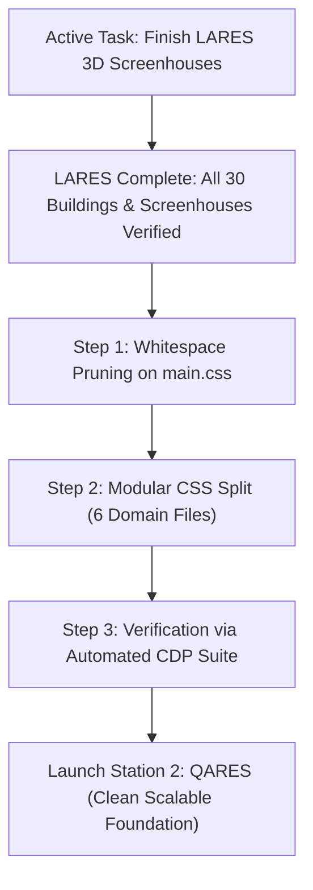

# CSS Architecture & Modularization Roadmap

**Project:** DA-LARES & Multi-Station Interactive Campus Wayfinding & Kiosk System  
**Document Status:** Approved Architectural Strategy  
**Created:** October 2026  
**Execution Milestone:** Post-LARES Completion (Pre-Station 2 / QARES Deployment)

---

## 1. Executive Summary & Forensic Health Check

As the system expands from **DA-LARES (Lipa City)** to multiple Department of Agriculture research stations across Region IV-A (such as **QARES in Tiaong, Quezon**), the frontend stylesheet requires an architectural transition from a monolithic legacy file to a **modular, domain-driven CSS architecture**.

### 📊 Current Forensic Metrics (`css/main.css`):

| Metric | Value Before Cleanup | Current Value (Post-Pruning) | Target State | Health Status |
| :--- | :--- | :--- | :--- | :--- |
| **Total Lines** | 18,783 lines | **9,785 lines** (-47.9%) | $\approx 3,000\text{ lines}$ (across modules) | 🟢 Cleaned (Step 1 Complete) |
| **Blank Lines** | 10,190 lines (54.3%) | **1,192 lines (12.1%)** | $< 10\%$ | 🟢 Normalized standard spacing |
| **Active CSS Content** | 8,593 lines | **8,593 lines** (100% preserved) | Segmented into 6 domain files | ⚠️ All features bundled into one file |
| **File Size** | $235.3\text{ KB}$ | **$226.3\text{ KB}$** | $< 180\text{ KB}$ total | 🟢 Optimized local delivery |
| **Station Coupling** | 0 station selectors | **0 station selectors** | Modular / Shared Shell | ✅ Shared kiosk UI components |

---

## 2. Why the CSS Works Now (The Good News)

1. **Shared UI Shell Paradigm:**
   The interface components—portrait touch kiosk sidebar, facility search bar, category dropdown, right-side details drawer, turn-by-turn navigation HUD, compass, speed selector pill, and camera widgets—are **application shell components**. They are 100% shared across LARES and future stations.
2. **GPU Canvas Offloading:**
   All 3D architectural models (`models/*.glb`), agricultural field boundaries, drone orthomosaics, and terrain layers are rendered directly on the GPU via WebGL (Mapbox GL JS + Three.js). Changing stations switches data and models, not CSS rules.
3. **Local Kiosk Caching:**
   In production (touch totem Linux/Chrome kiosk), `css/main.css` is downloaded once and cached in memory.

---

## 3. Why It Must Be Refactored for Future Stations (Technical Debt)

1. **The "Kitchen Sink" Monolith:**
   Kiosk desktop layout, responsive mobile bottom sheets (`.phone-*`), visitor wayfinding cards, admin polygon editors (`plot_draw.html`), and drone calibration overlays are currently compiled into a single file in chronological order rather than domain structure.
2. **Specificity & Cascade Override Collisions:**
   With 18,000+ lines, styles written late in the project conflict with earlier base styles. Overriding styles often requires high-specificity chains or `!important` flags (e.g., anchoring the Mapbox watermark and meters).
3. **Admin Styles in Public Visitor Kiosk:**
   Visitor touch kiosks and mobile phones load ~600 lines of developer/admin styles (`#drone-cal-panel`, `#fps-badge`, polygon edit handles) that are never used by general visitors.
4. **Developer Ergonomics:**
   Navigating an 18,000-line file with 10,000 blank lines slows down inspections and makes station-specific enhancements prone to regression.

---

## 4. Target Architecture: Domain-Driven Modular CSS

The target architecture replaces the monolithic file with clean, decoupled stylesheets in `css/`:

```text
css/
├── variables.css          # Design tokens (colors, gradients, glassmorphism, z-index, safe areas)
├── base.css               # Reset, box-sizing, touch-action, typography, custom scrollbars
├── kiosk.css              # Desktop kiosk totem layout (sidebar, search, filter dropdown, directory)
├── building-panel.css     # Right-side details drawer, sub-plot chips, hero cross-fade, lightbox
├── navigation.css         # Live turn-by-turn banner, A* path casing, route step list, speed controls
├── phone.css              # Mobile responsive sheet, touch drag handle, compact controls
├── admin.css              # Drone calibration, polygon drawing tools, FPS HUD (loaded when ?admin=1)
└── main.css               # Master orchestrator (@import or bundled entry point)
```

### Module Breakdown & Responsibilities:

#### 1. `css/variables.css` ($\approx 120\text{ lines}$)
* CSS Custom Properties: `--primary-green`, `--accent-cyan`, `--glass-bg`, `--panel-width: 420px`.
* Z-index hierarchy definitions (`--z-map: 1`, `--z-hud: 10`, `--z-drawer: 20`, `--z-modal: 50`).
* Safe-area padding tokens for mobile notch/home indicators.

#### 2. `css/base.css` ($\approx 250\text{ lines}$)
* Universal reset, HTML/body viewport locks (`overflow: hidden; touch-action: pan-x pan-y`).
* Typography utilities and font smoothing.
* Global utility classes (e.g. `.hidden`, `.glass-panel`).

#### 3. `css/kiosk.css` ($\approx 1,200\text{ lines}$)
* Kiosk sidebar container (`.sidebar`), header logo, station dropdown flyout menu.
* Search input row, search suggestions, and facility type filter dropdown.
* Directory items (`.dir-item`), facility category badges, and office search highlights.

#### 4. `css/building-panel.css` ($\approx 950\text{ lines}$)
* Right-side slide-out details panel (`.building-panel`, `width: 420px`).
* **Hero Image Controller:** `.bp-image-wrapper`, `.bp-image-overlay-vignette`, `.bp-image-badge`, `.bp-image-expand-hint`.
* **Multi-View Switcher:** `.bp-image-views-bar`, `.bp-view-chip`.
* Wayfinding cards (`HOW TO SPOT IT`, `WHAT'S INSIDE`), office pills, and QR code handoff card.

#### 5. `css/navigation.css` ($\approx 900\text{ lines}$)
* Top center live turn-by-turn instruction banner (`.turn-banner`).
* Step-by-step route directions container and arrival summary card.
* Floating speed control pills (`1x`, `2x`, `3x`), compass widget, and camera mode toggle.
* Spotlight beacon HUD marker (`.spotlight-beacon`, `.spotlight-hud-badge`).

#### 6. `css/phone.css` ($\approx 1,400\text{ lines}$)
* Mobile bottom sheet drawer (`.phone-sheet`, `snap-half`, `snap-full`).
* Mobile search header, phone directory list, and quick category chips.
* Touch gesture handles, mobile route banner, and phone lightbox view.

#### 7. `css/admin.css` ($\approx 600\text{ lines}$)
* Drone Calibration UI (`#drone-cal-panel`, coordinate nudgers, opacity sliders).
* Polygon drawing tool styles (`plot_draw.html`, vertex control points, edge guidelines).
* FPS performance badge (`#fps-badge`).
* *Conditional Loading:* Only injected into the DOM when `?admin=1` or `localStorage.da_admin_mode === 'true'`.

---

## 5. Rollout Strategy & Execution Timeline



### Execution Rules:
1. **Zero Disruption During LARES Modeling:**
   Do NOT execute the modular CSS split while authentic 3D modeling for LARES screenhouses is actively in progress.
2. **Immediate Whitespace Prune Permitted Anytime:**
   Removing the 10,000 blank lines from `main.css` can be executed in seconds with zero visual regression risk.
3. **Formal Split Point:**
   Execute the domain split immediately after the final LARES screenhouse model is exported, registered, and verified, serving as the official architectural handoff to **Station 2 (QARES)**.
