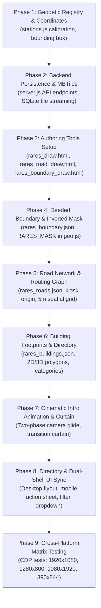

# DA-RARES (Tanay, Rizal) Implementation Plan
## Rizal Agricultural Research and Experiment Station — DASH Campus Integration

**Document Version:** 1.0.0  
**Target Station:** DA-RARES (Brgy. Cuyambay, Tanay, Rizal)  
**Standardized Protocol:** Based on [station-onboarding](../.agents/skills/station-onboarding/SKILL.md)  
**Target Delivery Date:** Q4 2026  

---

## 🏛️ Station Profile & Overview
- **Station Name:** DA-RARES
- **Full Legal Name:** Rizal Agricultural Research and Experiment Station
- **Jurisdiction:** Department of Agriculture Regional Field Office IV-A (CALABARZON)
- **Geographic Setting:** Upland mountainous agricultural terrain located in Brgy. Cuyambay, Tanay, Rizal (along the scenic Marilaque / Marikina-Infanta Highway in the Sierra Madre mountain range).
- **Mandate & Core Research Focus:** Upland rice varieties, high-value upland crops, organic farming systems, agroforestry, honeybee / apiculture research, upland coffee and root crop breeding.

---

## 🎯 Implementation Roadmap Overview

---

## 📋 Detailed Phase Breakdown

### **Phase 1: Geodetic Anchors, Coordinate Calibration & Station Registry**
- **File:** `js/data/stations.js`
- **Objectives:**
  1. Calibrate ground-truth center coordinates for the RARES Cuyambay compound.
  2. Define strict geographic bounding box (`bounds: [[sw_lng, sw_lat], [ne_lng, ne_lat]]`) to frame the upland research facility.
  3. Determine the station's signature 3D viewing perspective:
     - `defaultPitch`: $52^\circ$ (reveals mountain contours and building heights).
     - `defaultBearing`: Oriented along the main compound entry axis.
  4. Establish totem kiosk coordinates (`kioskCoords: [lng, lat]`).
  5. Define cinematic intro altitudes: `introStartZoom: 16.8` (high Sierra Madre overview) and `introTarget2DZoom: 19.5` (pin-point entrance zoom).

---

### **Phase 2: Backend Persistence & Offline Drone Tile Server**
- **File:** `server.js`
- **Objectives:**
  1. Add RARES REST endpoints:
     - `GET /api/rares/pin` and `POST /api/rares/pin` (with `rares_pin.json` fallback).
     - `GET /api/rares/roads` and `POST /api/rares/roads` (with automated timestamped backups in `backups/`).
     - `GET /api/rares/buildings` and `POST /api/rares/buildings` (with automated backups).
     - `GET /api/rares/boundary` and `POST /api/rares/boundary`.
  2. Register `RARES v1.mbtiles` offline drone imagery in `server.js` tile stream handler (`handleStationTileRequest('rares', req, res)`).
  3. Wire fallback to transparent $1\times 1$ PNG for out-of-bounds tile requests.

---

### **Phase 3: Browser Authoring Tools Setup**
- **Files:** `rares_draw.html`, `rares_road_draw.html`, `rares_boundary_draw.html`
- **Objectives:**
  1. Deploy standalone interactive authoring pages configured with Mapbox Draw v1.4.3.
  2. Pre-center map views directly on `STATIONS.rares.center`.
  3. Wire direct AJAX saves to the Phase 2 backend endpoints.

---

### **Phase 4: Official Deeded Boundary & Inverted World Mask**
- **Files:** `rares_boundary.json` & `js/data/geo.js`
- **Objectives:**
  1. Survey / digitize the deeded perimeter of DA-RARES in Tanay.
  2. Construct `RARES_MASK` in `js/data/geo.js` (outer world square with reverse-wound interior RARES parcel holes).
  3. Wire unconditional layer isolation in `js/stations.js` (`rares-mask-layer`), ensuring zero bleed or layer collision with LARES/QARES.

---

### **Phase 5: Road Network Graph & Station-Aware Routing**
- **Files:** `rares_roads.json` & `js/routing.js`
- **Objectives:**
  1. Map all compound primary driveways, pedestrian walking trails, and building entrance approach spurs.
  2. Connect entrance nodes (`features[].properties.type === 'entrance'`) directly to building footprints.
  3. Wire `js/routing.js` to initialize `state.raresRoadGraph` using the 5-meter Spatial Hash Grid.
  4. Enforce `origin = STATIONS.rares.kioskCoords` to strictly prevent cross-province route calculation bugs.

---

### **Phase 6: Building Footprint Geometry & Facility Directory**
- **Files:** `rares_buildings.json` & `js/data/buildings.js`
- **Objectives:**
  1. Digitize authentic 2D building footprints with heights ($Z$-extrusion values).
  2. Number facilities systematically according to official station directory records.
  3. Map facilities across official DASH categories:
     - `infrastructure` (Admin building, guard outpost, storage warehouse, utility shed).
     - `laboratory` (Upland crop diagnostic lab, soil/seed testing).
     - `trial_sites` (Upland rice terraces, agroforestry demonstration plots, apiculture apiary).
     - `conference` (Farmers' training center, multi-purpose pavilion, dormitories).
  4. Follow AGENTS.md Rule 6 strictly: **Zero invented offices or speculative room assignments.**

---

### **Phase 7: Cinematic Signature Intro Fly-in Animation & Curtain Synchronization**
- **Files:** `js/map-setup.js` & `js/stations.js`
- **Objectives:**
  1. Implement station switch curtain sequence:
     - Step 1: Dark transition curtain fades in (`.station-transition-curtain.active`).
     - Step 2: Camera bounds relaxed (`map.setMaxBounds(null)`).
     - Step 3: Camera teleports behind curtain to `introStartZoom`.
     - Step 4: Curtain fades out ($260\text{ms} + 120\text{ms}$).
  2. Execute two-phase intro animation:
     - Phase 1: High birds-eye glide to `STATIONS.rares.kioskCoords`.
     - Phase 2: Dynamic pitch-up into $52^\circ$ 3D mountain perspective.

---

### **Phase 8: Directory, Filtering & Dual-Shell UI Synchronization**
- **Files:** `index.html`, `js/sidebar.js`, `js/phone-ui.js`
- **Objectives:**
  1. Synchronize desktop sidebar station dropdown (`#station-dropdown-flyout`) to show `DA-RARES` with active badge upon selection.
  2. Synchronize mobile station modal sheet (`.phone-station-modal-sheet`) with RARES card, thumbnail icon, and description.
  3. Verify Type Filter dropdown correctly isolates RARES facilities by category.

---

### **Phase 9: Quality Gates & Automated Cross-Platform Matrix Testing**
- **Script:** `scratch/verify_rares_matrix.py`
- **Objectives:**
  1. Run automated headless Chrome CDP test suite across all 4 display targets:
     - **Landscape Full HD ($1920 \times 1080$):** Desktop Kiosk shell, sidebar, drawer, and 3D terrain canvas.
     - **Landscape Laptop ($1280 \times 800$):** Compact web layout, search, and category filter.
     - **Portrait Touch Kiosk Totem ($1080 \times 1920$):** Bottom touch panel, $28\text{px}$ border radius, touch targets $\ge 44\text{px}$.
     - **Mobile Web Smartphone ($390 \times 844$):** 3-snap bottom sheet (`peek`, `half`, `full`), top station pill, right rail stack.
  2. Confirm 0 console runtime errors, 0 network 404s, and 100% visual parity.

