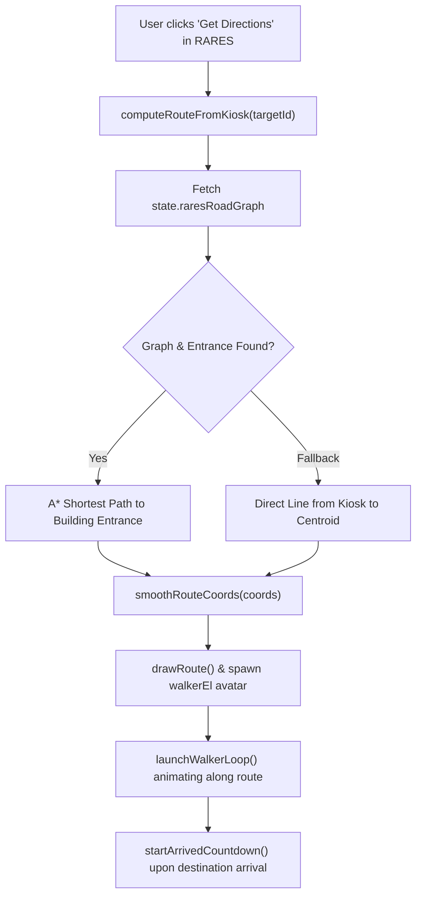
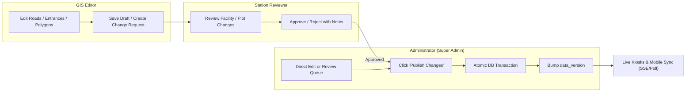
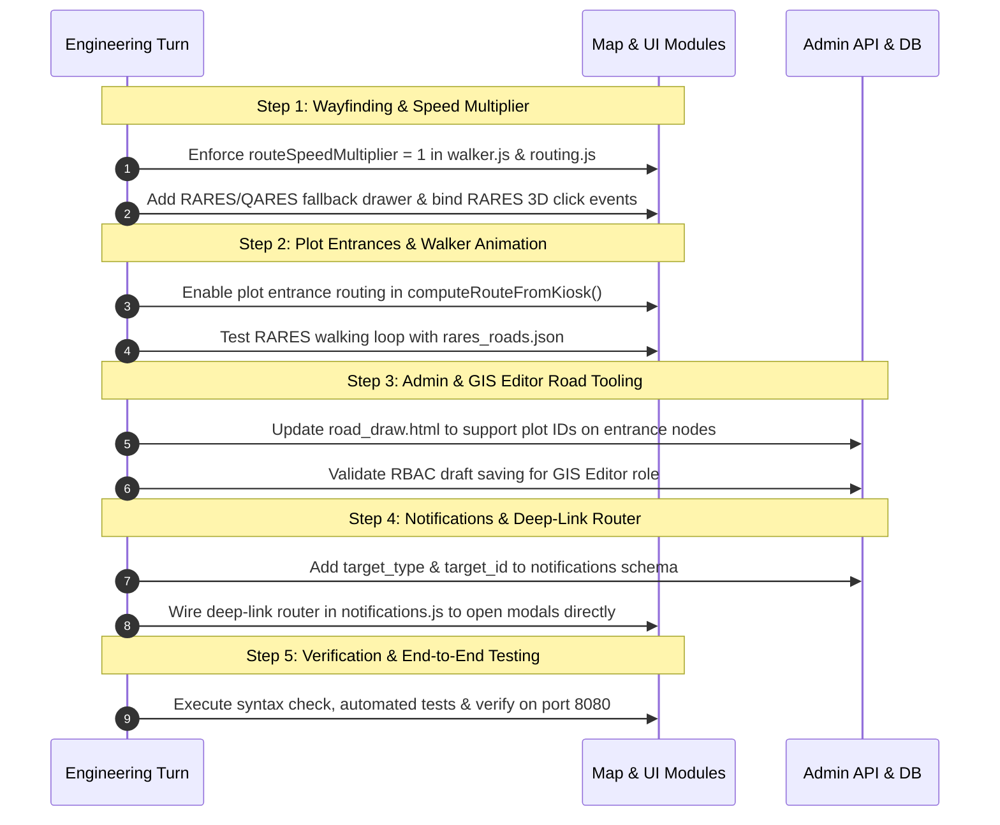

# Specification & Implementation Blueprint: Multi-Station Wayfinding, Walker Integration, Road Editor & Portal Workflow

**Project:** DA-CALABARZON iGUIDE (*Interactive Geospatial Unified Information Directory and Explorer*)  
**Scope:** DA-LARES, DA-QARES, DA-RARES, DA-CARES  
**Target Environments:** Portrait Touch Kiosk (`index.html`), Mobile Phone Web, Admin & GIS Editor Portal (`admin.html`)  
**Document Status:** Ready for Execution  

---

## 📋 Executive Summary of Directives

| # | Directive & Requirement | Affected Modules | Target Behavior |
| :--- | :--- | :--- | :--- |
| **1** | **QARES & RARES Menu Fallback** | `js/building-panel.js`<br>`js/phone-ui.js`<br>`js/stations.js`<br>`js/data/buildings.js` | Clicking any facility (map or directory) in QARES/RARES displays the building drawer even with zero baseline description. Shows title, number, empty/clean placeholder description, and an active **"Get Directions"** button. |
| **2** | **RARES Walking Model (Walker)** | `js/routing.js`<br>`js/walker.js`<br>`js/stations.js`<br>`rares_roads.json` | Animate the 3D claymation farmer avatar along the verified `rares_roads.json` network starting from the RARES Kiosk totem (`[121.34054, 14.57644]`). |
| **3** | **Always Start at $1\times$ Speed** | `js/walker.js`<br>`js/routing.js`<br>`css/main.css` | Pressing **"Get Directions"** immediately resets walking speed to $1\times$ (`routeSpeedMultiplier = 1`), updating UI speed pills and animation timing. |
| **4** | **GIS Editor & Super Admin Road/Entrance Tooling (Plot Entrances)** | `road_draw.html`<br>`js/routing.js`<br>`js/building-panel.js`<br>`roads.json` | Support adding entrance nodes for **Agricultural Plots** (`zone_*` / `plot_*`). Remove hardcoded plot navigation blockers in `getDirections()` when a valid entrance exists. |
| **5** | **Multi-Role Save & Admin Publish Workflow** | `database/admin_api.js`<br>`database/publish_engine.js`<br>`database/rbac.js`<br>`js/portal/*.js` | End-to-end verification of drafting/saving across all roles (`gis_editor`, `reviewer`, `administrator`) and atomic live publishing with zero reload kiosk synchronization. |
| **6** | **Role-Based Notifications & Deep Linking** | `database/admin_api.js`<br>`js/portal/notifications.js`<br>`admin.html` | Bell notification click router: redirects directly to the specific concern (e.g. opens Change Request modal, focuses edited building row) while general updates simply mark as read. |

---

## 🏛️ Section 1: QARES & RARES Universal Building Menu & Directions

### 1.1 Problem Statement & Root Cause
- Currently, `getBuildingById(buildingId)` in `js/data/buildings.js` filters QARES features with `cat === 'Buildings'`. Any feature under other categories (`infrastructure`, `laboratory`, etc.) returns `null`.
- In RARES, `js/stations.js` only sets map click listeners for QARES (`qares-footprints-3d`); RARES 3D footprints lack click bindings (`bindRARESBuildingEvents`).
- If a building has no detailed entry in `BUILDING_WAYFINDING_INFO`, descriptions can collapse or drawer actions may be hidden.

### 1.2 Required Engineering Changes

#### A. Comprehensive Resolver in `js/data/buildings.js`
Ensure `getBuildingById(buildingId)` seamlessly returns a valid structure for any facility ID across all stations:
```javascript
// Universal fallback object structure
return {
    id: p.id || buildingId,
    name: p.name || `Facility ${num}`,
    desc: p.description || p.desc || '', // Clean empty string or minimal subtitle
    num: num,
    color: p.color || (isRares ? '#10b981' : '#38bdf8'),
    coords: centerCoords,
    section: isRares ? 'Tanay Compound' : (isQares ? 'Tiaong Compound' : 'Lipa Compound'),
    type: p.type || 'Facility',
    category: p.category || 'infrastructure',
    facility_status: p.facility_status || 'Existing',
    image: p.image || '',
    images: Array.isArray(p.images) ? p.images : [],
    isQARES: isQares,
    isRARES: isRares
};
```

#### B. Full Click Binding for RARES in `js/stations.js`
Implement `bindRARESBuildingEvents()` matching `bindQARESBuildingEvents()`:
- Bind clicks on `rares-footprints-3d` and `rares-buildings-extrusion`.
- Trigger `window.navigateTo(feature.properties.id)`.

#### C. Unconditional Action Buttons in `js/building-panel.js` & `js/phone-ui.js`
- Ensure `.bp-actions` (containing **"Get Directions"**) and `.phone-bldg-actions-inline` are **always visible** (`display: flex`) for all QARES and RARES facilities.
- Suppress office cards gracefully without breaking layout when no offices exist (`display: none` for `#bp-offices-card`).

---

## 🚶 Section 2: RARES Walking Model (Walker) & Road Network

### 2.1 Current State
- `rares_roads.json` is already present and loaded in `state.raresRoadGraph` via `buildRoadGraph(roadData)`.
- The RARES Kiosk coordinate is defined at `[121.34054, 14.57644]`.
- The walker claymation animation loop (`launchWalkerLoop` in `js/routing.js`) is station-agnostic, but needs verification that `findShortestPath` generates smooth interpolated coordinates for RARES road segments.

### 2.2 Integration Plan



### 2.3 Verification Checklist for RARES Walker:
1. Verify `rares_roads.json` nodes connect cleanly to all 49 RARES building footprints.
2. In `js/routing.js`, verify `computeRouteFromKiosk` uses `state.RARES_KIOSK_COORDS` when `state.currentStationId === 'rares'`.
3. Ensure `walkerEl` avatar renders correctly on the 3D terrain/orthophoto without clipping below the plane.

---

## ⚡ Section 3: Force $1\times$ Speed Reset on "Get Directions"

### 3.1 Requirement
Every time the user triggers navigation (whether starting a new route, replaying a route, or opening a new destination), the walking avatar **must start at $1\times$ speed** ($1.2\text{ m/s}$ walking velocity). It must never carry over a previously selected $2\times$ or $4\times$ multiplier.

### 3.2 Implementation Touchpoints

#### A. In `js/routing.js` (`getDirections()` and `replayRoute()`):
```javascript
export function getDirections() {
    // Reset walker speed strictly to 1x at the start of any new route
    if (typeof setRouteSpeed === 'function') {
        setRouteSpeed(1);
    }
    // ... continue route calculation and drawing
}
```

#### B. In `js/walker.js` (`setRouteSpeed(multiplier)`):
Ensure default state initializes to 1:
```javascript
let routeSpeedMultiplier = 1; // Default to 1x
```
Update all speed pills in the DOM:
```javascript
export function resetRouteSpeedToDefault() {
    setRouteSpeed(1);
}
```

---

## 🛣️ Section 4: GIS Editor / Super Admin Road Tooling & Plot Entrances

### 4.1 Requirement
- The GIS Editor and Super Admin must be able to edit `roads.json` for DA-LARES and assign entrance nodes not only to standard buildings, but also to **Agricultural Plots** (`zone_coffee_orchard`, `zone_citrus_orchard`, `plot_1`, etc.).
- The system must route visitors directly to the plot's dedicated entrance gate/path rather than blocking route calculation.

### 4.2 Removing Hardcoded Plot Routing Blockers

In `js/routing.js` (`getDirections()`):
```javascript
// BEFORE (Blocked all plot routing):
// if (typeof FIELD_COMMODITY_ZONES !== 'undefined' && FIELD_COMMODITY_ZONES.some(z => z.id === targetId)) return;

// AFTER (Check if road graph has an entrance for this plot):
const plotEntrances = (BUILDING_ENTRANCES && BUILDING_ENTRANCES[targetId]) || [];
const hasEntranceNode = plotEntrances.length > 0 || hasRoadGraphEntrance(targetId);

// Allow navigation to plots if an entrance node exists or if selected directly
```

### 4.3 Enhancements to `road_draw.html`
- Expand the **Entrance Assignment Dropdown** in `road_draw.html` to include both:
  1. `BUILDING_DIRECTORY` (Buildings 1–32)
  2. `FIELD_COMMODITY_ZONES` (Zones 1–23 & Plots 1–45)
- Allow assigning `properties.type = "entrance"` and `properties.buildingId = "<zone_id>"` with visual plot tag colors.

---

## 💾 Section 5: Multi-Role Save & Admin Publish Pipeline

### 5.1 Role Capabilities Matrix



### 5.2 Verification Tasks for Roles:
1. **GIS Editor (`gis_editor`):**
   - Save road graph changes (`POST /api/roads/draft` or `/api/change-requests`).
   - Validate that unauthorized direct publish is blocked (HTTP 403).
2. **Station Reviewer (`reviewer`):**
   - Access station-specific review tab in `admin.html`.
   - Approve, deny, or request changes on pending items.
3. **Administrator (`administrator`):**
   - Execute **Publish Live** via `publish_engine.js`.
   - Verify transaction commits to MySQL and bumps `settings.data_version`.
   - Confirm active kiosks detect version bump and seamlessly update without reloading or resetting active kiosk users.

---

## 🔔 Section 6: Notification Engine & Deep-Link Navigation

### 6.1 Requirement
When users click the notification bell in the portal:
1. Notifications are grouped by role and station.
2. Clicking a specific notification must **redirect and deep-link** directly to the concern:
   - **Change Request notification:** Switch to Review tab and open the specific Change Request inspection modal (`openChangeRequestModal(id)`).
   - **Facility edit notification:** Switch to Buildings tab and select/highlight the target building row.
   - **User sign-up approval notification:** Switch to Users tab and open the user approval modal.
   - **General system broadcast / version update:** Mark as read without changing tabs.

### 6.2 Data Model Enhancement (`database/admin_api.js`)
Ensure `notifications` table payloads include deep-link target metadata:
```json
{
  "id": 1042,
  "title": "New Change Request #88",
  "message": "GIS Editor added 3 new plot entrances for Citrus Orchard",
  "station_id": "lares",
  "link_tab": "reviews",
  "target_type": "change_request",
  "target_id": "88",
  "is_read": 0
}
```

### 6.3 Deep-Link Router in `js/portal/notifications.js`
Enhance `handleNotificationClick(btn)`:
```javascript
async function handleNotificationClick(btn) {
    const id = btn.dataset.notifId;
    const linkTab = btn.dataset.linkTab;
    const station = btn.dataset.station;
    const targetType = btn.dataset.targetType;
    const targetId = btn.dataset.targetId;

    // 1. Mark as read
    try {
        await apiFetch(`/api/notifications/${id}/read`, { method: 'POST', body: '{}' });
    } catch (_) {}

    // 2. Dismiss dropdown and refresh count
    document.getElementById('notif-popover')?.classList.remove('open');
    await refreshNotifications();

    // 3. Deep-link routing
    if (targetType === 'system_update') {
        return; // General announcement: stay on current view
    }

    if (typeof onNavigateCallback === 'function') {
        onNavigateCallback({
            tabId: linkTab,
            stationId: station,
            targetType: targetType,
            targetId: targetId
        });
    }
}
```

---

## 🛠️ Step-by-Step Implementation Sequence



---

## ✅ Verification & Quality Assurance Plan

| Verification Task | Method | Expected Result |
| :--- | :--- | :--- |
| **QARES & RARES Menu** | Click facility in directory or 3D footprint in RARES/QARES | Drawer opens showing Name, Badge, Empty description, and visible "Get Directions" button. |
| **Speed Reset** | Set speed to $4\times$, stop route, click "Get Directions" on any building | Speed resets immediately to $1\times$; $1\times$ pill active; avatar walks at normal pace. |
| **RARES Walker** | Select building in RARES and click "Get Directions" | Claymation farmer avatar animates from RARES Kiosk along `rares_roads.json` to the building. |
| **Plot Entrances** | Add entrance node with `buildingId: "zone_citrus_orchard"` in road editor | Navigation draws path from Kiosk to the plot entrance and routes the walker. |
| **Role-Based Save** | Log in as `gis_editor` and save changes | Change Request created successfully; status is `pending_review`. |
| **Admin Publish** | Log in as `administrator` and click "Publish" | Changes commit to DB, `settings.data_version` increments, live map updates without reload. |
| **Notification Deep-Link** | Click notification for a pending Change Request | Switches tab to Reviews and immediately opens the inspection modal for that specific CR. |

---

*Authored for the DA-CALABARZON iGUIDE Engineering Workspace.*  
*Maintained under `docs/SPEC_STATIONS_WALKER_PORTAL_ROADMAP.md`.*

