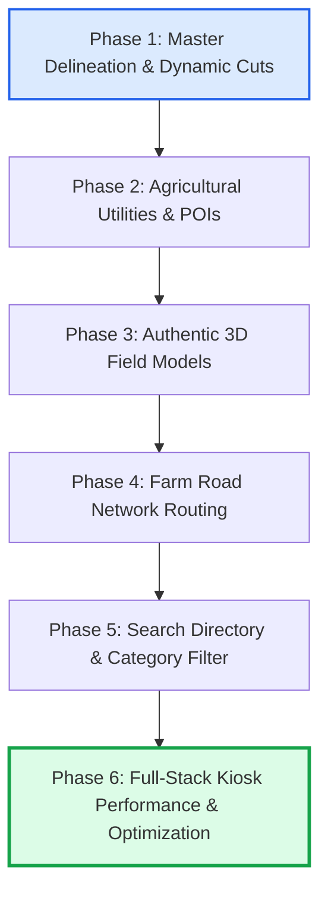

# DA-LARES Agricultural Field Plot Master Plan

**Comprehensive Phased Implementation & Architecture Guide**  
*Department of Agriculture - Lipa Agricultural Research and Experiment Station (DA-LARES), Lipa City, Batangas*

---

## Executive Summary

This strategic plan establishes the architecture and phased roadmap for integrating the **45 calibrated agricultural research plots** across the eastern 70% of the DA-LARES compound into the interactive 3D kiosk and wayfinding system.

### 🌟 Core Directives:
1. **The Clean Pin Strategy (Zero Sky Clutter):**  
   At the default kiosk overview camera angle ($52^\circ$ pitch looking across the compound), the sky and building skyline remain **100% uncluttered**. Floating text bubbles for field plots are hidden by default, while the translucent colored field washes stay cleanly seated on the drone terrain furrows. Labels illuminate **strictly on demand** (hover, tap/click, close zoom $\ge 17.8$, or search).
2. **True Combined Polygons (Zero Mid-Lines on Overview):**  
   Multi-plot blocks (e.g., *Citrus Orchard Plots 6–12*, *Corn Research Plots 39–41*, *Vegetable Derby Plots 3–5*) render as **single, unified, solid rectangles with zero internal lines** in the idle overview. Only when a block is clicked/selected do its internal partition cuts dynamically illuminate, revealing individual sub-plot boundaries.
3. **Dedicated Post-Phase Optimization Pass (Phase 6):**  
   Following the completion of functional features (delineation, POIs, 3D field models, road routing, search), a full-stack graphics, memory, and CPU optimization pass ensures sustained **60 FPS** performance on low-spec hardware (Raspberry Pi touch kiosks and mobile devices).

---

## 🏛️ Campus vs. Agricultural Field Spatial Division

```
┌─────────────────────────────────────────────────────────────────────────────────┐
│                           DA-LARES INTERACTIVE MAP                              │
├───────────────────────────────────────┬─────────────────────────────────────────┤
│           CAMPUS ZONE (30%)           │         AGRICULTURAL ZONE (70%)         │
│       (West Entrance to Road 30)      │       (Pili & Eucalyptus Drives)        │
├───────────────────────────────────────┼─────────────────────────────────────────┤
│ • 29 Permanent Buildings & Facilities │ • 45 Calibrated Agricultural Sub-Plots  │
│ • White numbered badge container (#1–29)│ • Grouped into 22 Clean Master Zones    │
│ • Royal blue marker theme             │ • Single unified outer rectangles       │
│ • Indoor offices & floor plans        │ • Zero internal lines on overview       │
│ • 3D Architectural GLTF Models        │ • Dynamic sub-plot cuts revealed on tap │
│ • Pedestrian walkway routing          │ • Clean pin strategy (Zero sky clutter) │
│ • Primary destination for visitors    │ • Primary destination for researchers   │
└───────────────────────────────────────┴─────────────────────────────────────────┘
```

---

## 🎨 Visual Behavior: Overview vs. Selected State

### 1. Overview State (Default / Idle)
- **Zero Sky Clutter:** No floating text badges occlude the 3D building rooftops (*Tissue Culture*, *RSBSA*, *Motorpool*, *Admin*).
- **True Combined Outer Polygons:** Contiguous multi-plot blocks form seamless, unbroken rectangles with zero lines in the middle.
- **Drone Alignment:** The translucent commodity color fills (15% opacity) highlight the crop zones while leaving drone orthomosaic furrows, tree canopies, and soil beds 100% visible.

```
┌─────────────────────────────────────────────────────────────────────────────────┐
│                                                                                 │
│                          🍊 Citrus Orchard (Plots 6–12)                         │
│            [Single seamless outer rectangle — Zero internal lines]              │
│                                                                                 │
└─────────────────────────────────────────────────────────────────────────────────┘
```

### 2. Selected State (Upon Tap / Click / Search)
- **Border Illumination:** The outer boundary illuminates with a crisp, high-contrast neon casing ($3.8\text{ px}$).
- **Dynamic Sub-Plot Cuts:** The interior dividing lines (`plots-internal-cuts`) animate from `opacity: 0.0` to `opacity: 0.85`, showing the exact boundaries of Plot 6, 7, 8, 9, 10, 11, and 12.
- **Commodity Badge:** The interactive label badge activates with quick-action buttons: `[Directions]`, `[Details]`, and `[Sub-Plots]`.
- **Slide-Out Details Drawer:** The bottom/side panel opens displaying:
  - Master Zone Title, Icon, Acreage, and Overview description.
  - Interactive **Sub-Plot Breakdown List** (e.g., Plot 8: Agro-Meteorological Station; Plot 7: Calamansi Clonal Block).
  - Tapping an individual sub-plot smoothly zooms the camera into that sub-plot partition.

```
╔═════════════════════════════════════════════════════════════════════════════════╗
║   Plot 6 (Sprinkler)   │   Plot 7 (Calamansi)   │   Plot 8 (AWS Met Station)    ║
║────────────────────────┼────────────────────────┼───────────────────────────────║
║   Plot 9 (Mandarin)    │   Plot 10 (IPM Block)  │   Plots 11–12 (Varietal)      ║
╚═════════════════════════════════════════════════════════════════════════════════╝
```

---

## 🗂️ Data Architecture (`js/data/plots.js`)

### 1. Master Group Structure
Every multi-plot agricultural area is stored with:
1. `groupPolygon`: The 4 outer bounding corners defining the combined rectangle (zero internal cuts).
2. `subPlots`: Array of individual calibrated plots with their specific names, crops, and micro-polygons.

```javascript
// js/data/plots.js
export const FIELD_COMMODITY_ZONES = [
    {
        id: 'zone_citrus_orchard',
        name: 'Citrus Orchard',
        plotRange: 'Plots 6–12',
        category: 'orchard',
        icon: '🍊',
        color: '#f97316',
        centerCoords: [121.16894, 13.96035],
        areaSqm: '14,250 m²',
        description: 'Center for citrus germplasm conservation, Calamansi clonal evaluation, Agro-Meteorological Station (AWS), and micro-sprinkler irrigation along Pili Drive.',
        
        // Single unified outer rectangle (zero internal mid-lines)
        groupPolygon: [
            [121.16801, 13.96042],
            [121.17013, 13.96116],
            [121.17040, 13.96045],
            [121.16828, 13.95973],
            [121.16801, 13.96042]
        ],

        // Sub-plots illuminated ONLY upon selection
        subPlots: [
            { plotNum: 6, name: 'Plot 6 - Sprinkler Irrigation Block', crop: 'Citrus Germplasm', details: 'Automated overhead/micro sprinkler test bed', polygon: [...] },
            { plotNum: 7, name: 'Plot 7 - Calamansi Clonal Block', crop: 'Philippine Calamansi', details: 'High-density clonal evaluation and selection orchard', polygon: [...] },
            { plotNum: 8, name: 'Plot 8 - Agro-Meteorological Station', crop: 'AWS Weather Mast', details: 'Houses AWS weather mast, rain gauge, and solar sensors', polygon: [...] },
            { plotNum: 9, name: 'Plot 9 - Mandarin & Orange Orchard', crop: 'Mandarin & Sweet Orange', details: 'Long-term citrus scion and rootstock trial orchard', polygon: [...] },
            { plotNum: 10, name: 'Plot 10 - Citrus IPM Research', crop: 'Citrus Varietal Collection', details: 'Fruit fly management and integrated pest management block', polygon: [...] },
            { plotNum: 11, name: 'Plot 11 - Citrus Horticultural Plot', crop: 'Mixed Citrus Accessions', details: 'Horticultural training and rootstock testing plot along Pili Drive', polygon: [...] },
            { plotNum: 12, name: 'Plot 12 - Citrus Field Irrigation Plot', crop: 'Citrus Germplasm', details: 'Irrigated varietal block with Pili Drive water line connection', polygon: [...] }
        ]
    }
    // ... all 22 master zones
];
```

### 2. Mapbox GeoJSON Layer Pipeline (`js/plot-layers.js`)

```javascript
// 1. Unified Group Outer Fill (Continuous solid polygon wash)
map.addLayer({
    id: 'plots-group-fill',
    type: 'fill',
    source: 'plots-group-source',
    paint: {
        'fill-color': ['get', 'color'],
        'fill-opacity': [
            'case',
            ['boolean', ['feature-state', 'selected'], false], 0.35,
            ['boolean', ['feature-state', 'hover'], false], 0.25,
            0.15 // Subtle wash; ground furrows remain 100% visible
        ]
    }
});

// 2. Seamless Perimeter Casing (Full outer rectangle with ZERO middle lines)
map.addLayer({
    id: 'plots-group-casing',
    type: 'line',
    source: 'plots-group-source',
    paint: {
        'line-color': ['get', 'color'],
        'line-width': [
            'case',
            ['boolean', ['feature-state', 'selected'], false], 3.8,
            ['boolean', ['feature-state', 'hover'], false], 2.8,
            1.8
        ],
        'line-opacity': 0.95
    }
});

// 3. Internal Sub-Plot Cuts (100% invisible on overview; illuminated ONLY on click!)
map.addLayer({
    id: 'plots-internal-cuts',
    type: 'line',
    source: 'plots-cuts-source',
    paint: {
        'line-color': '#ffffff',
        'line-dasharray': [2, 2],
        'line-width': 2.0,
        'line-opacity': [
            'case',
            ['boolean', ['feature-state', 'selected'], false], 0.90, // Visible on click
            0.0 // 100% INVISIBLE in overview state (Zero mid-lines!)
        ]
    }
});
```

---

## 🗺️ Master Zone Catalog (22 Commodity Blocks)

| Zone ID | Plot Range | Commodity Name | Category | Color | Key Research Focus / Facility |
| :--- | :--- | :--- | :--- | :--- | :--- |
| `zone_coffee_derby` | Plots 1–2 | Coffee Production & Technology Derby | Coffee / Plantation | `#8b5cf6` | High-density Arabica & Robusta technology demo |
| `zone_vegetable_derby` | Plots 3–5 | Vegetable Technology Derby | Vegetables / Annual | `#10b981` | Commercial open-pollinated & hybrid vegetable trials |
| `zone_citrus_orchard` | Plots 6–12 | Citrus Orchard & Germplasm | Orchard / Fruit | `#f97316` | Calamansi clonal, AWS Met Station, micro-sprinklers |
| `zone_organic_agriculture` | Plots 13–14 | Organic Agriculture Research Area | Organic Research | `#059669` | Bio-fertilizer, organic pest control & composting |
| `zone_sorghum_production` | Plot 15 | Sorghum Production Area | Grains / Biofuel | `#eab308` | Drought-resilient grain & forage crop trials |
| `zone_sweet_sorghum` | Plot 16 | Sweet Sorghum Research Plot | Grains / Biofuel | `#ca8a04` | Sugar extraction & biofuel feedstock studies |
| `zone_cassava_germplasm_w` | Plot 17 | Cassava Germplasm (West Block) | Root Crops / Tubers | `#d97706` | Industrial starch & high-yield table varieties |
| `zone_cassava_germplasm_e` | Plot 18 | Cassava Germplasm (East Block) | Root Crops / Tubers | `#b45309` | Disease-resistant clone multiplication nursery |
| `zone_sweet_potato_germplasm` | Plot 19 | Sweet Potato Germplasm Collection | Root Crops / Tubers | `#ea580c` | Nutritional bio-fortification & root development |
| `zone_coffee_propagation` | Plots 20–22 | Coffee Clonal Garden & Nursery | Nursery / Trees | `#7c3aed` | Clonal mother bushes, elevated water tower & CR |
| `zone_mango_orchard_s` | Plots 23–25 | Mango Orchard (South Block) | Orchard / Fruit | `#eab308` | Carabao mango varietal orchard & field shelter |
| `zone_fruit_sorghum_citrus` | Plots 26–28 | Fruit Trees, Surghum & Citrus | Mixed Agroforestry | `#84cc16` | Diversified multi-tier fruit & sorghum trials |
| `zone_tall_makapuno` | Plot 29 | Tall Makapuno Coconut Orchard | Coconut / Palms | `#14b8a6` | High-value embryo-cultured makapuno genetics |
| `zone_commercial_cacao` | Plots 30–32 | Commercial Cacao Agroforestry | Cacao / Agroforestry | `#6366f1` | Shade-grown Trinitario & Criollo clone canopy |
| `zone_scion_grove_cacao` | Plots 33–35 | Scion Grove Cacao Clonal Nursery | Nursery / Germplasm | `#4f46e5` | Certified grafting scion source & budwood garden |
| `zone_screenhouses` | Plot 36 | High-Value Crops Screenhouse Complex | Protected Cropping | `#ec4899` | Insect-proof tunnel houses for virus-free seeds |
| `zone_screenhouse_annex` | Plots 37–38 | Screenhouse Trial Annex | Protected Cropping | `#db2777` | Supplemental covered beds & field rest shelter |
| `zone_corn_research` | Plots 39–41 | Corn Research & Varietal Trials | Grains / Cereals | `#facc15` | Hybrid yellow corn, OPV, and drought endurance |
| `zone_glutinous_flint_corn` | Plot 42 | Glutinous & Flint Corn Selection | Grains / Cereals | `#eab308` | Native white flint & food-grade sticky corn |
| `zone_cacao_propagation_shed` | Plot 43 | Cacao Propagation & Potting Shed | Infrastructure / Shed | `#64748b` | Soil potting shed, root trainer racks, shading net |
| `zone_mango_orchard_n` | Plots 44–45 | Mango Orchard (North Perimeter Block) | Orchard / Fruit | `#ca8a04` | Mature fruiting mangoes along northern perimeter |

---

## 🚀 Phased Implementation Roadmap



### 📍 Phase 1: Clean Master Delineation & Dynamic Sub-Plot Cuts
- **True Merged Geometry:** In `js/data/plots.js`, compute and export the single seamless outer perimeter bounding rectangle for all 11 grouped multi-plot blocks.
- **Hidden Mid-Lines on Overview:** Internal cut lines configured with `opacity: 0.0` in the idle state; zero middle lines rendered.
- **Dynamic Selection Illumination:** When tapped, the outer perimeter illuminates with neon casing and internal cuts smoothly fade to `opacity: 0.85`.
- **Clean Pin LOD System:** Hide floating text markers at campus overview zoom ($< 17.8$); reveal pins on demand via hover, click, search, or close zoom.

### 📍 Phase 2: Agricultural Utilities & Infrastructure POIs
- Register physical field utilities documented in the 2019 master plan:
  - **Agro-Meteorological Station (AWS)** mast on Plot 8.
  - **Elevated Concrete Water Tower & Field Restroom** on Plot 22.
  - **Bahay Kubo Field Shelters** on Plots 25 and 37.
  - **Irrigation Deep-Well Manifolds & Water Taps** along Pili Drive & Eucalyptus Drive.
- Interactive POI markers with custom SVG icons (weather mast, water drop, shelter).

### 📍 Phase 3: Authentic 3D Field Models
- Bespoke lightweight Blender GLB models strictly under the $300\text{ KB}$ budget (Rule 4 compliant: structure only, no extraneous terrain turf):
  - `aws_weather_station.glb` ($\sim 95\text{ KB}$) — Solar sensor mast, anemometer, rain gauge, enclosure box.
  - `water_tower_facility.glb` ($\sim 130\text{ KB}$) — Concrete stilts, cylindrical tank, access ladder, attached utility shed.
  - `screenhouse_tunnel.glb` ($\sim 120\text{ KB}$) — Galvanized arched pipe frame, fine white insect mesh, entry airlock.
  - Bahay Kubo field shelters (reusing `exit_guard_house_1.glb`, $164\text{ KB}$).

### 📍 Phase 4: Farm Road Network Routing
- Incorporate ground-truth agricultural avenues into `roads.json` and `js/pathfinding.js`:
  - **Pili Drive:** Central East-West paved/gravel corridor.
  - **Eucalyptus Drive:** Southern compound avenue.
  - **Tall Makapuno + Cacao Road:** North-South connector linking Pili Drive to Mango Orchard.
- Enable full A* turn-by-turn pedestrian and vehicular routing from the Argosino Hall kiosk to any designated research plot or orchard.

### 📍 Phase 5: Search Directory & Category Filter
- Segmented category switch in the sidebar directory:
  - **`[ 🏛️ Campus Buildings ]`** — Highlights 29 compound facilities; dims agricultural fields.
  - **`[ 🌾 Agricultural Plots ]`** — Highlights 22 research commodity blocks; dims building models.
  - **`[ 🌐 All Locations ]`** — Displays unified overview.
- Fuzzy search indexing for crop names (*Calamansi*, *Trinitario Cacao*, *Makapuno*, *Yellow Corn*, *Robusta Coffee*).

---

## ⚡ Phase 6: Full-Stack Kiosk Performance & Hardware Optimization

A dedicated performance pass executed after functional completion, ensuring continuous **60 FPS** on Raspberry Pi touch kiosk totems and mobile browsers:

### 1. Geometry & Draw Call Batching
- **Unified GeoJSON Data Buffers:** Merge outer group polygons, cut lines, and utility points into static, consolidated Mapbox GeoJSON sources to avoid multi-layer GPU redraw overhead.
- **Zero-Allocation State Updates:** Utilize Mapbox GL `setFeatureState` instead of pushing updated GeoJSON strings across the JS bridge on hover or selection.

### 2. DOM Marker Virtualization
- **Viewport & Frustum Culling:** When looking across the compound, markers outside the camera frustum or occluded behind terrain/buildings are assigned `display: none`.
- **Zero-CPU Idle Footprint:** Marker CSS transforms are applied via hardware-accelerated `translate3d(x, y, 0)` with `will-change: transform`.

### 3. MBTiles Raster Tile Memory Throttling
- **Hardware-Tier Adaptive Tile Caching:**
  - Low-spec devices (Raspberry Pi / mobile): `maxTileCacheSize: 40`.
  - Desktop / High-spec: `maxTileCacheSize: 80`.
- Eliminates memory leaks and out-of-memory browser tab crashes during 24/7 continuous kiosk operation.

### 4. 60 FPS Frame Lock on Touch Kiosks & Mobile
- **Passive Event Listeners:** Enforce `{ passive: true }` on all touch, wheel, and gesture event listeners.
- **Throttled Camera Calculations:** Restrict camera pitch and bearing calculations during kinetic scroll to `requestAnimationFrame` cycles, eliminating micro-stutters.

### 5. Memory Leak Protection & Attractor Reset
- **Three.js Garbage Collection:** Explicitly dispose of GLTF geometries, textures, and shader materials when switching view modes.
- **Session Idle Reset:** Auto-reset after 90 seconds of inactivity back to the "You Are Here" Argosino kiosk overview, resetting memory pools and route animations cleanly.

---

## 🔬 Verification & Quality Assurance Checklist

| Checkpoint | Target Behavior | Pass Criteria |
| :--- | :--- | :--- |
| **Skyline Cleanliness** | Kiosk overview camera ($52^\circ$ pitch) | Zero floating plot pins cluttering building roofs; campus skyline 100% clean |
| **Combined Outer Polygons** | Idle state inspection of Plots 6–12, 39–41, etc. | Single continuous rectangle per block; ZERO lines in the middle |
| **Selection Activation** | Tap *Citrus Orchard* on the map | Outer boundary glows; internal cut lines smoothly animate to 85% opacity |
| **Sub-Plot Breakdown** | Details drawer inspection | Displays complete sub-plot list (Plots 6–12) with respective crops & irrigation details |
| **Direct Sub-Plot Zoom** | Tap *Plot 8 (AWS)* in the drawer list | Camera smoothly flies and frames directly into Plot 8's partition |
| **Kiosk Performance** | Continuous navigation on hardware totem | Solid 60 FPS rendering, zero frame drops, stable memory footprint |
