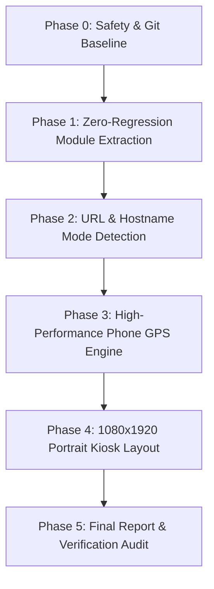
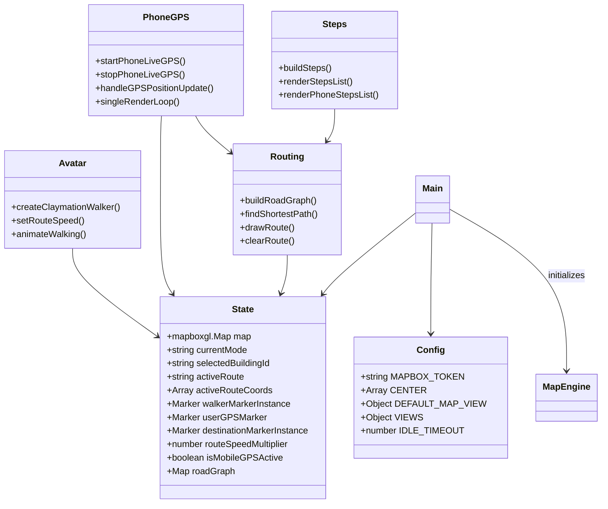

# DA-LARES Wayfinding Architecture & Refactor Plan

This document outlines the detailed execution strategy for modularizing the DA-LARES interactive 3D wayfinding system, optimizing its mobile GPS navigation performance, and implementing the dedicated 1080×1920 portrait kiosk layout.

---

## 1. Goal Description

The current application is contained within a monolithic, 9,288-line [`index.html`](index.html) file (~458 KB) comprising:
- **~3,860 lines of inline CSS styles**
- **~460 lines of HTML markup**
- **~4,940 lines of inline JavaScript**, including raw GeoJSON datasets, state management, pathfinding graph algorithms, Mapbox WebGL rendering, mobile GPS tracking, and claymation animations.

The goal is to refactor this codebase in **strict sequential phases** without changing any behavior or visual presentation during the refactor phases (Phases 1 and 2), followed by a dedicated high-performance optimization of the phone GPS loop (Phase 3), and a specialized standing portrait kiosk layout (Phase 4).



---

## 2. User Review Required

> [!IMPORTANT]
> **No Bundlers / Native ES Modules**: In Phase 1, code is split into native ES modules (`<script type="module">`). Modern desktop and mobile browsers support ES modules out-of-the-box. Mapbox GL JS and Turf.js remain global script tags.
>
> **Event Delegation Architecture**: Inline HTML event handlers like `onclick="navigateTo('...')"` cannot access scoped functions in ES modules without leaking to `window`. We will transition inline handlers to structured event delegation using `data-action`, `data-building-id`, and `data-speed` attributes on containers, maintaining identical behavior.
>
> **Phase Stops**: Per instructions, work will proceed strictly phase-by-phase. Each phase will be implemented, verified via browser testing and automated checks, committed to Git with a clear message, and reported to the user before proceeding to the next phase.

---

## 3. Open Questions & Design Decisions

1. **Static File Serving**: [`server.js`](server.js) already serves `__dirname` with `express.static(__dirname, { etag: false, maxAge: 0 })`. New subdirectories (`/data/`, `/styles/`, `/js/`) will be immediately accessible with zero backend changes.
2. **Backups Preservation**: All existing backup files (`index_backup_*.html`, `server_backup_*.js`) will be preserved untouched.
3. **Mode Decision Logic**:
   - `?mode=kiosk` or `localhost` / `127.0.0.1` $\rightarrow$ **Kiosk Mode** (`body.mode-kiosk`)
   - `?mode=phone` or external hostname / Cloudflare tunnel $\rightarrow$ **Phone Mode** (`body.mode-phone`)
   - Decided strictly **once on initial load** and never toggled on resize or orientation flip.

---

## 4. Phase-by-Phase Proposed Changes



---

### PHASE 0: SAFETY & BASELINE COMMIT

#### [NEW] [`.gitignore`](.gitignore)
Create `.gitignore` to protect node modules, logs, and binaries:
```gitignore
node_modules/
cloudflared.exe
*.log
npm-debug.log*
.DS_Store
Thumbs.db
```

#### Git Initialization
Run `git init`, stage all project files (including existing backups), and create the baseline commit:
`git commit -m "chore: baseline repository state before refactor"`

---

### PHASE 1: SPLIT index.html INTO MODULES (NO BEHAVIOR CHANGE)

#### Step 1.1: Extract Data Constants
Extract static geometry and catalog data out of `index.html`:
- [NEW] [`data/buildings.js`](data/buildings.js): `LARES_DRAWINGS` (QGIS 3D building polygons, properties, heights)
- [NEW] [`data/mask.js`](data/mask.js): `DA_LARES_OUTER_PERIMETER`, `LARES_MASK`, `LARES_COMPOUND_OUTLINE`
- [NEW] [`data/trees.js`](data/trees.js): `LARES_TREES` GeoJSON
- [NEW] [`data/boundary.js`](data/boundary.js): `LARES_BOUNDARY`, `SECTION_COLORS`, `SECTION_PASTEL_COLORS`
- [NEW] [`data/directory.js`](data/directory.js): `BUILDING_DIRECTORY`, `KNOWN_BUILDING_NAMES`, `CUSTOM_BUILDING_CENTERS`, building photos array

#### Step 1.2: Extract CSS Stylesheets
Extract ~3,860 lines of CSS from `<style>` tags into modular stylesheets under `styles/`:
- [NEW] [`styles/base.css`](styles/base.css): CSS reset, font imports (`Inter`), CSS variables (`--primary`, `--safe-top`), map canvas layout, toast alerts.
- [NEW] [`styles/kiosk.css`](styles/kiosk.css): Left glass sidebar, search bar, directory items, building information panel, floating camera control toolbar.
- [NEW] [`styles/phone.css`](styles/phone.css): Draggable bottom sheet (`peek`, `half`, `full`), top turn-by-turn navigation HUD, GPS permission prompt banner, mobile recenter floating action button.
- [NEW] [`styles/components.css`](styles/components.css): Map markers (building badges, section labels, entrance arrows, destination flags, kiosk pin), color picker modal, photo mosaic and lightbox, QR code handoff card.
- [NEW] [`styles/avatar.css`](styles/avatar.css): `.route-walker-avatar`, claymation stepped keyframes (`steps(4)`/`steps(6)`), squash-and-stretch torso, chunky limbs, contact shadow, dust clouds `💨`, speed lines `⚡`, speed classes (`1x`, `2x`, `4x`, `6x`).

#### Step 1.3: Extract JavaScript Modules
Extract the ~4,940 lines of JavaScript into dedicated single-responsibility ES modules:

1. [NEW] [`js/config.js`](js/config.js):
   - Access token, center coordinates, default camera presets (`DEFAULT_MAP_VIEW`, `VIEWS`, `INTRO_START_VIEW`), `IDLE_TIMEOUT`.
2. [NEW] [`js/state.js`](js/state.js):
   - Central mutable reactive state container:
     ```javascript
     export const state = {
         map: null,
         mapReady: false,
         currentMode: 'kiosk', // 'kiosk' | 'phone'
         selectedBuildingId: null,
         activeRoute: null,
         activeRouteCoords: null,
         activeFullRouteCoords: null,
         currentRouteSteps: null,
         currentRouteDestName: '',
         routeSpeedMultiplier: 2,
         routeCameraMode: 'follow',
         walkerMarkerInstance: null,
         destinationMarkerInstance: null,
         kioskMarkerInstance: null,
         userGPSMarker: null,
         isMobileGPSActive: false,
         isUserFollowingGPS: true,
         roadGraph: new Map(),
         ROAD_NETWORK: null,
         kioskCoords: [121.16646567620313, 13.958189696041458],
         savedBuildingColors: {}
     };
     ```
3. [NEW] [`js/api.js`](js/api.js):
   - REST API requests: `fetchKioskPin()`, `saveKioskPin(coords)`, `fetchTunnelUrl()`, `fetchBuildingColors()`, `fetchRoadNetwork()`.
4. [NEW] [`js/map.js`](js/map.js):
   - Mapbox instance initialization, raster satellite source, vector building 3D extrusions, boundary masking, section polygon fills, terrain toggle, Mapbox standard style transitions.
5. [NEW] [`js/markers.js`](js/markers.js):
   - 3D building labels creation, collision detection, route corridor label decluttering (`declutterLabelsForRoute()`, `restoreLabels()`), entrance arrow markers.
6. [NEW] [`js/routing.js`](js/routing.js):
   - Graph builder `buildRoadGraph()`, Dijkstra implementation `findShortestPath()`, route computation `computeRouteFromKiosk()`, route layers (`route-glow`, `route-casing`, `route-line`, `route-traveled-line`), `drawRoute()`, `clearRoute()`.
7. [NEW] [`js/steps.js`](js/steps.js):
   - `buildSteps()` calculating bearing delta angles, turn-by-turn banner update, step list DOM rendering (`renderStepsList()`, `renderPhoneStepsList()`).
8. [NEW] [`js/avatar.js`](js/avatar.js):
   - Claymation avatar DOM and SVG generation, `setRouteSpeed(multiplier)`, screen-relative facing flip logic (`map.project()`), stepped animation control, arrival celebration hop and idle states.
9. [NEW] [`js/kiosk-ui.js`](js/kiosk-ui.js):
   - Sidebar directory rendering, live search filter, building info panel (`showBuildingPanel()`), category filter chips, settings chips (trees, buildings, numbers, boundary), QR handoff card generator.
10. [NEW] [`js/kiosk-camera.js`](js/kiosk-camera.js):
    - Camera toolbar modes (`follow`, `3D`, `2D`, `free`), orbit animation around selected building, 45s idle screensaver attractor loop.
11. [NEW] [`js/phone-sheet.js`](js/phone-sheet.js):
    - Draggable bottom sheet snap transitions (`peek`, `half`, `full`), phone building details form, photo gallery mosaic and lightbox, phone directory search.
12. [NEW] [`js/phone-gps.js`](js/phone-gps.js):
    - Device orientation compass sensor binding, flashlight beam cone, GPS permission banner handlers, initial GPS watch registration.
13. [NEW] [`js/admin.js`](js/admin.js):
    - "You Are Here" kiosk pin unlocking and drag-and-drop relocation with MySQL persistence, custom building color picker eyedropper and saving.
14. [NEW] [`js/main.js`](js/main.js):
    - Central initialization point, event delegation listeners (replacing inline `onclick` attributes), URL query parameter router (`?dest=...`).

#### Step 1.4: Refactor index.html
- [MODIFY] [`index.html`](index.html):
  - Replace `<style>` block with `<link rel="stylesheet">` tags pointing to `styles/*.css`.
  - Replace inline `onclick="..."` with `data-action="..."` attributes.
  - Replace monolithic `<script>` block with `<script type="module" src="js/main.js"></script>`.

---

### PHASE 2: URL & HOSTNAME MODE DETECTION

#### Specification:
1. Mode is determined **once on initial document load**:
   ```javascript
   export function detectMode() {
       const params = new URLSearchParams(window.location.search);
       const forcedMode = params.get('mode');
       if (forcedMode === 'kiosk' || forcedMode === 'phone') {
           return forcedMode;
       }
       const host = window.location.hostname;
       if (host === 'localhost' || host === '127.0.0.1') {
           return 'kiosk';
       }
       return 'phone';
   }
   ```
2. Set mode class on `<body>`:
   ```javascript
   document.body.classList.add(currentMode === 'kiosk' ? 'mode-kiosk' : 'mode-phone');
   ```
3. Update CSS:
   - Change media queries `@media (max-width: 768px)` to `body.mode-phone` selectors.
   - Change desktop queries `@media (min-width: 769px)` to `body.mode-kiosk` selectors.
   - Result: A mobile device rotated into landscape orientation **stays in phone mode**, keeping the active GPS tracking and bottom sheet without breaking.
4. Update launch scripts:
   - [MODIFY] [`start_kiosk.bat`](start_kiosk.bat): change URLs to `http://localhost:8080/?mode=kiosk`.
   - [MODIFY] [`start_kiosk_silent.vbs`](start_kiosk_silent.vbs): verify argument pass-through.

---

### PHASE 3: HIGH-PERFORMANCE PHONE GPS ENGINE

#### 3.1 Unified 60fps Render Loop (`requestAnimationFrame`)
- Eliminate multiple conflicting glide intervals and `map.panTo()` calls.
- GPS fixes push to a target state queue `{ targetLngLat, targetHeading, accuracy, timestamp, speed }`.
- A single `requestAnimationFrame` loop computes exponential smoothing:
  $$P_{frame} = P_{prev} + (P_{target} - P_{prev}) \times (1 - e^{-\Delta t / \tau})$$
  (where $\tau \approx 180\text{ ms}$).
- When speed $> 0.5\text{ m/s}$ and fix age $< 3\text{ s}$, extrapolate ahead via dead-reckoning.
- In the same frame: update marker position and call `map.jumpTo({ center: P_frame })` synchronously.

#### 3.2 Accuracy-Weighted Noise Filter
- Implement an accuracy-weighted Kalman filter: trust high-accuracy fixes ($\le 5\text{m}$) immediately; heavily smooth or damp noisy fixes ($> 20\text{m}$).
- Reject impossible jump velocities ($> 40\text{ m/s} = 144\text{ km/h}$).

#### 3.3 Optimized Active-Route Snapping
- When navigation along a route is active: **snap exclusively to the active route polyline**, never searching the wider 50+ segment campus road network.
- Windowed search: test only candidate segments in the immediate neighborhood (3 segments behind, 10 ahead of last match).
- Hysteresis: remain snapped until user exceeds $20\text{m}$ distance; require $< 10\text{m}$ proximity to re-snap.
- Calculate perpendicular projection once per fix and share across marker, line trimming, and turn-by-turn evaluation.

#### 3.4 Monotonic Progress & DOM Throttling
- Distance along route is strictly non-decreasing (permitting max $3\text{m}$ backward jitter).
- DOM step updates fire only when the active instruction index or rounded meter distance changes.
- Throttle GeoJSON line-trimming `map.getSource('route-source').setData(...)` to max once per $500\text{ms}$ and only if moved $> 1\text{m}$.

#### 3.5 Graphics & CPU Optimization
- Replace high-cost `backdrop-filter: blur(16px)` on mobile bottom sheet and HUD with GPU-efficient `rgba(15, 23, 42, 0.96)`.
- Skip coords/zoom badge DOM mutations during map camera movements on phones.

#### 3.6 Screen Wake Lock
- Integrate Screen Wake Lock API:
  ```javascript
  let wakeLock = null;
  async function acquireWakeLock() {
      try {
          if ('wakeLock' in navigator) wakeLock = await navigator.wakeLock.request('screen');
      } catch (err) {}
  }
  ```
- Acquire lock on navigation start; release on arrival or cancel; re-acquire on `visibilitychange`.

#### 3.7 Diagnostic HUD Overlay (`?debug=1`)
- Render a lightweight diagnostic overlay showing:
  - GPS Fix Age (ms)
  - Raw vs Snapped Accuracy (m)
  - Current Speed (km/h) & Heading
  - Live Rendering Frame Rate (FPS)

---

### PHASE 4: PORTRAIT KIOSK LAYOUT (1080×1920)

#### Visual Layout Structure:
For 1080×1920 standing physical screens:
- **Top 58% of viewport**: 3D Mapbox WebGL viewport with 3D buildings, route polyline, and claymation character.
- **Bottom 42% of viewport**: Dedicated static information and navigation console (`#kiosk-portrait-dock`).
  - **Browsing State**: Prominent search bar, category chips, large-card building directory.
  - **Navigating State**: Large destination header, prominent upcoming step card, speed buttons (`1x`, `2x`, `4x`, `6x`), Repeat, Cancel, and prominent "Take with Me" QR code modal button.
- **Top Turn-by-Turn Banner**: Positioned comfortably below top margin without obstructing Mapbox compass or attribution controls.
- **Vertical Camera Toolbar**: Compact vertical control stack on the right map margin; automatically dims after 5 seconds of inactivity.
- **Readability & Ergonomics**:
  - Touch targets $\ge 64\text{px}$ for accessibility.
  - Body typography $\ge 22\text{px}$; step instructions $\ge 32\text{px}$.
  - Landscape mode (1920×1080) automatically retains the classic floating glass left sidebar as fallback.

---

### PHASE 5: FINAL REPORT & AUDIT

- Comprehensive log of all generated files, architecture dependency graph, and audit of edge-case behaviors.
- FPS and fix age benchmarking before and after Phase 3.

---

## 5. Verification & Testing Plan

### Automated Syntax & Build Verification
```bash
# Verify JavaScript syntax across all extracted modules
node -e "
const fs = require('fs');
['js/config.js', 'js/state.js', 'js/api.js', 'js/map.js', 'js/markers.js', 'js/routing.js', 'js/steps.js', 'js/avatar.js', 'js/kiosk-ui.js', 'js/kiosk-camera.js', 'js/phone-sheet.js', 'js/phone-gps.js', 'js/admin.js', 'js/main.js'].forEach(file => {
  const code = fs.readFileSync(file, 'utf8');
  console.log('Testing', file);
  new Function('import', code.replace(/import\s+.*?from\s+['\"].*?['\"];?/g, '').replace(/export\s+.*?;?/g, ''));
});
console.log('All modules syntax OK');
"
```

### Manual Verification Matrix
1. **Phase 1 Verification**:
   - Open `http://localhost:8080/` in browser.
   - Verify zero console errors.
   - Test Kiosk flow: click building, click "Get Directions", watch claymation avatar walk along the green route with feet anchored to the line, verify idle animation at destination, test QR code modal.
   - Test Phone flow: open DevTools in mobile dimension, select building, test bottom sheet snap states (`peek`, `half`, `full`), test simulated route.
2. **Phase 2 Verification**:
   - Load `http://localhost:8080/?mode=kiosk`: verify `body.mode-kiosk`, sidebar is visible.
   - Load `http://localhost:8080/?mode=phone`: verify `body.mode-phone`, bottom sheet is visible even on desktop width.
   - Rotate phone view: verify mode does not switch.
3. **Phase 3 Verification**:
   - Activate DevTools Sensors (Geolocation override): simulate moving along campus roads.
   - Verify marker and camera move synchronously with zero rubber-banding or drift.
   - Verify `?debug=1` overlay shows FPS $\ge 30$ and fix latency $< 200\text{ms}$.
4. **Phase 4 Verification**:
   - Set browser dimensions to 1080×1920 portrait: verify 58/42 vertical split, large typography, browsing and navigating dock states.
   - Set browser dimensions to 1920×1080 landscape: verify smooth fallback to left sidebar.
