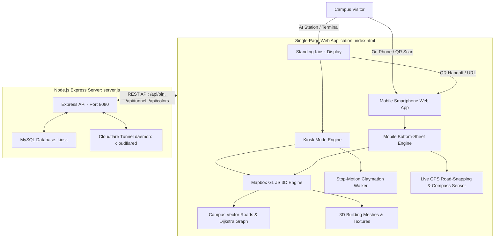
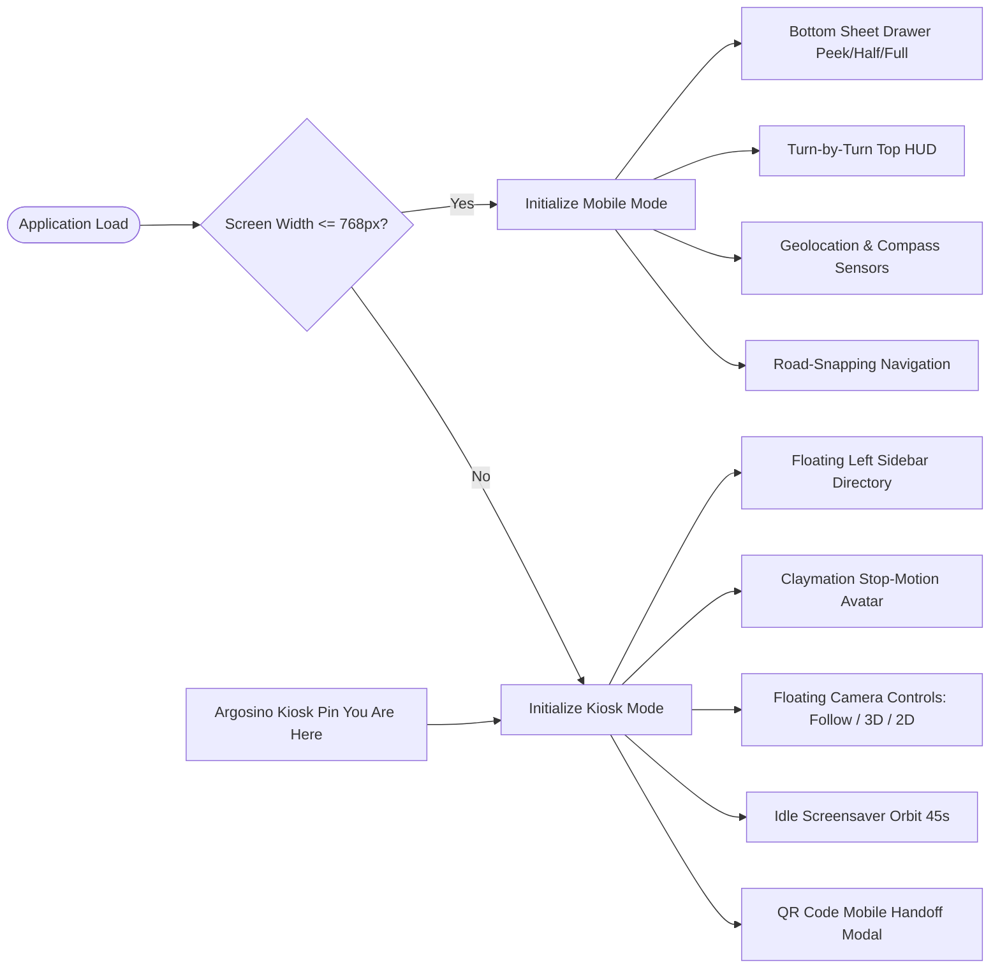
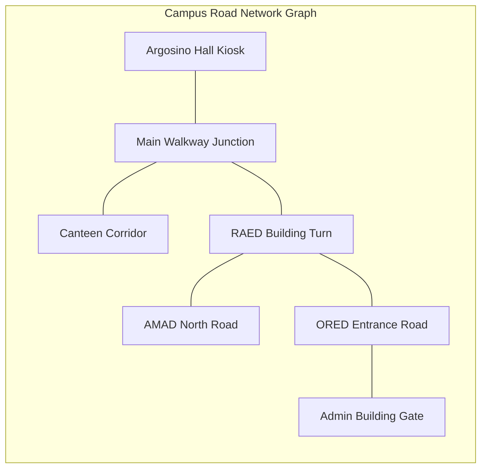
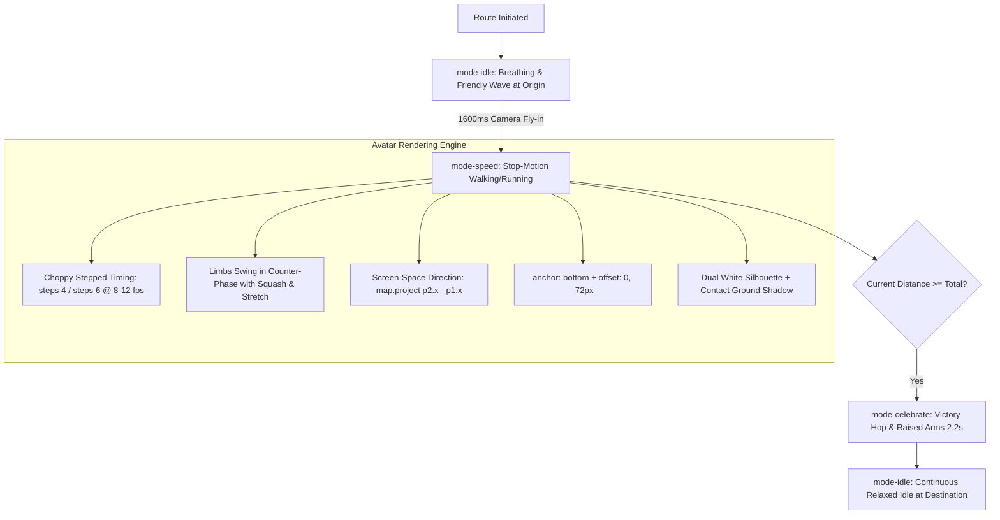
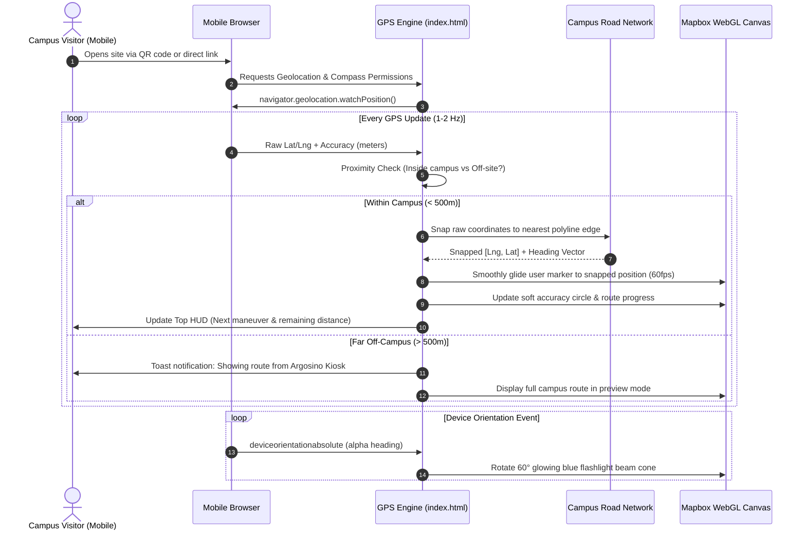
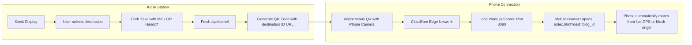

# DA-LARES Interactive 3D Campus Wayfinding System
## Comprehensive Architecture & Technical Specification Manual

---

### Executive Overview

The **DA-LARES Interactive 3D Wayfinding System** is an enterprise-grade digital campus navigation platform developed for the Department of Agriculture - Lowland Agricultural Research and Extension Station (DA-LARES) in Lipa City, Batangas.

The application operates as a **unified hybrid system**, serving two distinct operational form factors from a single responsive codebase:
1. **Interactive Standing Kiosk Mode**: Deployed on fixed physical touchscreens (such as the Argosino Hall lobby terminal) for on-site campus visitors. It provides 3D building exploration, automated simulated route walkthroughs powered by a stop-motion claymation avatar, camera choreography, and dynamic QR-code handoff.
2. **Mobile Smartphone GPS Navigation Mode**: Accessed by visitors on their own smartphones (either directly via the Cloudflare public web link or by scanning the kiosk’s QR code). It delivers an experience akin to Google Maps or Apple Maps, featuring live GPS road snapping, hardware compass orientation beams, and turn-by-turn audio-visual guidance.



---

## 1. System Architecture & Infrastructure

### 1.1 Technology Stack

| Layer | Technologies Used | Purpose |
|---|---|---|
| **Mapping & 3D WebGL** | Mapbox GL JS v3.31.0, Turf.js v6.5.0 | High-performance WebGL 3D terrain rendering, extrusion layers, vector road computations, line-slicing animations, spatial geometric calculations |
| **Imagery & Base Maps** | Google Satellite Tiles, Mapbox Standard 3D | Orthorectified high-resolution satellite basemap overlay with fallback 3D lighting terrain |
| **Frontend Framework** | Vanilla HTML5, CSS3, Modern ES6+ JavaScript | Zero-framework footprint; instant page load without bundle hydration lag; maximum 60fps rendering performance on kiosk hardware |
| **Styling & UI Tokens** | Custom Glassmorphism, Google Fonts (`Inter`), CSS Variables | Consistent theme tokens: `#22c55e` (DA green), `#38bdf8` (sky blue accent), `#0f172a` (slate dark backdrop) |
| **Backend Runtime** | Node.js (v18+), Express.js, `cors` | Lightweight asynchronous REST API server running on port `8080` |
| **Persistence** | MySQL 8.0 (`mysql2` pool) | Persistent storage for kiosk coordinates (`kiosk_pin`), building color themes, and active tunnel states |
| **Networking & Handoff** | Cloudflare Named / Quick Tunnels (`cloudflared`) | Encrypted, public HTTPS ingress allowing mobile phones to connect to the local server without port forwarding |

---

## 2. Dual-Mode Architecture

The application determines its operational profile dynamically via the `isPhoneMode()` predicate:

```javascript
function isPhoneMode() {
    return window.innerWidth <= 768;
}
```



### 2.1 Mode Comparison Matrix

| Feature | Standing Kiosk Mode | Smartphone Mobile Mode |
|---|---|---|
| **Screen Target** | 1080×1920 (Portrait) / 1920×1080 (Landscape) | 375×667 to 430×932 (iOS & Android) |
| **Primary Interaction** | Multi-touch stationary screen / Mouse | One-handed thumb reach gestures & touch swipe |
| **Directory Navigation** | Permanent left translucent glass sidebar with search & category pills | Multi-height gesture-snappable bottom sheet (`peek`, `half`, `full`) |
| **Route Visualization** | Simulated stop-motion animated claymation character traversing the path | Live user GPS position marker gliding along snapped road vectors |
| **Camera Choreography** | Follow walker camera, 3D orbiting camera, top-down 2D overview, Free Look | 45° perspective driving follow view with manual panning & recenter FAB |
| **Sensors Used** | None (Fixed coordinate reference) | W3C Geolocation API + DeviceOrientation compass sensor |
| **Idle Behavior** | After 45s of inactivity, auto-closes dialogs and enters continuous 3D campus flyover | Stays active; screen sleep managed by phone OS |
| **Connectivity** | Local LAN / Localhost | Public HTTPS via Cloudflare Tunnel |

---

## 3. Road Network Graph & Routing Engine

### 3.1 Geometric Vector Road Graph

All pedestrian and vehicular walkways within the DA-LARES compound are modeled as an undirected topological node-and-edge graph (`roadGraph`).
- **Nodes**: Exact intersection coordinates `[longitude, latitude]` on campus roads.
- **Edges**: Traversable path segments with weighted distances computed via Turf.js spherical distance (`turf.distance` using haversine formula).



### 3.2 Pathfinding Algorithm (Dijkstra)

When a destination is selected:
1. **Entrance Identification**: The system looks up the target building's `entrances` array. If multiple entrances exist, it computes the network distance to each and selects the nearest entrance node.
2. **Nearest Road Connector**: The origin (Kiosk coordinates or user's GPS position) is projected onto the nearest road segment to eliminate "flying over buildings."
3. **Shortest Path Computation**: The `findShortestPath(startCoord, endCoord, graph)` function executes Dijkstra's algorithm to resolve the optimal sequence of coordinates.
4. **Natural Turn-by-Turn Instruction Parsing**: The `buildSteps(coords, directory, destId)` function computes the bearing change between segments $\Delta \theta = \theta_{i+1} - \theta_i$:
   - $|\Delta \theta| < 25^\circ$: `"Continue straight"`
   - $25^\circ \le \Delta \theta < 120^\circ$: `"Turn right"` / `"Turn left"`
   - $\Delta \theta \ge 120^\circ$: `"Make a sharp turn"`
   - Final coordinate: `"Arrive at [Building Name]"`

---

## 4. Kiosk Mode: Features & Animation Pipeline

### 4.1 "You Are Here" Argosino Kiosk Pin

- Marked on the map with a glowing green pulse ring and label: `📍 You Are Here 🔒`.
- **Draggable Relocation**: Facility administrators can click the padlock icon to unlock the pin, drag it to any new installation spot on campus, and click save. The updated coordinates are saved immediately to MySQL via `POST /api/pin`.

### 4.2 Claymation Stop-Motion Avatar Engine

A central user-experience highlight of the kiosk navigation is the custom **Claymation Stop-Motion Walker/Runner Avatar**, replacing generic navigation arrows with a handmade aesthetic:



#### Avatar Construction Details:
1. **White Sticker Outline**: Uses `filter: drop-shadow(0 0 2.5px #ffffff) drop-shadow(0 0 1.2px #ffffff) drop-shadow(0 6px 12px rgba(0, 0, 0, 0.75))` for readability against dark satellite asphalt and green foliage.
2. **Ground Contact Shadow**: An animated `<ellipse class="clay-shadow">` sitting directly under the red shoes, scaling on each footfall.
3. **Pixel-Perfect Ground Alignment (`anchor: 'bottom', offset: [0, 0]`)**: The marker's bottom anchor places the contact shadow directly on the green route line on the ground plane, eliminating false vertical offsets in tilted 3D perspectives.
4. **Screen-Relative Facing**: Uses `map.project(current).x - map.project(prev).x` rather than map longitude differences, ensuring the sprite faces forward on screen even as the camera rotates.
5. **Speed Pacing**: User-selectable speed multipliers (`1x`, `2x`, `4x`, `6x`) alter step pacing and trigger dust clouds (`💨`) and speed lines (`⚡`) without overlaying text badges on the model.

### 4.3 3D Camera Modes

- **🚶 Follow Mode**: Camera tracks directly behind the moving avatar at `zoom: 20.2`, `pitch: 68°`, keeping the destination in view.
- **🧭 3D Mode**: 45° overhead isometric view of the campus corridor.
- **🗺️ 2D Mode**: Orthographic top-down plan view for campus overview.
- **🎯 Free Look**: Disengages auto-tracking, allowing visitors to pinch-zoom and rotate freely.

---

## 5. Mobile Smartphone Mode: GPS Navigation Engine



### 5.1 Road-Snapping Algorithm

Standard smartphone GPS exhibits 4–15 meters of noise, especially near building overhangs. To prevent the user position from jumping across walls:
1. The engine calculates the perpendicular projection of the GPS coordinate onto all nearby road polyline segments using `turf.pointToLineDistance`.
2. If the distance to the nearest road is within the capture threshold ($\le 25\text{ m}$), the marker coordinate is snapped to that segment.
3. If the user intentionally walks into an open lawn or field ($> 25\text{ m}$ away), snapping disengages smoothly, and a subtle dashed connector indicates the route back to the path.

### 5.2 Sensor Fusion: Compass Beam Cone

- Reads `deviceorientationabsolute` (or standard `deviceorientation` with iOS `webkitCompassHeading` support).
- Renders an SVG flashlight beam (`.user-gps-heading`) consisting of a 60-degree radial gradient fan cone pointing in the device's physical direction.

### 5.3 Mobile Bottom Sheet UX

Inspired by modern navigation systems, the bottom sheet (`#phone-bottom-sheet`) uses CSS touch-drag physics with 3 snap states:
- **`peek` (134px)**: Minimal bar showing remaining meters, arrival ETA, and emergency cancel/repeat buttons.
- **`half` (52% viewport)**: Shows primary building photo, department details, and quick maneuver list.
- **`full` (94% viewport)**: Expanded turn-by-turn step cards with icons and complete photo gallery.

---

## 6. QR Code Handoff & Cloudflare Ingress



### 6.1 Dynamic Tunnel Management

1. When `server.js` boots, it starts a child process running `cloudflared tunnel`.
2. The tunnel outputs a dynamic public HTTPS endpoint (e.g., `https://lunch-object-writer-stages.trycloudflare.com`).
3. This endpoint is parsed and stored in the MySQL database:
   ```sql
   INSERT INTO settings (`key`, `value`) VALUES ('tunnel_url', ?)
   ON DUPLICATE KEY UPDATE `value` = VALUES(`value`);
   ```
4. When the kiosk displays a QR code, it queries `/api/tunnel` and encodes:
   `https://<tunnel-url>/?dest=<selectedBuildingId>`
5. Any visitor scanning the code gets instant mobile access to the system with their chosen destination pre-loaded.

---

## 7. Data Models & Database Schemas

### 7.1 MySQL Tables (`kiosk` database)

#### `settings` Table
Stores operational runtime key-value configuration.

```sql
CREATE TABLE IF NOT EXISTS settings (
    `key` VARCHAR(255) PRIMARY KEY,
    `value` TEXT
);
```
- `kiosk_pin`: JSON array `[longitude, latitude]` defining the Argosino Hall physical kiosk anchor.
- `tunnel_url`: Active Cloudflare public ingress URL.
- `drawing_counter`: Internal vector revision counter.

#### `building_colors` Table
Enables dynamic thematic styling of building 3D meshes without modifying source code.

```sql
CREATE TABLE IF NOT EXISTS building_colors (
    building_id VARCHAR(255) PRIMARY KEY,
    roof_color VARCHAR(50),
    number_color VARCHAR(50)
);
```

### 7.2 Building Directory Schema (`BUILDING_DIRECTORY`)

Each campus facility is defined in `index.html` with the following structure:

```typescript
interface CampusBuilding {
    id: string;               // Unique slug, e.g. "bldg-ored"
    name: string;             // Human-readable title
    type: string;             // e.g. "Research / Office", "Laboratory"
    section: string;          // Campus section (e.g. "North Compound")
    color: string;            // Theme hex color for map pins & UI tags
    coords: [number, number]; // [Longitude, Latitude] center coordinate
    entrances: [number, number][]; // Snapping entrance coordinates on road
    desc: string;             // Overview of services & functions
    photos: string[];         // Image URLs for mobile gallery
}
```

---

## 8. Summary of File Structure

```
c:/Users/LGU-SanPedro/Downloads/map/
├── index.html                 # Complete Frontend Single-Page App (Kiosk + Phone)
│   ├── CSS Design System      # Dark glassmorphism, responsive queries, claymation keyframes
│   ├── Building Data Models   # 32+ DA-LARES buildings, entrances, colors, descriptions
│   ├── Vector Road Topology   # Graph nodes and interconnecting walkway edges
│   ├── Mapbox WebGL Engine    # Google Satellite raster tiles, 3D building extrusions
│   ├── Routing Subsystem      # Dijkstra pathfinder, line-slicer, turn-by-turn builder
│   ├── Kiosk Animation Engine # Claymation stop-motion avatar, camera follow, screensaver
│   └── Mobile GPS Engine      # Geolocation watch, road snapping, compass sensor, bottom-sheet
│
├── server.js                  # Backend API Server
│   ├── Express Router         # REST endpoints: /api/pin, /api/tunnel, /api/colors
│   ├── MySQL Pool Manager     # Connection pool and table initialization
│   └── Cloudflare Subprocess  # cloudflared daemon monitor & automatic URL publisher
│
├── package.json               # Node.js project manifest & dependencies
└── cloudflared.exe            # Cloudflare Tunnel binary for public HTTPS ingress
```

---

## 9. Operational Lifecycle & Maintenance

1. **Starting the Service**:
   Run `node server.js` from the workspace folder. This boots Express on `http://localhost:8080/`, confirms MySQL connectivity, and establishes the Cloudflare tunnel.
2. **Kiosk Launch**:
   Open Google Chrome in kiosk full-screen mode pointing to `http://localhost:8080/`:
   ```bash
   chrome.exe --kiosk http://localhost:8080/ --disable-pinch --overscroll-history-navigation=0
   ```
3. **Kiosk Pin Repositioning**:
   If the physical kiosk terminal is moved to another building lobby, simply click the `📍 You Are Here 🔒` badge on the map, unlock the pin, drag it to the new position, and confirm the prompt to update the database.
4. **Mobile Visitor Access**:
   Visitors scan the on-screen QR code from the kiosk or open the published station link. All road calculations, camera orientations, and GPS positions function automatically without requiring an app store download.
