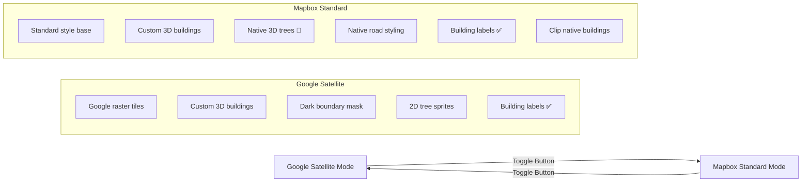

# Fix Mapbox 3D View — Realistic Trees, Building Labels, and Proper Style Toggle

## Understanding Your Request

You have **two map view modes** and their purpose is clear:

| Mode | Purpose | Style | What It Shows |
|------|---------|-------|---------------|
| **Google Satellite** | Realistic aerial view | Google raster tiles + custom layers | Satellite imagery, your custom 3D buildings, boundary overlays |
| **Mapbox 3D** | Animated/comic/architectural map | Mapbox Standard native style | Native 3D trees (realistic with trunk+canopy), native roads, soft muted colors, building names visible |

### What's Wrong Right Now (Image 1 — Current)
1. **Building names/numbers are hidden** — A CSS rule `body.map-mode-mapbox .bldg-map-marker { display: none !important; }` hides all building labels in Mapbox mode
2. **Trees are flat green circles** — Using a 2D sprite billboard (`symbol` layer with `icon-image`), not real 3D trees
3. **Colors are harsh** — Bright pastels (`#86efac`, `#93c5fd`, `#fde68a`) instead of the soft, muted tones in the reference
4. **Roads look custom-drawn** — Using your `roads.json` rendered as thick grey lines, not the native Mapbox road styling

### What You Want (Image 2 — Reference)
The reference image shows the **Mapbox Standard Style** with:
- **Native 3D trees** — Realistic models with visible trunks and canopies (built into Mapbox Standard style)
- **Native 3D buildings** — Soft cream/ivory extruded buildings
- **Native road network** — Styled roads with proper widths and subtle colors
- **Building names visible** — Text labels on/near buildings
- **Soft, muted color palette** — Light greens, cream, subtle greys

> [!IMPORTANT]
> The key insight: **Mapbox Standard style** (`mapbox://styles/mapbox/standard`) in **Mapbox GL JS v3** provides native 3D trees and buildings out-of-the-box. We need to upgrade from v2.15.0 to v3.x and use `map.setStyle()` to actually swap the entire basemap style when toggling.

## User Review Required

> [!IMPORTANT]
> **Mapbox GL JS Upgrade: v2.15.0 → v3.31.0**
> This is required because the native 3D trees and buildings you want are only available in Mapbox GL JS v3+ with the Standard style. The v2→v3 migration is backward-compatible for existing APIs (`addLayer`, `addSource`, markers, etc.).

> [!WARNING]
> **Style Switching Reloads Layers:** When we call `map.setStyle()` to switch between Google Satellite and Mapbox Standard, all custom layers/sources are removed. Our existing `map.on('style.load', setupLayers)` handler already re-adds them, so this should work seamlessly. But the transition will cause a brief reload.

> [!IMPORTANT]
> **Building Labels in Mapbox Mode:** You want the numbered building markers (①②③...) to remain visible in Mapbox mode. Currently they are force-hidden by CSS. We will remove that CSS rule so labels show in both modes.

## Open Questions

> [!IMPORTANT]
> **Your custom 3D buildings vs native Mapbox buildings:** In Mapbox Standard mode, do you want:
> - **Option A:** Keep your custom 33 traced DA-LARES buildings (fill-extrusion) AND show native Mapbox trees — Use a `clip` layer to hide native buildings in your compound area, but keep native trees.
> - **Option B:** Use native Mapbox Standard buildings AND native trees everywhere (simplest, but less accurate than your traced footprints).
> 
> **Recommendation: Option A** — Your custom building footprints are more accurate. We clip native Mapbox buildings inside the DA-LARES compound but keep the native 3D trees.

> [!IMPORTANT]
> **Section boundary colors in Mapbox mode:** Currently, the section ground fills use bright pastels. In the Standard style, the native ground colors are soft greens/creams. Should we:
> - **Option A:** Hide boundary fills entirely in Mapbox mode (let native Mapbox terrain colors show through) — matches your reference image
> - **Option B:** Keep subtle boundary fills at low opacity
>
> **Recommendation: Option A** — The reference image shows no colored boundary overlays.

## Proposed Changes

### Overview



---

### Component 1: Mapbox GL JS Version Upgrade

#### [MODIFY] `index.html` — Lines 16-18

Upgrade from v2.15.0 to v3.31.0:

```diff
-    <!-- Mapbox GL JS v2.15.0 -->
-    <link href="https://api.mapbox.com/mapbox-gl-js/v2.15.0/mapbox-gl.css" rel="stylesheet">
-    <script src="https://api.mapbox.com/mapbox-gl-js/v2.15.0/mapbox-gl.js"></script>
+    <!-- Mapbox GL JS v3.31.0 (Standard style with native 3D trees & buildings) -->
+    <link href="https://api.mapbox.com/mapbox-gl-js/v3.31.0/mapbox-gl.css" rel="stylesheet">
+    <script src="https://api.mapbox.com/mapbox-gl-js/v3.31.0/mapbox-gl.js"></script>
```

---

### Component 2: Fix Building Labels (CSS)

#### [MODIFY] `index.html` — Lines 2842-2845

Remove the CSS rule that force-hides building markers in Mapbox mode:

```diff
-        /* In Mapbox Masterplan mode, declutter small building markers when zoomed out to show the pristine masterplan */
-        body.map-mode-mapbox:not(.zoom-in-buildings) .bldg-map-marker {
-            display: none !important;
-        }
+        /* In Mapbox mode, adapt marker styling for light background */
+        body.map-mode-mapbox .bldg-map-marker {
+            background: rgba(255, 255, 255, 0.92);
+            border: 1px solid rgba(0, 0, 0, 0.12);
+            box-shadow: 0 2px 8px rgba(0, 0, 0, 0.15);
+        }
+        body.map-mode-mapbox .bldg-map-name {
+            color: #1e293b;
+            text-shadow: none;
+        }
+        body.map-mode-mapbox .bldg-map-marker:hover {
+            background: rgba(255, 255, 255, 0.98);
+            border-color: #3b82f6;
+        }
```

This makes the building labels adapt their appearance for the light Mapbox background (dark text on white pill instead of white text on dark pill).

---

### Component 3: Style Toggle via `setStyle()` (Core Change)

#### [MODIFY] `index.html` — `toggleMapboxView()` function (~Line 4103)

Instead of just toggling paint properties, actually swap the entire map style:

```javascript
function toggleMapboxView(btn) {
    const nextMode = (currentMapStyleMode === 'google') ? 'mapbox' : 'google';
    currentMapStyleMode = nextMode;

    if (nextMode === 'mapbox') {
        // Switch to Mapbox Standard style (native 3D trees + buildings)
        map.setStyle('mapbox://styles/mapbox/standard');
    } else {
        // Switch back to satellite base (our setupLayers will add Google tiles)
        map.setStyle('mapbox://styles/mapbox/satellite-streets-v12');
    }
    // Note: style.load event fires → setupLayers() re-adds all custom layers
}
```

#### [MODIFY] `index.html` — `setupLayers()` function (~Line 3568)

Update `setupLayers` to handle both modes properly:

**In Mapbox Standard mode:**
- Skip adding Google raster tiles
- Skip adding dark mask outside compound
- Skip adding custom road network (native roads are better)
- Skip section boundary fills (let native terrain colors show)
- Add a `clip` layer to hide native Mapbox buildings inside DA-LARES compound
- Still add your custom 3D buildings (more accurate footprints)
- Skip custom tree sprites (native 3D trees are better)
- Use `slot: 'middle'` when adding custom building layers for proper depth ordering

**In Google Satellite mode:**
- Keep everything as-is (Google tiles, dark mask, custom trees, boundaries, etc.)

#### [MODIFY] `index.html` — `setMapStyleMode()` function (~Line 4117)

Simplify this function since the style swap handles most visual changes. It now only needs to:
- Toggle `body.map-mode-mapbox` CSS class
- Update toggle button text/icons
- Fly to appropriate camera position

---

### Component 4: Camera and UI Polish

#### [MODIFY] `index.html` — `MAPBOX_VIEW_PRESET` (~Line 3382)

Keep the existing camera preset but adjust zoom slightly to match the reference angle:

```javascript
const MAPBOX_VIEW_PRESET = {
    center: [121.1683, 13.9601],
    zoom: 17.2,    // slightly closer to match reference
    pitch: 55,
    bearing: -28
};
```

---

## Verification Plan

### Manual Verification

1. **Load app at `http://localhost:3000`** — Should start in Google Satellite mode as default
2. **Click "Mapbox 3D" toggle** — Map should:
   - Switch to Mapbox Standard style with soft muted colors
   - Show native 3D trees with realistic trunks and canopies
   - Show your custom 3D DA-LARES buildings (not native ones)
   - Show building name labels (①②③ pills)
   - Fly to the `MAPBOX_VIEW_PRESET` camera angle
3. **Click "Google Sat" toggle** — Map should:
   - Switch back to satellite imagery
   - Dark mask should reappear
   - Custom boundary overlays should reappear
   - Custom tree sprites should reappear
4. **Toggle back and forth** multiple times — No crashes, layers re-add correctly
5. **Test on phone mode** — Same toggle behavior on mobile UI
6. **Test building click** — Navigating to a building should still work in both modes
